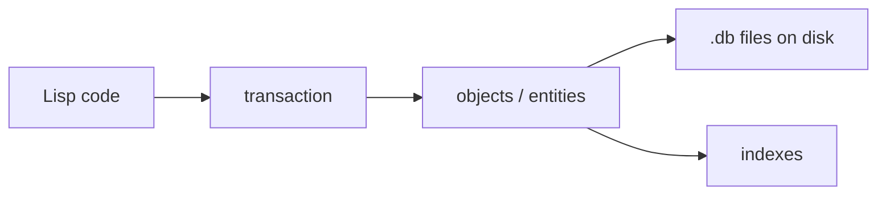

[Read This!](caveatemptor.md) |
  [Picolisp](picolisp.md) | [Picolisp Machine](pilmachine.md) | [Pil Sources](pilsource.md) |
  [Linux](linux.md) | [BASH](bash.md) |
  [C-Programmming](cprogramming.md) | [Javascipt](javascript.md) | [Python](python.md) |
  [Operating Systems](os.md) | [AssemblyLanguage](assemblylanguage.md) |
  [Computer Security](computersecurity.md) |
  [Firewalls](firewalls.md) |
  [Exploitation](exploitation.md) | [Social Engineering](internetexploitation.md) | [Metasploit](metasploit.md) |
  [Emacs](emacs.md) | [vim](vim.md) |
  [Pharo Smalltalk](pharo.md) |
  [Databases](databases.md) | [Picolisp DB's](pildb.md)

# Picolisp Databases

Here is the truth about PicoLisp's database: **it is not a bolt-on library – it is the language's own object system, made durable.** Entities and relations are first-class, transactions are built in, and there is no ORM because you never leave Lisp.

### What it is, in plain words

The **PicoLisp DB** is an embedded, transactional, hierarchical database integrated into PicoLisp. You declare **classes** and **relations**; objects live in a file (or files) on disk; changes happen inside transactions that either commit or roll back. Queries are ordinary Lisp code – there is no separate query language.

Relations cover the usual needs:

- `+Link` / `+Joint` – links between objects;
- `+List`, `+Bag`, `+Number`, `+Date`, `+Time` – typed values;
- `+Key`, `+Ref`, `+Idx` / `+Fold` – uniqueness and indexes for fast lookup;
- `+Blob` – large binary / text data stored alongside.

This is the same family of ideas as earlier Lisp machines and Smalltalk images, scaled to persistent files and multi-user access with file locking.

### Why it matters

Most stacks glue three languages together: application, ORM, SQL. PicoLisp collapses them. For internal tools, business apps and the kind of small multi-user systems PicoLisp was born for, that means less code and nowhere for an ORM to paper over a bad schema. If you already like PicoLisp, the DB is the reason it can replace a whole Rails-sized stack.

### An everyday analogy: a notebook that *is* the filing cabinet

In a typical web app, objects in memory are photocopies of rows in a filing cabinet; you spend your life copying back and forth. In PicoLisp the notebook *is* the cabinet. Turn a page (fetch an object), pencil a change, and when you close the transaction the cabinet has the change. No photocopying step.



### A hands-on example

```lisp
# Start with a DB prefix
(pool "app.db")

# Define a class with relations
(class +Person +Entity)
(rel nam (+Need +Sn +Idx +String))     # required, indexed name
(rel tel (+List +String))              # list of phone numbers
(rel friend (+List +Link) (+Person))   # friends

# Create and commit
(new! '(+Person) 'nam "Vidyuth" 'tel '("+971…"))
(new! '(+Person) 'nam "Alex")

# Find by index
(collect 'nam '+Person "Vidyuth")

# Update in a transaction
(let P (car (collect 'nam '+Person "Vidyuth"))
   (put!> P 'friend (collect 'nam '+Person "Alex")) )

# Query with ordinary Lisp
(filter '((P) (member "Alex" (mapcar get (; P friend) 'nam)))
   (collect 'nam '+Person) )
```

`new!` and `put!>` are the writing forms that participate in transactions; `commit` / `rollback` (or the implicit ones around request handlers in the Pil server) finalise them. For multi-process access, `pool` with the right flags and the built-in locking keep things consistent.

A small web form in Pil can bind directly to these objects – which is why PicoLisp applications are often tiny relative to what they do. See [The Health Application](pilhealth.md) and [PicoLisp by Example](picolispbyexample.md).

### When to use it – and when not

**Use it** for applications you control end-to-end, where the schema fits objects and links, and you want one language. **Prefer SQLite/PostgreSQL** when you need ad-hoc SQL analytics, polyglot access, or a team that doesn't speak Lisp. They are not enemies; PicoLisp can talk to external SQL too when you need it.

### Exploring an existing DB

```lisp
(pool "app.db")
(regs)                              # registered object counts
(collect 'nam '+Person)             # all persons by name index
(show (car @))                      # inspect one object
(tree 'nam '+Person)                # dump the index tree
```

Indexes are maintained automatically as you `put!>` – which is why declaring `+Idx` / `+Key` at the relation matters from the start. Adding an index later means rebuilding it across existing objects.

### Common misconceptions

- **"It's a toy DB."** It has powered production business systems for decades.
- **"No SQL means no queries."** You write queries as Lisp – often shorter than the SQL they replace.
- **"Embedded means single-user."** File locking supports multi-process access; for heavy concurrent write loads, evaluate carefully.
- **"I need an ORM."** The language *is* the mapping.
- **"It's separate from PicoLisp."** Without the DB, you still have the language; without the language, you don't have this DB. They are designed together.

### Connections

- [PicoLisp](picolisp.md), [PicoLisp Tutorials](piltutorials.md), [Pil Sources](pilsource.md).
- [Databases](databases.md) – how this compares to SQL and friends.
- [The Health Application](pilhealth.md) – a real app built this way.

Persistance is a really headache, achieving it reliably in a distributed environment is a nightmare.

```

```

## Links, Sources and Reading List

- [CockroachDB](https://www.cockroachlabs.com)
- [Picolisp DB's](pildb.md)
-
