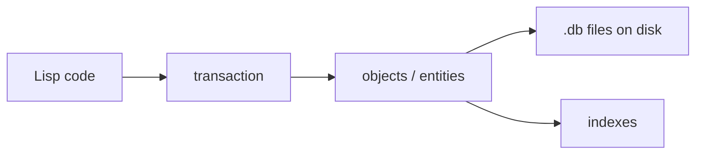

# PicoLisp Databases

Here is the truth about PicoLisp's database: **it is not a bolt-on library. It is the language's own object system, made durable.** Entities and relations are first-class, transactions are built in, and there is no ORM, because you never leave Lisp.

### What it is, in plain words

The **PicoLisp DB** is an embedded, transactional object database built into PicoLisp. You declare **classes** and **relations**. Objects are *external symbols* (they print like `{2}` or `{A1}`) that live in one or more files on disk. They are loaded on demand when you touch them, and written back when you commit. Queries are ordinary Lisp, plus Pilog when you want declarative search.

Relations cover the usual needs:

- `+Link` / `+Joint`: links between objects (`+Joint` keeps both sides in sync).
- `+String`, `+Number`, `+Date`, `+Time`, `+Bool`, `+List`, `+Bag`: typed values.
- `+Key` (unique), `+Ref` (non-unique), `+Idx` and `+IdxFold` (full-text word index), `+Sn` (soundex), `+Fold` (case-folded): indexes for fast lookup.
- `+Need`: the value is required.
- `+Blob`: large binary or text data stored in a separate file.

All of this was re-checked against **PicoLisp 26.9** (pil21) in October 2026. The DB layer (`@lib/db.l`) has stayed remarkably stable across pil32, pil64 and pil21. Database files are compatible across 64-bit versions, and `@lib/replica.l` adds replication.

### Why it matters

Most stacks glue three languages together: application, ORM and SQL. PicoLisp collapses them into one. For internal tools, business apps and the kind of small multi-user systems PicoLisp was born for, that means less code and nowhere for an ORM to paper over a bad schema.

### An everyday analogy: a notebook that *is* the filing cabinet

In a typical web app, objects in memory are photocopies of rows in a filing cabinet, and you spend your life copying back and forth. In PicoLisp the notebook *is* the cabinet. Turn a page (fetch an object), pencil in a change, and when you close the transaction the cabinet has the change. There is no photocopying step.



### A hands-on example

This runs as-is on 26.9 (`pil db.l +`):

```picolisp
(class +Person +Entity)
(rel nm      (+Need +Sn +IdxFold +String))   # required, word-indexed name
(rel tel     (+List +String))                # list of phone numbers
(rel city    (+Ref +String))                 # indexed city
(rel friends (+List +Joint) friends (+Person))  # two-way friendships

(pool "app.db")                              # open (or create) the DB

(setq V (new! '(+Person) 'nm "Vidyuth" 'city "Dubai" 'tel '("+971 0000")))
(setq A (new! '(+Person) 'nm "Alex" 'city "Langweid"))
(put!> V 'friends (list A))                  # A's friends now include V too

(db 'nm '+Person "Alex")                     # -> {6}  exact lookup
(collect 'city '+Person "Dubai")             # -> ({2})
(mapcar '((P) (; P nm)) (; A friends))       # -> ("Vidyuth")
(show V)
```

`show` prints:

```
{2} (+Person)
   nm "Vidyuth"
   friends ({6})  # (+Person)
   tel ("+971 0000")
   city "Dubai"
```

`new!` and `put!>` are the "bang" forms. Each one wraps its change in its own small transaction (lock, change, commit). For several changes at once, use `dbSync`, then plain `put>`/`new`, then `(commit 'upd)`, or `rollback`. In the web GUI, the form library does this for you.

### Exploring an existing DB

```picolisp
(pool "app.db")
(collect 'city '+Person)                          # every person with a city
(iter (tree 'city '+Person)                       # walk an index in order
   '((P) (println (; P nm) (; P city))) )
(show (db 'nm '+Person "Alex"))                   # inspect one object
(dbck)                                            # consistency check, NIL = OK
```

Indexes are maintained automatically as you `put!>`, which is why it matters to declare `+Key`/`+Ref`/`+Idx` on the relation from the start. Adding an index later means rebuilding it across existing objects (`rebuild` in `@lib/too.l`). For real applications, split classes across several files with `dbs` and `dbs+`, and use `(pool "db/" *Dbs)`. The [Health app](pilhealth.md) shows the pattern.

### Pilog queries

For multi-criteria searches, PicoLisp uses Pilog's `select` with `db`, `same`, `range` and `part` filters. This is what the GUI's search dialogs generate. It is powerful but takes some learning; start with the reference's [select](https://software-lab.de/doc/refS.html#select/3) section and the [app tutorial](https://software-lab.de/doc/app.html). For simple cases, `collect` and `db` (above) are all you need.

### When to use it, and when not

**Use it** for applications you control end-to-end, where the schema fits objects and links, and you want one language. **Prefer SQLite/PostgreSQL** when you need ad-hoc SQL analytics, polyglot access, or a team that doesn't speak Lisp. They are not enemies: PicoLisp can talk to SQL through `native` calls into a C library, or by piping to `sqlite3`.

### Common misconceptions

- **"It's a toy DB."** It has powered production business systems for decades.
- **"No SQL means no queries."** You write queries as Lisp, and they are often shorter than the SQL they replace.
- **"Embedded means single-user."** Processes forked from the same server share the DB safely through file locking and `tell`-based cache synchronisation. That is exactly how the web server handles many users.
- **"I need an ORM."** The language *is* the mapping.

### My own note

Persistence is a real headache, and achieving it reliably in a distributed environment is a nightmare. Distributed SQL systems like [CockroachDB](https://www.cockroachlabs.com) throw enormous engineering at that problem. PicoLisp sidesteps it by staying small: one server, forked children, and files on a disk. That is not the answer for everything, but for a lot of applications it is the honest one.

### Connections

- [PicoLisp](picolisp.md), [PicoLisp Tutorials](piltutorials.md), [PicoLisp Sources](pilsource.md).
- [Databases](databases.md): how this compares to SQL and friends.
- [The Health Application](pilhealth.md): a real app built this way. [Updating the Database](upd.md).
