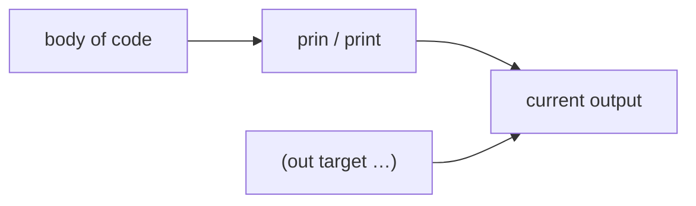
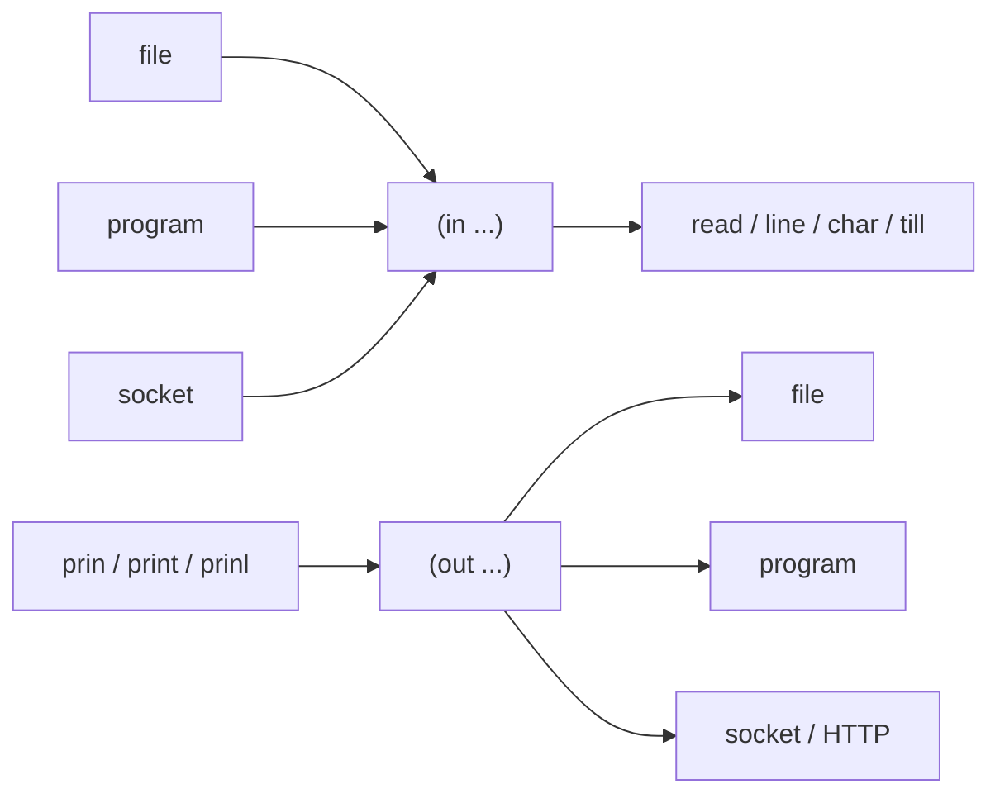

{.right}
 [computingFreedom](computingfreedom.md) |
  [Build](bciyh.md) |
  [Picolisp](picolisp.md) | [Picolisp Machine](pilmachine.md) | [Pil sources](pilsource.md) | [Pil Tutorials](piltutorials.md) |
  [Linux](linux.md) | [BASH](bash.md) |
  [C Programmming](cprogramming.md) |
  [Operating Systems](os.md) |
  [JavaScript](javascript.md) |
  [Emacs](emacs.md)  | [vim](vim.md) |
  [Pharo Smalltalk](pharo.md) |
  [Computer Security](computersecurity.md) |
  [Penti](penti.md)

# Input / Output IO

Here is the truth about I/O in PicoLisp: **everything is a stream or a list of characters, and the same functions that print to your terminal can print into a socket, a file or a string.** Once you meet `in`, `out` and `prin`, the rest is composition.

### What it is, in plain words

PicoLisp I/O is built from a few ideas:

- **Current input / output** – redirected with `in` and `out` for the dynamic extent of a body.
- **Characters and lines** – `char`, `line`, `read`, `skip`.
- **Printing** – `prin`, `prinl`, `print`, `println`, `space`, `pack`.
- **Files and processes** – pathnames, `pipe`, HTTP via `@lib/http.l`.
- **Binary** – `rd`, `wr` for raw bytes when text isn't enough.

There is no separate "file object" API to memorise – you bind the current stream and use the same readers and writers.

### Why it matters

Web handlers, CGI, templating and DB dumps in PicoLisp are all I/O redirection plus printing. Understanding `out`/`in` means understanding how Pil apps talk to the world without a maze of classes.

### An everyday analogy: a funnel you can aim

Instead of every tool having its own hose, PicoLisp gives you one funnel (`prin`) and lets you aim it at the sink, the bucket or the neighbour's tank (`out "file"`, `out (pipe …)`, HTTP response). Same funnel, different target.



### A hands-on example

```lisp
# Write a file
(out "hello.txt"
   (prinl "Hello from Vikix")
   (println (date) (time)) )

# Read it back
(in "hello.txt"
   (until (eof)
      (println (line T)) ) )

# Build a string without printing at all
(pack "x=" 3 " y=" 4)            # -> "x=3 y=4"

# Capture what some code prints: run it in a pipe, read it back
(pipe (prinl "captured!") (line T))   # -> "captured!"

# Read from another program: a list as the "file" runs it
(in '("uname" "-a")
   (prinl (line T)) )

# HTTP server fragment (after loading http/xhtml)
(de go ()
   (html 0 "Hi" NIL NIL
      (<h1> NIL "Hello")
      (<p> NIL "Uptime thoughts go here") ) )
```

`print` produces a readable, `read`-able representation (with quotes); `prin` prints raw. Choose consciously – especially when emitting HTML (where `@lib/xhtml.l` helpers already escape).

### Common misconceptions

- **"`prin` and `print` are synonyms."** They differ on quoting and separators.
- **"You must close files."** `in`/`out` close when the body returns (even on throw).
- **"Binary needs a different language."** Use `rd`/`wr` and sizes.
- **"`pack` captures output."** `pack` only joins its arguments into a string. To capture what code *prints*, run it with `pipe` (or `out` into a temporary file from `(tmp "x")`) and read it back.
- **"HTTP is separate."** It's streams plus libraries.

### Pretty-printing and debugging

`(pretty Expr)` and friends help you see structure. During HTTP development, temporarily `(out 2 (println …))` to write traces to stderr without corrupting the response body. For large dumps, prefer writing files with `out` over flooding the console.

Remember that `read` reads one Pil expression – great for config files written as s-expressions, surprising if you expected line-oriented text (use `line` for that).

### Reading structured data

Because `read` understands PicoLisp syntax, the easiest config file format is PicoLisp itself:

```picolisp
# settings.l contains:  (theme . "dark") (font . "Iosevka") (size . 14)
(in "settings.l"
   (make
      (while (read)
         (link @) ) ) )
# -> ((theme . "dark") (font . "Iosevka") (size . 14))
```

For line-oriented text such as `/etc/passwd`, combine `line` with `split`:

```picolisp
(in "/etc/passwd"
   (until (eof)
      (let F (split (line) ":")
         (prinl (car F) " -> " (last F)) ) ) )
```

`(line)` without `T` returns a list of characters, which `split` cuts on `":"`; `prinl` happily prints those character lists. Use `(line T)` when you want a string straight away. `till` reads up to a delimiter, and `skip` jumps over whitespace and comments, which is all you need for small parsers.

### Talking to other programs

A list where a file name would go means "run this program". That works for both `in` and `out`:

```picolisp
(in '("ls" "-1" "/var/service")          # Void's enabled runit services
   (until (eof) (prinl "service: " (line T))) )

(out '("sort" "-r")                       # feed another program
   (mapc prinl '("pear" "apple" "fig")) )
```

`call` runs a program and waits, returning `T` on success, which is perfect for scripts that glue Unix tools together. For JSON, load `@lib/json.l` and use `readJson` and `printJson`, so web APIs fit into the same stream model.

### Where the streams go



### Connections

- [PicoLisp](picolisp.md), [PicoLisp Tutorials](piltutorials.md), [box](plbox.md).
- [PicoLisp DB](pildb.md), [with-output-to-string](withoutputtostring.md) (CL cousin).

Comments can be embedded in the input stream with the hash # character.
Everything up to the end of that line will be ignored by the reader.

```
: (* 1 2 3)  # This is a comment
-> 6
```

A comment spanning several lines (a block comment) may be enclosed between

```
#{ and }#
```

*Examples checked on PicoLisp 26.9, October 2026. Note that the xhtml tag functions take a CSS/attribute argument first, NIL if you have none.*
