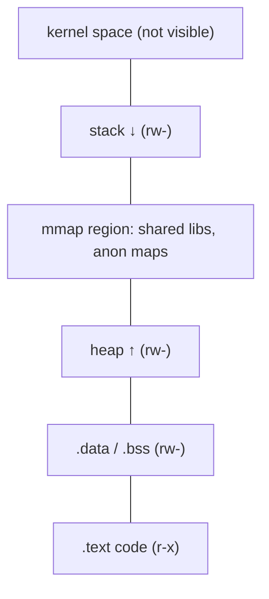

[linuxtools](linuxtools.md)

# pmap

The truth about a running program's memory is that **it isn't one big block – it's a patchwork map of regions, each with its own purpose and permissions.** pmap prints that map.

### What it is, in plain words

**pmap** (from the `procps-ng` package, installed almost everywhere) reports the **memory map** of a process: every region of virtual address space it has, how big each is, what permissions it has (read, write, execute), and what backs it – a file like `/usr/lib/libc.so.6`, the heap, the stack, or anonymous memory.

It is really a friendly front end to the file `/proc/<pid>/maps` (and, with `-X`, `/proc/<pid>/smaps`), which the kernel maintains for every process.

### Why it matters

"How much memory is this program using?" sounds simple and isn't. A process maps shared libraries it shares with everyone, reserves address space it never touches, and allocates heap it may never give back. pmap lets you see *which* of those you are looking at, so you can tell a real leak from a scary-looking number. It also teaches you, very concretely, how a process is laid out in memory – essential for C, debugging and security work.

### An everyday analogy: a city zoning map

A city's area isn't "used" uniformly. There are residential zones, industrial zones, parks, roads and plots that are zoned but empty. A zoning map tells you what each area is for and who's allowed to do what there. pmap is the zoning map of a process: code zones (read + execute), data zones (read + write), shared library districts, and big reserved plots that are mostly empty.



### A hands-on example

Look at your own shell:

```bash
pmap $$
```

Output (trimmed):

```
12345:   bash
000055d0c1a00000    180K r---- bash
000055d0c1a2d000    756K r-x-- bash
000055d0c1aea000    228K r---- bash
000055d0c1b24000     16K rw--- bash
000055d0c2f1e000   1320K rw---   [ anon ]
00007f2a1b200000   1940K r-x-- libc.so.6
...
00007ffd4e9f1000    132K rw---   [ stack ]
 total            10248K
```

The extended view adds the numbers that actually matter:

```bash
pmap -x $$
```

```
Address           Kbytes     RSS   Dirty Mode  Mapping
...
total kB           10248    4120    1536
```

- **Kbytes** – size of the virtual region (just address space).
- **RSS** (Resident Set Size) – how much of it is actually in RAM right now.
- **Dirty** – pages modified by this process; these can't simply be dropped and re-read from disk.

For the most detail, including **PSS** (proportional set size – shared pages divided fairly among their users), use:

```bash
pmap -X $$          # wide output from smaps
pmap -XX $$         # everything the kernel reports
```

### Watching a leak

Write a little C program that leaks on purpose:

```c
#include <stdlib.h>
#include <string.h>
#include <unistd.h>
int main(void) {
    for (;;) {
        char *p = malloc(1 << 20);   /* 1 MiB */
        memset(p, 1, 1 << 20);       /* touch it so it becomes resident */
        sleep(1);
    }
}
```

```bash
gcc leak.c -o leak && ./leak &
watch -n1 "pmap -x $! | tail -1"
```

The `RSS` total climbs a megabyte a second. Large `malloc` calls use `mmap`, so you'll also see new `[ anon ]` regions appear. Kill it with `kill %1`.

### Common misconceptions

- **"The total is how much RAM it uses."** The first total is *virtual* size. Look at RSS, or better, PSS, for real usage.
- **"Shared libraries count against every process."** Their code pages are shared. RSS double-counts them across processes; PSS doesn't.
- **"Freed memory goes back to the OS."** Often it stays in the allocator's pool for reuse, so RSS doesn't drop after `free()`. That isn't a leak.
- **"`[ anon ]` means something's wrong."** Anonymous memory is just memory not backed by a file – heaps, thread stacks, JIT buffers. Normal.
- **"Mappings with `x` are suspicious."** Code must be executable. What's suspicious is a region that's both writable *and* executable (`rwx`), which modern hardening tries to forbid.

### Related tools

- `cat /proc/<pid>/status` – quick VmRSS, VmSize, threads.
- `smem` – PSS per process, system wide.
- `top` / `htop` – RES and VIRT columns are the same ideas.
- `valgrind --tool=massif` or `heaptrack` – who allocated what.

### Connections

- [Linux Memory and Process](linuxprocessesandmemory.md) – the layout behind the map.
- [The Linux Process Manager](thelinuxprocessmanager.md) – how processes are created and scheduled.
- [Linux Introspection](linuxinstrospection.md) – more ways to ask Linux about itself.
- [objdump](objdump.md) – the sections in the file that become these regions.
- [C Programming](cprogramming.md) – where `malloc` and the stack come from.

[@ linux.die.net](https://linux.die.net/man/1/pmap)
[understanding-process-memory](https://techtalk.intersec.com/2013/07/memory-part-2-understanding-process-memory/)
