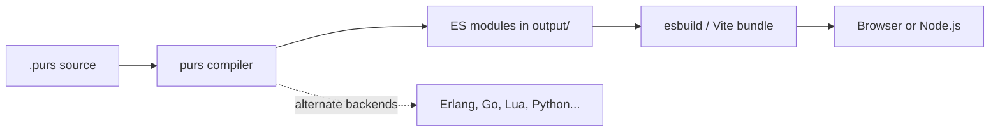

[Read This!](caveatemptor.md) | | [Quick Links](quicklinks.md) | [Algorithms](algorithms.md) | [AssemblyLanguage](assemblylanguage.md) | [BASH](bash.md) |   [C-Programmming](cprogramming.md) |
[CommonLisp](commonlisp.md) |
[Computer Security](computersecurity.md) |  [Databases](databases.md) | [Emacs](emacs.md) |  [Exploitation](exploitation.md) |
[Functional Programming](functional.md) |
[Firewalls](firewalls.md) |   [Git](git.md) | [Haskell](haskell.md) | [Javascript](javascript.md) | [Julia](julia.md) | [Social Engineering](internetexploitation.md) |
[Picolisp](picolisp.md) | [Pharo Smalltalk](pharo.md) | [Purescript](purescript.md) |
[Linux](linux.md) |
[Python](python.md) |
[Operating Systems](os.md) |
[Machine Learning](machinelearning.md) | [Metasploit](metasploit.md) |  [Open Data Science](opendatascience.md) |
[Networking](networking.md) | [Machine Learning](machinelearning.md) | [Racket](racket.md) | [Scheme](scheme.md) |
[Unity](unity.md) | [vim](vim.md) | [V](vlang.md) |
[Web Development](webdevelopment.md) | [Windows WSL](windowswsl.md)

# Purescript

Here is the truth about PureScript: **it's Haskell's ideas, aimed at the places JavaScript runs.** You get strong static types, purity and type classes, and out comes small, readable JavaScript.

### What it is, in plain words

PureScript is a strictly evaluated, purely functional programming language that compiles to JavaScript (by default) and, through community backends, to other targets such as Erlang, Go, Lua, Python and Chez Scheme. It was created by Phil Freeman in 2013 and is now maintained by a core team and community. The compiler itself is written in Haskell.

Key features:

- **Static types with inference** – the compiler works out most types; you annotate the important ones.
- **Purity** – side effects are tracked in the type (`Effect Unit`), so a function that says it returns `Int` really can't secretly write to a file.
- **Type classes**, higher-kinded types, rank-N types, and **row polymorphism** – records whose types say "any record with at least a `name` field".
- **Strict evaluation** – unlike Haskell, arguments are evaluated before calls, which matches JavaScript and makes performance easier to predict.
- **Tiny runtime** – no big runtime library shipped to the browser; output is plain ES modules.

### Why it matters

JavaScript (and even TypeScript) lets whole classes of bugs through: `undefined is not a function`, missing cases, mutation from afar. PureScript removes them by design. If it compiles, a surprising amount of the time it simply works – and refactoring a large front end becomes something you do calmly rather than fearfully. It's also one of the gentlest on-ramps to typed functional programming for web developers, and the ideas carry straight back into [Haskell](haskell.md).

### An everyday analogy: an electrical inspector

TypeScript is a friendly electrician who checks the obvious things. PureScript is the full building inspector: every circuit, every junction box, and a stamp on any wire that touches the outside world ("this one has effects"). It's slower to get approval, but once the stamp's on the wall the house doesn't catch fire.



### A hands-on example

You need Node.js. Install the compiler and the package manager/build tool **Spago**:

```bash
npm install -g purescript spago
mkdir hello-ps && cd hello-ps
spago init
spago run
```

Edit `src/Main.purs`:

```haskell
module Main where

import Prelude
import Data.Array (filter, range)
import Data.Foldable (sum)
import Effect (Effect)
import Effect.Console (log)

-- A pure function: types say exactly what it does
squareSum :: Int -> Int
squareSum n = sum (map (\x -> x * x) (filter even (range 1 n)))

-- Row polymorphism: works on ANY record that has a `name` field
greet :: forall r. { name :: String | r } -> String
greet person = "Hello, " <> person.name

-- Algebraic data type with exhaustive pattern matching
data Shape = Circle Number | Rect Number Number

area :: Shape -> Number
area (Circle r) = 3.14159 * r * r
area (Rect w h) = w * h

main :: Effect Unit
main = do
  log (show (squareSum 10))                         -- 220
  log (greet { name: "Vikid", os: "Void Linux" })   -- extra field is fine
  log (show (area (Rect 3.0 4.0)))                  -- 12.0
```

`spago run` compiles and runs it on Node. If you add a new `Shape` constructor and forget to handle it in `area`, the compiler refuses to build – that's the inspector at work.

For web apps the popular libraries are **Halogen** (component framework), **Deku** and **react-basic** bindings. Calling existing JavaScript goes through the **FFI**: write a `Main.js` file next to `Main.purs`, export functions, and declare their types with `foreign import`.

### PureScript versus its neighbours

| | TypeScript | PureScript | Elm | Haskell |
|---|---|---|---|---|
| Types | gradual, unsound by design | sound, inferred | sound, inferred | sound, inferred |
| Effects tracked | no | yes (`Effect`) | managed by runtime | yes (`IO`) |
| Type classes | no | yes | no | yes |
| Evaluation | strict | strict | strict | lazy |
| JS interop | seamless | FFI | ports (restricted) | via GHC JS backend |

### Common misconceptions

- **"It's just Haskell for the browser."** Close in spirit, but strict evaluation, records with row types, no built-in laziness and a different standard library make it its own language.
- **"The output is unreadable."** Generated JavaScript is fairly close to the source – you can debug it.
- **"Purity means no side effects."** Effects are allowed; they're *visible in the type*.
- **"It's abandoned since Elm/TypeScript won."** It's a smaller community, but the compiler and Spago continue to get releases and the package set is maintained.
- **"You must understand monads first."** You can write `do` blocks in `Effect` long before the theory clicks – understanding comes with use.

### Connections

- [Haskell](haskell.md) – PureScript's parent in ideas.
- [Functional Programming](functional.md) and [Lambda Calculus](lambdacalculus.md).
- [Javascript](javascript.md) and [Node JS](nodejs.md) – the platform it compiles to.
- [Web Development](webdevelopment.md).

[Purescript by Example](https://book.purescript.org/chapter1.html)
