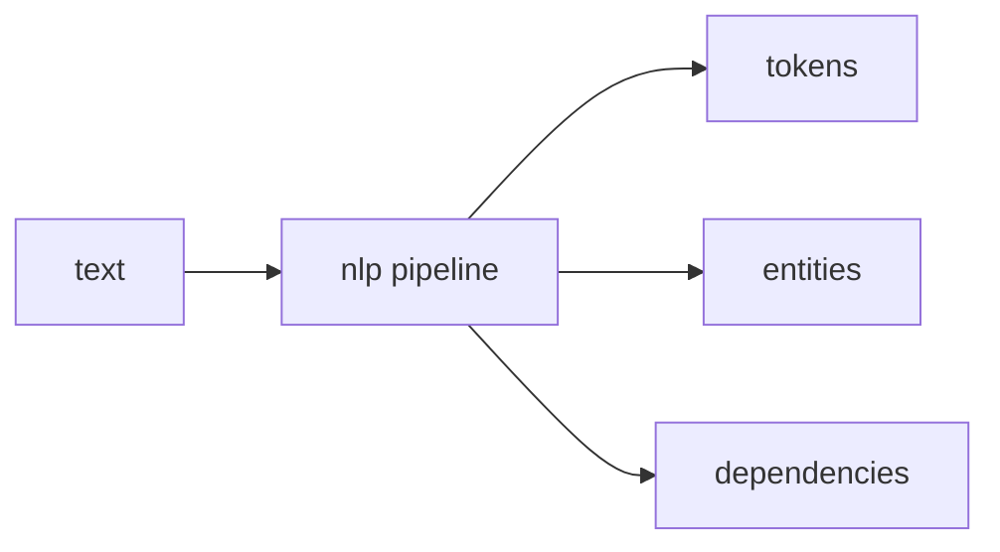

[Python Libraries, tools and Links](pythonlibrariestoolsandlinks.md) | [Official Python Docs](https://docs.python.org/3/)
| [Intro to Pygame](intropygame.md) | [spaCy](pythonspacy.md)

# Python spaCy NLP Library

Here is the truth about spaCy: **it is an industrial-strength Natural Language Processing library for Python that treats linguistic annotation as a pipeline of fast, composable components.** If you need to tokenise, tag, parse or recognise entities in real text, spaCy is the default workhorse.

### What it is, in plain words

**spaCy** (Explosion AI) provides:

- language-specific **pipelines** (English, German, …) loaded as models;
- **tokens**, **spans** and **docs** as first-class objects;
- POS tagging, lemmatisation, dependency parsing, named entity recognition (NER);
- rules (`Matcher`, `PhraseMatcher`) alongside statistical models;
- training APIs to customise components on your data;
- tight integration with [NumPy](numpy.md) and the wider PyData stack.

It emphasises production performance over research experimentation (compare NLTK for teaching, Hugging Face Transformers for large neural models).

### Why it matters

Text is everywhere – logs, tickets, docs, chats. Turning it into structured data (entities, noun phrases, sentence boundaries) is the gateway to search, routing and analytics. spaCy makes that gateway fast enough for servers, not just notebooks.

### An everyday analogy: a mail sorting facility

Raw text is a sack of unsorted letters. spaCy's pipeline stamps each token (postmark), labels the addressee (NER), and bags sentences for delivery. You can add your own stampers. Transformers are a brilliant specialist who reads each letter deeply; spaCy is the facility that keeps the belt moving.



### A hands-on example

```bash
pip install spacy
python -m spacy download en_core_web_sm
```

```python
import spacy

nlp = spacy.load("en_core_web_sm")
doc = nlp("Vidyuth built Vikix on Void Linux in Dubai.")

for token in doc:
    print(f"{token.text:12} {token.pos_:6} {token.lemma_}")

print("--- entities ---")
for ent in doc.ents:
    print(ent.text, ent.label_)

print("--- noun chunks ---")
for chunk in doc.noun_chunks:
    print(chunk.text)
```

Rule-based match on top of the model:

```python
from spacy.matcher import Matcher
matcher = Matcher(nlp.vocab)
matcher.add("OS", [[{"LOWER": "void"}, {"LOWER": "linux"}]])
print(matcher(doc))
```

For heavier neural models, pipe spaCy with Hugging Face or use spaCy's own transformer pipelines when accuracy beats speed requirements.

### Common misconceptions

- **"spaCy is a chatbot library."** It's linguistic annotation. Dialog is your code on top.
- **"Small models are useless."** `sm` models are fine for many entity and tokenization tasks; step up when metrics demand it.
- **"You must train from scratch."** Start with pretrained; fine-tune on your labels.
- **"NLP means LLMs now."** LLMs are great; a 20 MB spaCy model still wins on latency, cost and control for structured extraction.
- **"NLTK and spaCy are interchangeable."** NLTK is a teaching toolkit; spaCy is a product pipeline.

### Connections

- [Python](python.md), [NumPy](numpy.md), [Machine Learning](machinelearning.md).
- [Open Data Science](opendatascience.md), [Regular Expressions](regularexpressions.md).

[Official spaCy page](https://spacy.io/)

```
  pip install spacy
```

```
  python -m spacy info
```

```
  pip install -U spacy
```

```
  python -m spacy download en
```

```
  python -m spacy download en_core_web_md
```

```
import spacy
nlp = spacy.load('en_core_web_md')
doc = nlp(u'I am learning to program NLP in Spacy. It\'s so amazing.')
print([w.text for w in doc])

for token in doc:
  print(token.text, token.lemma_)
```
