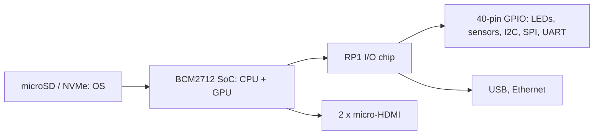

# RasberryPi

Here is the truth about the Raspberry Pi: **it's a real computer that costs about as much as a meal out, small enough to forget in a drawer and open enough to understand all the way down to the pins.** That combination is why it changed how people learn computing.

### What it is, in plain words

The **Raspberry Pi** is a family of single-board computers made by Raspberry Pi Ltd (the trading arm of the UK Raspberry Pi Foundation, an education charity). The first model shipped in 2012. A Pi is a whole computer on one board: an ARM processor (Broadcom system-on-chip), RAM, USB, networking, HDMI output, and – the special part – a **40-pin GPIO header** that lets software switch real electrical signals on and off.

The current family, roughly:

- **Raspberry Pi 5** (2023) – quad-core Cortex-A76 at 2.4 GHz, 2–16 GB RAM, a PCIe connector for NVMe SSDs, and Raspberry Pi's own **RP1** I/O chip.
- **Raspberry Pi 500 / 500+** – a Pi 5 built into a keyboard, like the home computers of the 1980s.
- **Raspberry Pi Zero 2 W** – tiny and cheap, for embedded projects.
- **Compute Modules** – the Pi on a small card for building into products.
- **Pico / Pico 2** – a different beast: a **microcontroller** (RP2040 / RP2350 chips) with no operating system, programmed in C, MicroPython or Rust.

The official OS is **Raspberry Pi OS** (Debian-based, 64-bit by default). Ubuntu, Fedora, Arch Linux ARM, LibreELEC, Home Assistant OS and others run too – and so does **Void Linux**, which publishes `aarch64` images for the Pi.

### Why it matters

A Pi lets you own a whole Linux server for the price of a few cups of coffee and a couple of watts of power. People use them as home servers, ad blockers (Pi-hole), media centres, retro game consoles, network monitors, robots, weather stations and classroom computers. More importantly, GPIO lets software touch the physical world, and that's the moment computing stops being abstract.

### An everyday analogy: a Swiss Army knife with a breadboard attached

A laptop is a sealed appliance. A Pi is more like a pocket knife – small, cheap, useful for many jobs – with a set of terminals on the side where you can clip on wires, buttons, lights and sensors. Plug it into a TV and it's a desktop; leave it headless in a cupboard and it's a server; wire it to a motor and it's a robot.



### A hands-on example: a headless Pi and a blinking LED

**1. Flash the OS.** Use **Raspberry Pi Imager** (on Void/Arch: `rpi-imager` from the repos or Flatpak). Choose your board and Raspberry Pi OS Lite (64-bit), then in the settings set hostname, username, Wi-Fi and enable SSH with your public key. Write to the card, insert it, power on.

**2. Log in.**

```bash
ssh vikid@pi.local
sudo apt update && sudo apt full-upgrade -y
cat /proc/device-tree/model     # Raspberry Pi 5 Model B Rev 1.0
vcgencmd measure_temp           # SoC temperature
```

**3. Wire an LED.** Connect GPIO 17 (physical pin 11) → 330 Ω resistor → LED long leg; LED short leg → ground (pin 9).

**4. Blink it.** Use **gpiozero**, which works on every model including the Pi 5. (The old `RPi.GPIO` library doesn't support the Pi 5's RP1 chip.)

```python
from gpiozero import LED, Button
from signal import pause

led = LED(17)
led.blink(on_time=0.5, off_time=0.5)

button = Button(2)          # optional: button between GPIO 2 and ground
button.when_pressed = led.toggle
pause()
```

```bash
python3 blink.py
```

Or from the shell with the modern `libgpiod` tools:

```bash
gpioset GPIO17=1                    # LED on until Ctrl-C (libgpiod v2)
pinctrl get 17                      # inspect a pin (Pi's own tool)
```

**5. Give it a job.** A few one-command ideas: `curl -sSL https://install.pi-hole.net | bash` (read the script first!), a Syncthing node, a Git server over SSH, or a [PicoLisp](picolisp.md) web app running on `aarch64` – PicoLisp's tiny footprint suits a Pi perfectly.

### Common misconceptions

- **"It's a toy."** A Pi 5 is faster than many laptops from a decade ago and runs real server workloads 24/7.
- **"Any phone charger will do."** Under-powering causes random crashes and corrupted cards. Use the official 27 W USB-C supply for the Pi 5.
- **"SD cards are fine forever."** They wear out under heavy writes. Use a good card, log to RAM, or boot from an NVMe SSD.
- **"Pico is a small Pi."** It's a microcontroller: no Linux, no files, just your program running on bare metal.
- **"GPIO pins are 5 V."** They're 3.3 V. Connecting 5 V directly can kill the chip.

### Connections

- [Linux](linux.md) and [Linux Tools](linuxtools.md) – everything you'll use on the Pi.
- [Python](python.md) – the usual language for GPIO projects.
- [Cool Hardware](coolhardware.md) – other gadgets worth knowing.
- [SSH Login](sshlogin.md) – how you'll talk to a headless Pi.
- [Networking](networking.md) – turning it into a home server.

## Links
