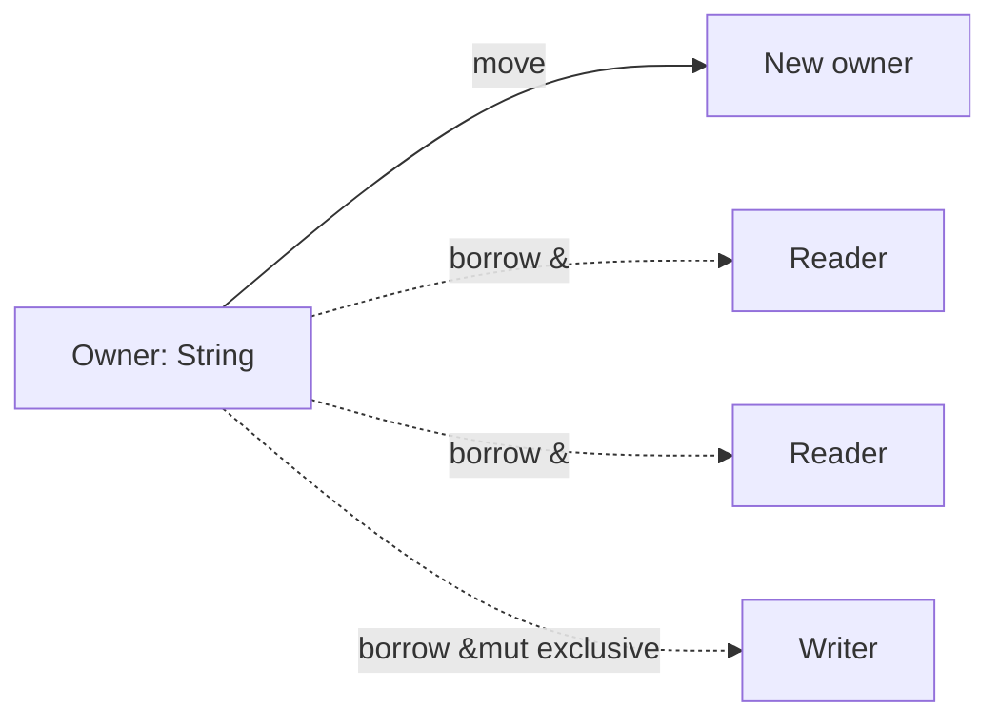

[Algorithms](algorithms.md) | [Apple](apple.md) | [AssemblyLanguage](assemblylanguage.md) |
[BASH](bash.md)  |   [Bash Cookbook](vikidsbashcookbook.md)  |
[C-Programmming](cprogramming.md) | [CommonLisp](commonlisp.md) | [Computer Security](computersecurity.md) | [CuisSmalltalk](cuissmalltalk.md) |
[Databases](databases.md) | [Emacs](emacs.md) |  [Exploitation](exploitation.md) | [Firewalls](firewalls.md) |
[Fortran](fortran.md) | [Functional Programming](functional.md) |
[Git](git.md) | [GNUSmalltalk](gnusmalltalk.md) | [Haskell](haskell.md) |  [Javascript](javascript.md) |  [Julia](julia.md) |
[Linux](linux.md) | [Machine Learning](machinelearning.md) | [Metasploit](metasploit.md) |[Machine Learning](machinelearning.md) |
[Networking](networking.md) | [Operating Systems](os.md) | [Open Data Science](opendatascience.md) | [Odin](odin.md) |
[Picolisp](picolisp.md) | [Pharo Smalltalk](pharo.md) | [Purescript](purescript.md) | [Python](python.md) |
[Racket](racket.md) | [Rust](rust.md)| [Scheme](scheme.md)  | [Social Engineering](internetexploitation.md)  |
[Unity](unity.md) | [vim](vim.md) | [V](vlang.md) |
[Web Development](webdevelopment.md) | [Windows](windows.md) |[Zig](ziglang.md)

# Rust

Here is the truth Rust is built on: **most bugs that crash systems and open security holes are memory bugs, and a compiler can stop nearly all of them – if you're willing to talk to it about ownership.** Rust is that conversation.

### What it is, in plain words

**Rust** is a general-purpose language sponsored by the Rust Foundation, first stable in 2015, aimed at the same jobs as C and C++: operating systems, browsers, engines, embedded, CLI tools and performance-sensitive services. Its headline idea is **memory safety without a garbage collector**, enforced at compile time by the **ownership** and **borrowing** rules:

- every value has one **owner**;
- when the owner goes out of scope, the value is dropped (freed);
- you can **borrow** either many shared references (`&T`) or one mutable reference (`&mut T`), but not both at once.

Get those wrong and the program doesn't compile. Get them right and you don't get use-after-free, double-free or data races.

Other pillars: **algebraic types** (`enum` with data, pattern matching), **traits** (like type classes / interfaces), a fearless concurrency story, and a first-class toolchain – `rustc`, **Cargo** (build + packages), `rustfmt`, Clippy.

### Why it matters

The Linux kernel accepts Rust now. Android, Windows, Firefox, Cloudflare, AWS and Discord use it in production. The NSA and consumer-protection agencies have publicly urged moving away from C/C++ for new code. If you care about systems programming in 2026, Rust is no longer optional knowledge – even if you keep writing C for pleasure or PicoLisp for joy.

### An everyday analogy: a library with a strict librarian

In C, anyone can photocopy a book, scribble in it, or shelve two copies of the same rare manuscript. In Rust the librarian enforces rules: one person *owns* the book; anyone may *read* it over their shoulder (`&T`); only one person at a time may take it to the desk and annotate (`&mut T`); and when the owner leaves the building, the book goes back on the shelf (or into the bin). Annoying when you're in a hurry. Wonderful when nothing gets lost.



### A hands-on example

Install with rustup (the standard way – distro packages lag and split the toolchain oddly):

```bash
curl --proto '=https' --tlsv1.2 -sSf https://sh.rustup.rs | sh
source ~/.cargo/env
rustc --version
cargo new hello && cd hello
```

`src/main.rs`:

```rust
use std::collections::HashMap;

#[derive(Debug)]
struct Machine {
    name: String,
    uptime_days: u32,
}

fn greet(m: &Machine) -> String {                 // shared borrow
    format!("{} has been up {} days", m.name, m.uptime_days)
}

fn bump(m: &mut Machine) { m.uptime_days += 1; }  // mutable borrow

fn main() {
    let mut box_ = Machine {                       // box is a reserved word
        name: String::from("vikix"),
        uptime_days: 12,
    };
    println!("{}", greet(&box_));
    bump(&mut box_);

    // Ownership: this *moves* the String out
    let name = box_.name;
    // println!("{}", box_.name);   // error[E0382]: borrow of moved value
    println!("{name}");

    // Pattern matching and Result
    let nums = vec![3, 1, 4, 1, 5];
    let total: i32 = nums.iter().map(|n| n * n).sum();
    println!("sum of squares = {total}");

    let mut counts: HashMap<&str, u32> = HashMap::new();
    for w in ["void", "lisp", "void"] {
        *counts.entry(w).or_insert(0) += 1;
    }
    println!("{counts:?}");

    // Errors are values
    match std::fs::read_to_string("/etc/os-release") {
        Ok(s) => println!("first line: {}", s.lines().next().unwrap_or("?")),
        Err(e) => eprintln!("nope: {e}"),
    }
}
```

```bash
cargo run
cargo clippy          # the linter you should always keep on
cargo test
cargo build --release # optimised binary in target/release/
```

### The parts you'll keep learning

- **Lifetimes** (`'a`) – making the "borrows don't outlive the owner" rule explicit across function boundaries.
- **Traits** – `Display`, `Iterator`, `From`, and your own; `dyn Trait` for heterogeneous collections.
- **`async` / `.await`** – futures and runtimes (Tokio is the common one).
- **`unsafe`** – the escape hatch where *you* promise the rules hold. Used sparingly, ideally behind a safe API.
- **No garbage collector** does *not* mean no heap: `Box`, `Vec`, `String`, `Rc`, `Arc` all allocate. You just know when.

### Common misconceptions

- **"The borrow checker rejects good programs."** It rejects programs it can't *prove* are safe. Sometimes you rewrite; sometimes you use `Rc`/`RefCell`/`Arc`/`Mutex`; rarely you use `unsafe`.
- **"Rust is only for systems programming."** People write web services, WASM apps, command-line tools and embedded firmware in it.
- **"Rewrite everything in Rust."** Migration cost is real. New components and trusted boundaries first.
- **"No GC means it's always faster than Go/Java."** Often yes for latency and memory; not automatically for every throughput benchmark.
- **"Scalars and compound types are the whole language."** They're the start – see the lists of integer, float, `char`, `bool`, arrays and tuples at the top of older notes – but ownership, traits and enums are the real language.

### Connections

- [C Programming](cprogramming.md) – what Rust is reacting to.
- [Zig](ziglang.md), [Odin](odin.md), [V](vlang.md) – other modern systems languages.
- [Functional Programming](functional.md) – traits, iterators and `Result` owe a debt here.
- [objdump](objdump.md) – look at the machine code `rustc` emits.
- [Computer Security](computersecurity.md) – why memory safety matters.

**Scalar Types**

```
Signed integers:   i8, i16, i32, i64, i128 and isize (pointer size)
Unsigned integers: u8, u16, u32, u64, u128 and usize (pointer size)
Floating point:    f32, f64
char               Unicode scalar values like 'a', 'α' and '∞' (4 bytes each)
bool               either true or false
```

The unit type (), whose only possible value is an empty tuple: ()
**Compound Types**

```
Arrays like [1, 2, 3]
Tuples like (1, true)
```

### External Links

- [Rust-lang.org](https://www.rust-lang.org)
- [Rust Book](https://doc.rust-lang.org/stable/book/)
- [Rustlings](https://github.com/rust-lang/rustlings/)
- [rust-by-example](https://doc.rust-lang.org/rust-by-example/)
