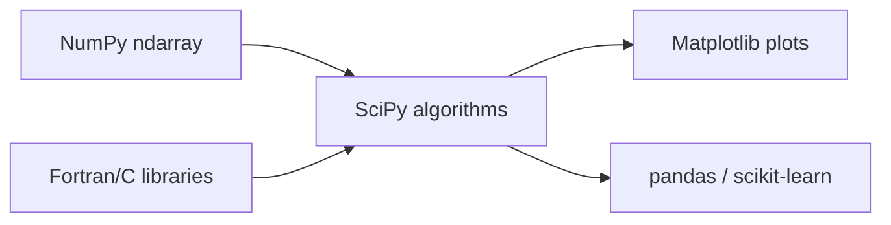

[computingFreedom](computingfreedom.md) |
  [Build](bciyh.md) |
  [Picolisp](picolisp.md) | [Picolisp Machine](pilmachine.md) | [pil sources](pilsource.md) |
  [Linux](linux.md) | [BASH](bash.md) |
  [C Programmming](cprogramming.md) |
  [Operating Systems](os.md) |
  [Javascipt](javascript.md) |
  [Emacs](emacs.md)  | [vim](vim.md) |
  [Pharo Smalltalk](pharo.md) |
  [Computer Security](computersecurity.md) |
  [Python](python.md) |

# SciPy

Here is the truth about SciPy: **it is the standard library Python never shipped for science and engineering.** Where NumPy gives you arrays, SciPy gives you the algorithms that *use* them – integration, optimisation, signal processing, statistics, sparse linear algebra and more.

### What it is, in plain words

**SciPy** (pronounced "sigh pie") is an open-source Python library built on [NumPy](numpy.md). It collects battle-tested implementations of classical numerical methods, many of them wrappers around the same Fortran and C libraries (QUADPACK, FFTpACK, ARPACK, ODEPACK, LAPACK) that scientists have trusted for decades. The top-level packages you'll actually import:

| Package | Job |
|---------|-----|
| `scipy.integrate` | numerical integration, ODE solvers |
| `scipy.optimize` | root finding, curve fitting, minimisation |
| `scipy.linalg` | denser linear algebra than `numpy.linalg` |
| `scipy.sparse` | sparse matrices and solvers |
| `scipy.signal` | filtering, convolution, spectral analysis |
| `scipy.stats` | distributions, tests, descriptive stats |
| `scipy.interpolate` | splines and interpolants |
| `scipy.fft` | Fourier transforms |
| `scipy.ndimage` | N-dimensional image processing |
| `scipy.spatial` | KD-trees, distance computations |
| `scipy.special` | Bessel, gamma, erf and friends |
| `scipy.io` | MATLAB `.mat`, Matrix Market, wav, etc. |

SciPy 1.x is mature; releases continue steadily in 2026. It shares NumPy's array object, so the two feel like one system.

### Why it matters

Before SciPy (and its sibling ecosystem – Matplotlib, pandas, scikit-learn), serious numerics meant MATLAB, Fortran or C. SciPy gave Python a free, coherent alternative that runs everywhere. If you do data analysis, physics, DSP, optimisation or stats in Python, you are standing on it – even when a higher-level library is what you import.

### An everyday analogy: a well-stocked lab bench

NumPy is the set of clean glass beakers (the containers). SciPy is the instruments on the bench: the balance, the spectrometer, the centrifuge. Same beakers, specialised tools that know how to use them.



### A hands-on example

```bash
pip install numpy scipy matplotlib
```

```python
import numpy as np
from scipy import integrate, optimize, signal, stats

# 1. Integrate a function: ∫_0^π sin(x) dx = 2
area, err = integrate.quad(np.sin, 0, np.pi)
print(area, err)

# 2. Solve an ODE: y' = -2y, y(0) = 1
sol = integrate.solve_ivp(lambda t, y: -2 * y, [0, 3], [1], dense_output=True)
print(sol.sol(1.0))            # ≈ e^{-2} ≈ 0.135

# 3. Fit a curve
def model(x, a, b): return a * np.exp(-b * x)
x = np.linspace(0, 4, 50)
y = model(x, 2.5, 1.3) + 0.2 * np.random.default_rng(0).normal(size=50)
params, _ = optimize.curve_fit(model, x, y, p0=(1, 1))
print(params)                  # ≈ [2.5, 1.3]

# 4. Filter a noisy signal
t = np.linspace(0, 1, 500, endpoint=False)
sig = np.sin(2 * np.pi * 5 * t) + 0.5 * np.random.default_rng(1).standard_normal(500)
b, a = signal.butter(4, 0.1)   # low-pass
clean = signal.filtfilt(b, a, sig)

# 5. A quick statistic
print(stats.describe(clean))
print(stats.ttest_1samp(clean, 0.0))
```

When a routine has a NumPy and a SciPy version (linear algebra especially), the SciPy one is often more complete – more decompositions, more solvers, better control over specialised cases. For sparse systems (most of a matrix is zeros), *always* look at `scipy.sparse.linalg` before a dense approach.

### How it relates to the rest of the stack

- **NumPy** – arrays and basic ops; SciPy depends on it.
- **pandas** – labelled tables; uses NumPy underneath, often hands numeric columns to SciPy.
- **scikit-learn** – machine learning; uses SciPy's sparse matrices and optimisers.
- **Matplotlib / Polars / JAX / PyTorch** – adjacent tools; SciPy stays the classical-methods home.
- **MATLAB** – the commercial ancestor of this workflow; SciPy deliberately covers similar ground.

### Common misconceptions

- **"SciPy and NumPy are competitors."** SciPy builds on NumPy. You import both.
- **"SciPy is a machine-learning library."** That's scikit-learn, PyTorch, JAX. SciPy is classical numerical methods.
- **"`scipy.misc` still has imread."** That went away years ago. Use `imageio` or `imageio.v3`.
- **"It's slow because Python."** The hot loops are in compiled code. Your job is to call them on whole arrays, not from a Python `for` loop.
- **"Any version is fine."** Pin SciPy (and NumPy) in production; numerical results can change slightly across major versions as algorithms improve.

### Installing and versions

```bash
pip install "scipy>=1.11"
# or in a scientific stack:
pip install numpy scipy matplotlib pandas ipython
```

On Void: `sudo xbps-install -S python3-scipy`. Distro packages are fine for exploration; for research and production, use a venv or conda and pin versions so results stay reproducible.

### Connections

- [NumPy](numpy.md) – the foundation.
- [Python](python.md), [iPython](ipython.md), [Open Data Science](opendatascience.md).
- [Fortran](fortran.md) – where many of the underlying algorithms were born.
- [Machine Learning](machinelearning.md).

Check Installation in Jupyter Notebooks:

```
import numpy as np
print("I like ", np.pi)

from scipy import misc
import matplotlib.pyplot as plt

face = misc.face()
plt.imshow(face)
plt.show()
```

## Libraries, Tools

- [SciPy](scipy.md) --- [@ SciPy.org](https://www.scipy.org/)
- [Numpy](numpy.md) --- [ @ numPy.org](http://www.numpy.org/)
- [iPython](ipython.md) --- [@ ipython.org](https://ipython.org/)
