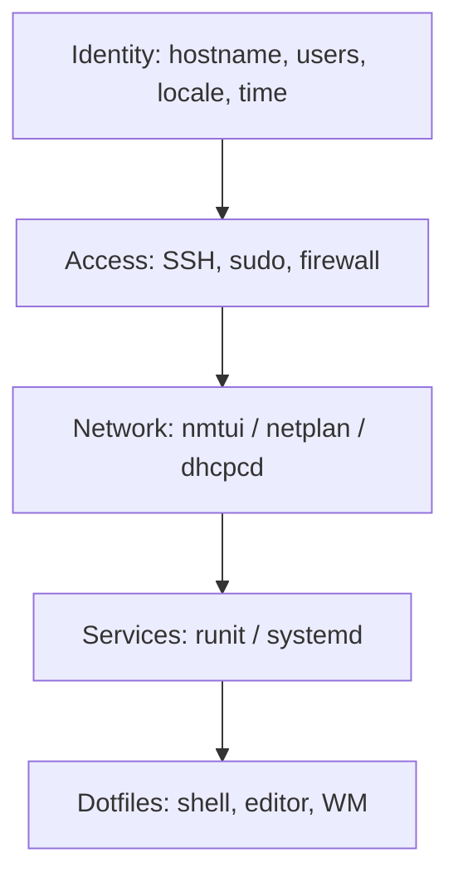

[computingFreedom](computingfreedom.md) |
  [Build](bciyh.md) |
  [Picolisp](picolisp.md) | [Picolisp Machine](pilmachine.md) | [pil sources](pilsource.md) |
  [Linux](linux.md) | [BASH](bash.md) |
  [C Programmming](cprogramming.md) |
  [Operating Systems](os.md) |
  [Javascipt](javascript.md) |
  [Emacs](emacs.md)  | [vim](vim.md) |
  [Pharo Smalltalk](pharo.md) |
  [Computer Security](computersecurity.md) |
  [Python](python.md) | [SimpleLinuxConfig](simplelinuxconfig.md) | [Keyboard Config](keyboardconfig.md)

# Simple Linux Configuration

Here is the truth about configuring Linux: **almost everything is a text file, and the system will tell you which one if you ask.** Once that sinks in, "configuration" stops being a mystery and becomes a short list of files you actually touch.

### What it is, in plain words

**Simple Linux configuration** means the everyday settings that make a machine *yours*: hostname, timezone, locale, keyboard, users, network, what starts at boot, and a few shell and editor defaults. Distros hide these behind installers and GUIs, but underneath they are the same ideas – and on a minimal system like Void/Vikix you meet them directly.

### Why it matters

A freshly installed system is nobody's. Five minutes of configuration turns it into a place you can think in: the right keymap for your fingers, the right time on the clock, SSH keys that Just Work, a window manager that launches on login. Doing it from the text files also means your config can live in Git and move with you.

### An everyday analogy: moving into a flat

The landlord hands you empty rooms. You change the locks (users and SSH), label the doorbell (hostname), set the clocks (timezone), plug in the router (network), choose which lamps turn on when you open the door (services), and put your kettle where you want it (dotfiles). None of that requires rebuilding the building.



### A hands-on pocket list

**Hostname, time, locale**

```bash
# systemd distros
sudo hostnamectl set-hostname vikix
sudo timedatectl set-timezone Asia/Dubai
sudo localectl set-locale LANG=en_GB.UTF-8

# Void / generic
echo vikix | sudo tee /etc/hostname
sudo ln -sf /usr/share/zoneinfo/Asia/Dubai /etc/localtime
# uncomment your locale in /etc/locale.gen, then:
sudo locale-gen          # Debian-family
# Void: set LANG in /etc/locale.conf and reconfigure glibc
```

**Keyboard** (console and X)

```bash
# console on systemd
sudo localectl set-keymap uk
# X11 – see Keyboard Config for the long version
setxkbmap -layout us,ru -option caps:ctrl_modifier
```

A Caps-Lock-as-Control remap pays for itself the first day you use Emacs or StumpWM. For deeper remapping, [KMonad](kmonad.md).

**Users and sudo**

```bash
sudo useradd -m -G wheel vikid     # wheel/sudo group name varies
sudo passwd vikid
sudo EDITOR=nvim visudo            # allow wheel/%sudo
```

**Network** – use [nmtui](nmtui.md) on NetworkManager systems; on Void with dhcpcd, `ln -s /etc/sv/dhcpcd /var/service/` and optionally static config in `/etc/dhcpcd.conf`.

**What starts at boot**

```bash
# systemd
systemctl enable --now sshd NetworkManager
# Void runit
sudo ln -s /etc/sv/sshd /var/service/
sudo ln -s /etc/sv/NetworkManager /var/service/
```

**Dotfiles worth carrying**

| File | Purpose |
|------|---------|
| `~/.bashrc` / `~/.zshrc` | aliases, prompt, `PATH` |
| `~/.inputrc` | readline keybindings |
| `~/.config/nvim/init.lua` or `~/.emacs.d/` | editor |
| `~/.stumpwmrc` | StumpWM |
| `~/.gitconfig` | name, email, aliases |
| `~/.ssh/config` | hosts and keys – see [SSH Login](sshlogin.md) |

Keep them in a Git repo and symlink in; GNU Stow or a small shell script is enough.

**A tiny first-boot script** (adapt paths for your distro):

```bash
#!/bin/sh
set -e
sudo hostnamectl set-hostname vikix 2>/dev/null || echo vikix | sudo tee /etc/hostname
sudo timedatectl set-timezone Asia/Dubai 2>/dev/null || sudo ln -sf /usr/share/zoneinfo/Asia/Dubai /etc/localtime
ssh-keygen -t ed25519 -N "" -f ~/.ssh/id_ed25519
git clone git@github.com:you/dotfiles.git ~/dotfiles && ~/dotfiles/install.sh
```

### Firmware and microcode

On bare metal, install CPU microcode and keep firmware current – a boring security and stability win:

```bash
# Debian/Ubuntu
sudo apt install intel-microcode amd64-microcode
# Void
sudo xbps-install -S linux-firmware
```

Then reboot after kernel or firmware updates when prompted.

### Common misconceptions

- **"Configuration means editing a Windows-style registry."** On Linux it's almost always a file you can comment, diff and put in Git.
- **"I need a GUI tool for each setting."** You don't. The GUI usually writes the same file you would.
- **"Dotfiles are separate from system config."** System-wide lives in `/etc`; per-user in `$HOME`. Both matter.
- **"Once it works, never touch it."** Read `/etc` after big upgrades; packages sometimes drop new config as `.pacnew`/`.rpmnew`/`.dpkg-dist`.
- **"Void and Ubuntu configure differently."** Paths and service managers differ; the *ideas* (hostname, time, users, network, services, dotfiles) are identical.

### Connections

- [Keyboard Config](keyboardconfig.md), [nmtui](nmtui.md), [SSH Login](sshlogin.md).
- [systemd](systemd.md), [Ubuntu Common Tasks](ubuntucommontask.md).
- [Linux Tools](linuxtools.md), [Linux Introspection](linuxinstrospection.md).
- [Build](bciyh.md) – how Vikix itself is put together.

- [Keyboard Config](keyboardconfig.md)

#### Reading List & Source
