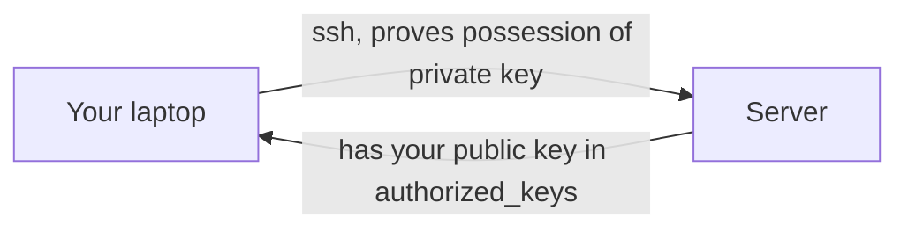

# Logging into Servers with SSH

Here is the truth about SSH: **the password is the weakest part of it, and you should almost never use one.** SSH is how you get a shell on another machine securely; keys are how you do it without turning a password guess into a break-in.

### What it is, in plain words

**SSH** (Secure Shell) is a protocol and a set of tools (`ssh`, `scp`, `sftp`, `ssh-keygen`, `ssh-agent`) that give you an encrypted channel to another computer. Typical uses:

- an interactive login shell;
- running a single remote command;
- copying files (`scp`, `rsync -e ssh`, `sftp`);
- tunnelling other traffic (`-L`, `-R`, `-D`);
- Git over SSH (`git@github.com:…`).

It replaced telnet, rlogin and rsh – protocols that sent passwords and sessions in the clear. The current major version is **SSH-2**; OpenSSH (OpenBSD) is the implementation almost everyone runs.

### Why it matters

If you run a server – a VPS, a Pi on your desk, a build box – SSH is the front door. Misconfigure it and bots will find the password in hours. Configure it well and it is quieter, safer and *more convenient* than typing a password every time. On Vikix I treat SSH keys the way I treat house keys: few of them, carefully kept.

### An everyday analogy: a door with two kinds of lock

A password is a combination lock anyone who sees you enter the digits can replay. A key pair is a padlock you bought open and hung on the server's door (the **public** key), while the only key that opens it (the **private** key) never leaves your pocket. Anyone can hang a padlock; only you can open it.



### A hands-on example

**1. Make a key pair** (ed25519 is the right default in 2026):

```bash
ssh-keygen -t ed25519 -C "vikid@vikix" -f ~/.ssh/id_ed25519
# set a passphrase – ssh-agent will remember it for the session
```

**2. Install the public key on the server.**

```bash
ssh-copy-id -i ~/.ssh/id_ed25519.pub user@server.example
# or manually: append the .pub line to ~/.ssh/authorized_keys on the server
```

**3. Log in, and never type a password again.**

```bash
ssh user@server.example
```

**4. Harden the server** – drop into `/etc/ssh/sshd_config.d/hardening.conf`:

```
PermitRootLogin no
PasswordAuthentication no
KbdInteractiveAuthentication no
PubkeyAuthentication yes
AuthenticationMethods publickey
AllowUsers vikid
```

```bash
sudo sshd -t && sudo systemctl reload ssh   # systemd
# on Void: sudo sshd -t && sudo sv restart sshd
```

**5. Make life easier with `~/.ssh/config`:**

```
Host vikix
    HostName 203.0.113.5
    User vikid
    IdentityFile ~/.ssh/id_ed25519
    AddKeysToAgent yes
    IdentitiesOnly yes

Host *.lab.example
    User admin
    ProxyJump bastion          # jump via a bastion host
```

Now `ssh vikix` just works. `ssh-add` (or the built-in agent on most desktops) holds the unlocked key in memory so you type the passphrase once per session.

**6. Digits / DigitalOcean-style droplets** take your public key at creation time – paste the contents of `id_ed25519.pub` into the panel, or use their CLI. Same idea everywhere: public key on the server, private key on you.

### Tunnels worth knowing

```bash
ssh -L 8080:localhost:80 vikix     # local:8080 → vikix's port 80
ssh -R 9090:localhost:3000 vikix   # vikix:9090 → your local 3000
ssh -D 1080 vikix                  # SOCKS proxy via the server
```

### Copying files and agent forwarding

```bash
scp ./site.tgz vikix:~/backups/
rsync -avz -e ssh ./content/ vikix:~/site/content/
```

`ssh -A vikix` forwards your local agent so you can, from that server, push to GitHub with *your* key – the private key still never touches the server. Use it sparingly and only to hosts you trust; a compromised server could use your agent while you're connected. Prefer a deploy key or a short-lived certificate for automation.

### Common misconceptions

- **"Any key type is fine."** Prefer `ed25519`. RSA keys should be ≥ 3072 bits if you must; DSA and ECDSA-on-weak-curves are past their prime.
- **"A key without a passphrase is more convenient."** It's convenient for attackers who get your laptop too. Use a passphrase + agent.
- **"`authorized_keys` is a directory."** It's a file. Permissions must be tight: `~/.ssh` mode `700`, `authorized_keys` mode `600`.
- **"Disabling passwords locks me out."** Keep a live session open while you test a new config; confirm a new login works before you disconnect.
- **"Telnet is equivalent on a private network."** Private networks get compromised. Use SSH anyway.

### Connections

- [Ubuntu Common Tasks](ubuntucommontask.md) – enabling `sshd` on a fresh box.
- [Linux Security](linuxsecurity.md) and [Computer Security](computersecurity.md).
- [Online VPS](onlinevps.md) and [Linode](linode.md) – where you'll SSH first.
- [Raspberry Pi](rasberrypi.md) – headless Pis live and die by SSH.

[ How to use ssh keys with Digitalocean Droplets](https://www.digitalocean.com/community/tutorials/how-to-use-ssh-keys-with-digitalocean-droplets
)
