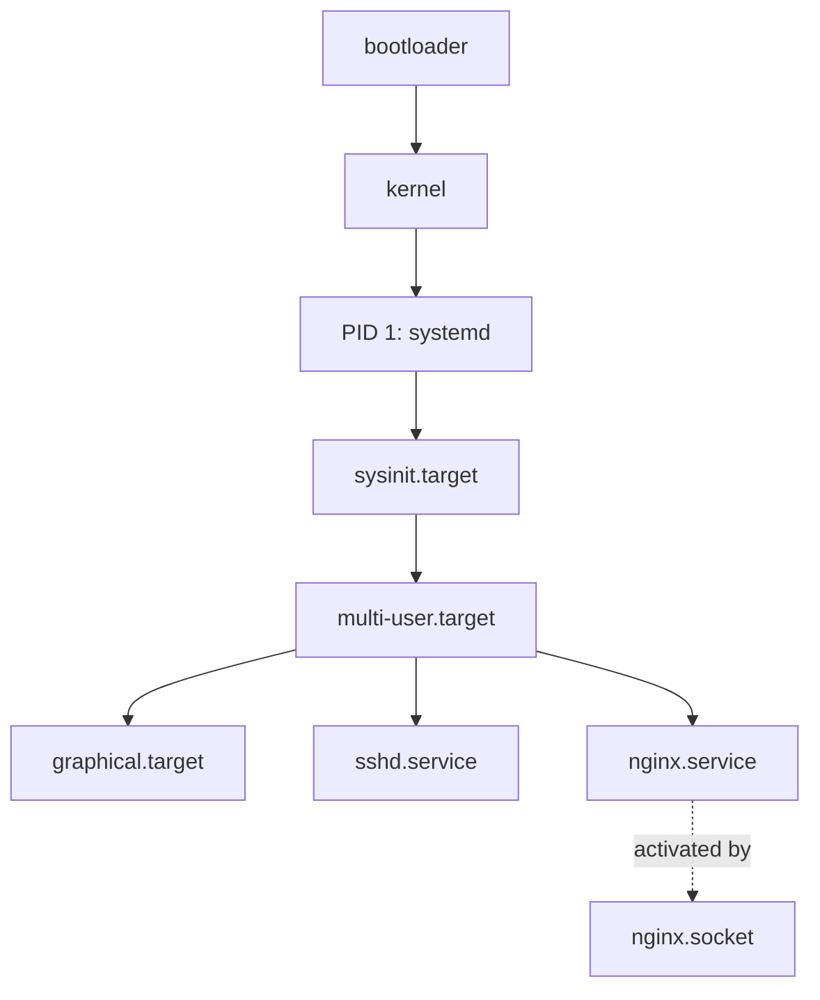

[computingFreedom](computingfreedom.md) |
  [Build](bciyh.md) |
  [Picolisp](picolisp.md) | [Picolisp Machine](pilmachine.md) | [pil sources](pilsource.md) |
  [Linux](linux.md) | [BASH](bash.md) |
  [C Programmming](cprogramming.md) |
  [Operating Systems](os.md) |
  [Javascipt](javascript.md) |
  [Emacs](emacs.md)  | [vim](vim.md) |
  [Pharo Smalltalk](pharo.md) |
  [Computer Security](computersecurity.md) |
  [Python](python.md) | [SimpleLinuxConfig](simplelinuxconfig.md) |
  [Tools and Software](linuxtoolsandsoftware.md)

# systemd

Here is the truth about systemd: **it is not "just an init system" – it is a suite that starts the system, supervises services, manages sockets, timers, mounts, devices and logs, and it has largely won.** Love it or not, on most Linux boxes in 2026 it is PID 1, and you need to speak its language.

### What it is, in plain words

**systemd** (the project) and **`systemd`** (the PID 1 binary) replace a pile of older Unix mechanisms with one set of ideas:

- **Units** – declarative config files describing things to manage: `.service`, `.socket`, `.timer`, `.mount`, `.target`, …
- **Dependencies** – `Wants=`, `Requires=`, `After=` so the system comes up in a sensible order, in parallel.
- **Sockets and activation** – services can start *when something connects*, like classic inetd but modern.
- **Timers** – calendar or monotonic schedules that replace most of cron.
- **journald** – a structured log store queried with `journalctl`.

It was introduced by Lennart Poettering and Kay Sievers in 2010 and adopted by Fedora, then RHEL, Debian, Ubuntu and most others. Notable holdouts: **Void Linux** (runit – what Vikix uses), Alpine (OpenRC), Slackware, and the BSDs.

### Why it matters

If you touch a typical server you will use `systemctl` and `journalctl` every day. Writing a solid service unit is how you make a program survive reboots and crashes cleanly. Understanding systemd also clarifies what Void's runit is *not* doing – and why some of us prefer that.

### An everyday analogy: a stage manager

A play doesn't start because the actors feel like it. A stage manager calls places, raises the curtain, cues the lights, and if an actor faints mid-scene, sends the understudy on. systemd is the stage manager of the machine: units are the cues, targets are the acts (`multi-user.target`, `graphical.target`), and the journal is the prompt book.



### A hands-on example

Am I on systemd?

```bash
ps -p 1 -o comm=                 # systemd
[[ -d /run/systemd/system ]] && echo yes
systemctl is-system-running      # running / degraded / offline
```

Everyday service control:

```bash
systemctl status nginx
systemctl start nginx
systemctl enable --now nginx     # start now AND at boot
systemctl reload nginx           # graceful
systemctl stop nginx
systemctl restart nginx
systemctl disable nginx
```

Logs:

```bash
journalctl -u nginx -f                 # follow
journalctl -u nginx --since "1 hour ago"
journalctl -b                          # this boot
journalctl -p err                      # errors and worse
```

A minimal service unit for a small app – save as `/etc/systemd/system/vikidwiki.service`:

```ini
[Unit]
Description=VikiD wiki app
After=network-online.target
Wants=network-online.target

[Service]
Type=simple
User=vikid
WorkingDirectory=/home/vikid/wiki
ExecStart=/home/vikid/wiki/bin/server
Restart=on-failure
RestartSec=2
Environment=NODE_ENV=production

[Install]
WantedBy=multi-user.target
```

```bash
sudo systemctl daemon-reload
sudo systemctl enable --now vikidwiki
```

A timer that runs a backup every night (pair of units):

```ini
# /etc/systemd/system/backup.service
[Service]
Type=oneshot
ExecStart=/usr/local/bin/backup.sh

# /etc/systemd/system/backup.timer
[Unit]
Description=Nightly backup
[Timer]
OnCalendar=*-*-* 03:30:00
Persistent=yes
[Install]
WantedBy=timers.target
```

```bash
sudo systemctl enable --now backup.timer
systemctl list-timers
```

### systemd vs runit (Void)

| | systemd | runit (Void) |
|---|---|---|
| Config | declarative unit files | a `run` shell script per service |
| Supervision | built in | `runsv` per service |
| Logs | journald (binary) | plain text in `/var/log/socklog` or similar |
| Parallel boot | yes | yes |
| Scope | init + many subsystems | just init + supervision |
| Size | large | tiny |

Both work. systemd gives you one vocabulary for almost everything; runit gives you something you can read and modify with a text editor and a shell in thirty seconds. Vikix chose the second.

### Unit types you will actually use

- **`.service`** – a process to run.
- **`.timer`** – when to run a service (replaces cron for most local jobs).
- **`.socket`** – listen on a port/path; start the service on demand.
- **`.target`** – a named group of units, like a runlevel (`multi-user.target`).
- **`.mount` / `.automount`** – filesystems, declared instead of (or as well as) `/etc/fstab`.

`systemctl cat nginx.service` shows the full unit with all drops-ins; `systemctl edit nginx` creates an override without touching the package file.

### Common misconceptions

- **"systemd is an init system."** PID 1 is one piece. The project also covers logging, login, DNS resolution (`systemd-resolved`), network (`systemd-networkd`), boot loading (`bootctl`) and more – some of which you can take or leave.
- **"`service nginx start` is the systemd way."** That's a SysV compatibility wrapper. Prefer `systemctl`.
- **"The journal is unreadable / loses logs."** `journalctl` is the interface; you can also forward to syslog. Configure retention with `SystemMaxUse=` in `journald.conf`.
- **"Everything must be a unit."** Cron still works. So do plain background processes. Units are for things you want supervised.
- **"Using Void means you'll never see systemd."** Cloud images, containers and other people's machines will make sure you do.

### Connections

- [Linux](linux.md) and [Simple Linux Configuration](simplelinuxconfig.md).
- [Ubuntu Common Tasks](ubuntucommontask.md) – `systemctl` in practice.
- [nmtui](nmtui.md) – NetworkManager often coexists with systemd.
- [Operating Systems](os.md) – what PID 1 actually does.

How to know if you are using systemd?

```
ps --no-headers -o comm 1
```

```
[[ -d /run/systemd/system ]] && echo "using systemd"

[ -d /run/systemd/system ] && echo "using systemd" || echo "NOT using systemd"
```

```
[[ `systemctl` =~ -\.mount ]] || { echo 'Systemd not found'; exit 1; }
```
