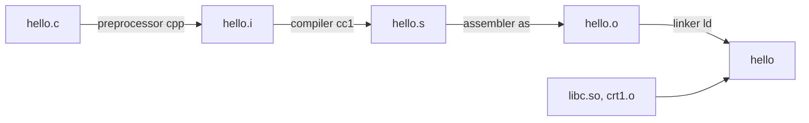

[Back to C programming](cprogramming.md)

# The Compiler

Here is the truth about compiling: **"the compiler" is really four programs taking turns, and you can stop the conveyor belt at any station and look at what is on it.** Once you have done that once, error messages stop being mysterious, because you know which station shouted.

### What it is, in plain words

When you type `gcc hello.c -o hello`, the `gcc` *driver* runs a pipeline:



1. **Preprocess** – expand `#include`, `#define` and `#if`. Output is still C, just much longer.
2. **Compile** – parse, type-check, optimise, and emit assembly for your CPU.
3. **Assemble** – turn assembly text into machine code in an *object file* (ELF on Linux).
4. **Link** – join object files and libraries, resolve names between them, and produce an executable.

The eight "translation phases" below are the C standard's precise description of steps 1 and 2. Compilers are free to merge them as long as the result is the same.

In 2026 the two big free C compilers are **GCC** (version 15 is current, defaulting to the C23 standard) and **Clang/LLVM**. Both are excellent. Clang tends to give friendlier error messages; GCC often wins on embedded targets. Tiny alternatives such as **TCC** and **cproc** are fun to read because they fit in your head.

### Why it matters

- **Error messages make sense.** "undefined reference to `foo`" is a *linker* error: the code compiled fine but no object file defined `foo`. "implicit declaration of function" is a *compiler* error: you forgot a header. Different station, different fix.
- **Performance.** `-O2` versus `-O0` can be a 3x to 10x difference. Knowing what the optimiser does (inlining, vectorising, dead code removal) lets you write code it can help.
- **Security.** Flags like `-fstack-protector-strong`, `-D_FORTIFY_SOURCE=3`, `-fPIE -pie` and `-fsanitize=address` are cheap defences. Distributions like Void and Arch build packages with hardening flags turned on.

### An everyday analogy: a printing press

You hand in a manuscript with notes like "insert chapter 3 here" (preprocessing). An editor turns it into typeset pages (compiling to assembly). The plate maker etches the pages onto metal plates (assembling). The binder collects plates from several authors, checks every cross-reference points somewhere real, and stitches the book (linking). A missing cross-reference is the binder's complaint, not the editor's.

### A hands-on example: stop at every station

```bash
cat > hello.c <<'C'
#include <stdio.h>
#define WHO "VikiD"
int main(void) { printf("Hello, %s\n", WHO); return 0; }
C

gcc -E hello.c -o hello.i      # 1. preprocess only (try: wc -l hello.i)
gcc -S -O2 hello.c -o hello.s  # 2. compile to assembly
gcc -c hello.c -o hello.o      # 3. assemble to an object file
gcc hello.o -o hello           # 4. link
./hello

gcc -v hello.c 2>&1 | grep -E 'cc1|collect2|as '   # see the real programs run
nm hello.o                                          # 'U printf' = needs linking
objdump -d hello.o | less                           # machine code
```

`hello.i` is hundreds of lines long, all from `stdio.h`. `nm` shows `printf` as **U**, undefined, which is exactly the hole the linker fills from libc. That is the whole story of separate compilation in two commands. See [objdump](objdump.md) to go further.


The C compiler translates **C-source-code** into **machine code**.

The Compiler translates each *source file* into an *object file* also known as
a **module**.

If there are more that 1 *object files*, these are then *linked* by the
**linker** which outputs a **executable**.

The **executable** is what we normally run as a program in the system.

## The Translation Phases

The compilation takes place in 8 steps.

1. **Read Source**
    - Convert the *File Charset* into *Source Charset* if necessary
    - Convert *end-of-line indicators* to *newline chars* if needed
    - [Trigraphs](trigraphs.md) are converted to their single char versions
    - [Digraphs](digraphs.md) are left as they are.
1. **whenever a backslash is followed by a newline character, it is deleted**
1. **Source is Broken in [Tokens](tokens.md).**
    - each Comment is converted into a space.
1. **Preprocessor Directives are carried out and macro calls are expanded**
1. **It is the converted into the Execution Character Set**
    - all character and escape sequences in char constants and strings converted.
1. **Adjacent String Literals are concatenated**
1. **Compiling Begins** and the tokens are converted into Machine Code
1. **The Linker** is invoked
    - it resolves references to external objects and functions
    - generates the executable file
    - External objects and functions should not be defined more than once

## Compiling Programs

use make when you can. Assume you have a file, file.c, then:

```
make file
```

or

```
CFLAGS="-Wall" make file
```

use a makefile named "Makefile":

```
CFLAGS=-Wall -g

clean:
  rm -f file
```

A more useful everyday `Makefile` in 2026, with warnings, debug info and sanitizers on during development:

```make
CC      ?= gcc
CFLAGS  ?= -std=c23 -Wall -Wextra -Wshadow -O2 -g
DEVFLAGS = -O0 -fsanitize=address,undefined

hello: hello.c
	$(CC) $(CFLAGS) $< -o $@

dev: hello.c
	$(CC) $(CFLAGS) $(DEVFLAGS) $< -o hello

clean:
	rm -f hello *.o
```

Remember that recipe lines in a Makefile must start with a real **tab**, not spaces.

## Common misconceptions

- **"Compiling and linking are the same thing."** They are separate steps run by separate programs. Most beginner "compile errors" with *undefined reference* are linker errors.
- **"Headers contain the library."** Headers only *declare* functions. The code lives in the library (`libc.so`, `libm.so`) that the linker pulls in. That is why some programs need `-lm`.
- **"Optimisation changes what my program means."** It never changes the meaning of correct code. It can expose bugs that were *already there*, usually undefined behaviour.
- **"Warnings are optional."** Treat them as errors while you learn: add `-Werror`.
- **"Interpreted languages skip all this."** Python compiles to bytecode, JavaScript engines compile to machine code at run time, and PicoLisp's pil21 is itself built by compiling Lisp to LLVM IR. The stations are just in different places.

## Connections

- [C Programming](cprogramming.md), [Identifiers](identifier.md), [Literals](literals.md), [Objects in C](object.md).
- [Assembly Language](assemblylanguage.md), [objdump](objdump.md), [Using the C Debugger](gbddebugger.md).
- [PicoLisp Assembly](pilasm.md) and [The PicoLisp Machine](pilmachine.md) – a very different compiler story.
- [Computer Languages](computerlanguages.md) – where compilers fit among all the languages.
