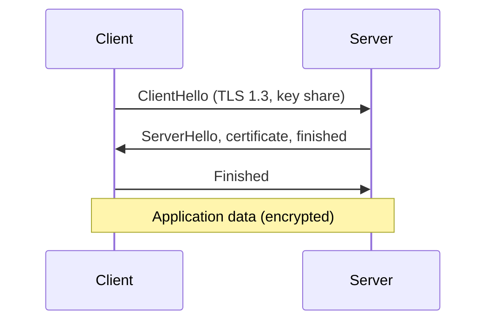

[Read This!](caveatemptor.md) |
  [Picolisp](picolisp.md) | [Picolisp Machine](pilmachine.md) | [Pil Sources](pilsource.md) |
  [Linux](linux.md) | [BASH](bash.md) |
  [C-Programmming](cprogramming.md) |
  [Operating Systems](os.md) |
  [Computer Security](computersecurity.md) | [ICSsecurity](icssecurity.md) |
  [Firewalls](firewalls.md) | [Networking](networking.md) | [Security Programs](securityprogram.md) |
 [Exploitation](exploitation.md) | [Social Engineering](internetexploitation.md) | [Metasploit](metasploit.md) | [wifi-penetration](wifipenetration.md) |
 [Forensics](forensics.md) | [SecureNetworkArchitecture](securenetworkarchitecture.md)

# TLS - Transport Layer Security

Here is the truth about TLS: **it is the reason the lock icon means anything – a protocol that turns an open pipe into a private, authenticated conversation.** HTTPS is just HTTP spoken through that pipe.

### What it is, in plain words

**TLS** (Transport Layer Security), successor to the old SSL, is the cryptographic protocol that provides:

1. **Confidentiality** – eavesdroppers see ciphertext.
2. **Integrity** – tampering is detected.
3. **Authentication** – usually of the server, optionally of the client, via certificates.

A **certificate** binds a public key to a name (like `thevikidtruth.com`), signed by a **Certificate Authority** your browser trusts. Let's Encrypt made trusted certificates free and automatic; there is no excuse for plaintext web in 2026.

Current practical versions: **TLS 1.3** (preferred – faster handshake, fewer options) and TLS 1.2 (still around). TLS 1.0/1.1 are obsolete and disabled everywhere that matters.

### Why it matters

Without TLS, passwords, cookies and personal data travel as postcard text. With TLS misconfigured, you can get a false sense of safety – old ciphers, expired certs, missing stapling, or trusting the wrong CA. Understanding the handshake enough to read `openssl s_client` output turns "HTTPS broken" from a mystery into a checklist.

### An everyday analogy: a negotiation in a crowded café

You and a banker meet in public. You agree on a secret handshake (key exchange), show ID cards a notary has stamped (certificates), then whisper in a code only you two know (session keys). Everyone hears the whispers; nobody can understand or change them without detection. That is TLS.



### A hands-on example

**Probe a site:**

```bash
openssl s_client -connect thevikidtruth.com:443 -servername thevikidtruth.com </dev/null 2>/dev/null \
  | openssl x509 -noout -subject -issuer -dates
curl -vI https://thevikidtruth.com 2>&1 | grep -E 'SSL|TLS|subject|expire'
```

**Get a free certificate with Caddy** (automatic renewals):

```caddyfile
thevikidtruth.com {
    root * /var/www/site
    file_server
}
```

Caddy obtains and renews Let's Encrypt certs by default. With nginx, **certbot** (`certbot --nginx -d example.com`) is the usual path; on Void, `acme.sh` or `lego` fit well with runit.

**A modern nginx snippet:**

```nginx
ssl_protocols TLSv1.2 TLSv1.3;
ssl_prefer_server_ciphers off;
ssl_certificate     /etc/ssl/example.fullchain.pem;
ssl_certificate_key /etc/ssl/example.key;
add_header Strict-Transport-Security "max-age=63072000" always;
```

Then test at SSL Labs or with `testssl.sh`.

### Certificates, chains and what browsers check

A leaf certificate for `example.com` is signed by an intermediate CA, which is signed by a root CA shipped with your browser or OS. If any link is missing, expired or revoked, the handshake fails. Common breaks:

- serving only the leaf without the intermediate (send the full chain);
- clock skew on the server (TLS is time-sensitive);
- name mismatch (`www` vs apex) – use Subject Alternative Names covering both;
- forgotten renewal.

`openssl s_client -showcerts` prints the chain you actually serve. Compare it to what you think you configured.

### Common misconceptions

- **"SSL and TLS are different things I need."** SSL is the old name; say TLS. People still say "SSL certificate" out of habit.
- **"HTTPS means the site is safe."** It means the *pipe* is private and the certificate matches. The site can still be malicious.
- **"Self-signed is fine for production."** Fine for labs. Browsers will warn; users will leave.
- **"More cipher options is better."** Fewer, modern ones are better. Let TLS 1.3 choose.
- **"Certificates last forever."** Let's Encrypt's last 90 days on purpose. Automate renewal.

### Post-quantum TLS has arrived

The biggest change since the old notes below: TLS is going **post-quantum**. A future quantum computer could break the elliptic-curve key exchange that protects today's traffic, and attackers can record encrypted traffic now to decrypt later ("harvest now, decrypt later"). So the industry moved first on the key exchange.

Since 2024 the major browsers and servers default to a **hybrid** key exchange, **X25519MLKEM768**: it combines the classical X25519 curve with ML-KEM (formerly Kyber), the lattice-based scheme NIST standardised as FIPS 203 in 2024. If either half holds, your session key is safe. By 2026 a large share of all HTTPS connections already use it, and OpenSSL 3.5 and recent BoringSSL negotiate it automatically. Signatures (the certificate side) are migrating more slowly, because certificates live for years.

You can see what your own connection negotiated:

```bash
openssl s_client -connect thevikidtruth.com:443 -groups X25519MLKEM768 </dev/null 2>/dev/null \
  | grep -E 'Protocol|Cipher|Negotiated|group'
# Look for: TLSv1.3, and "Negotiated TLS1.3 group: X25519MLKEM768"
```

### A hands-on example: inspect and test a server

```bash
# Which TLS versions and ciphers does a server allow?
nmap --script ssl-enum-ciphers -p 443 thevikidtruth.com

# Full certificate chain and expiry
echo | openssl s_client -connect thevikidtruth.com:443 -servername thevikidtruth.com 2>/dev/null \
  | openssl x509 -noout -subject -issuer -dates

# Grade a public server's configuration
# (browser) https://www.ssllabs.com/ssltest/
```

For your own servers, the practical advice in 2026 is short: serve **TLS 1.3 and 1.2 only**, get free certificates from Let's Encrypt with automatic renewal (Caddy does this with zero configuration), and let the library pick the cipher suite. The era of hand-tuning long cipher strings is over, and that is a good thing.

### Connections

- [Encryption](encryption.md), [Computer Security](computersecurity.md), [Securing Web Apps](securingwebapps.md).
- [Web Development](webdevelopment.md), [Firewalls](firewalls.md).
- [SSH Login](sshlogin.md) – another cryptographically protected channel, different protocol.

- TLS works in practice because it uses [Public Key Cryptography](publickeycryptography.md "MISSING PAGE")
  which allows peers to establish a **secure connection over**
  an insecure, unencrypted channel **without proper knowledge of each other**
- The protocol also allow **both peers to Authenticate each other's identity**
- It does this through an **established chain of trust**

## Tools, Links and Sources

- [eforensicsmag](https://eforensicsmag.com/)
- [OpenVPN Presentation - User Space](https://openvpn.net/papers/BLUG-talk/index.html)
- [OpenVPN Home](https://openvpn.net/)
