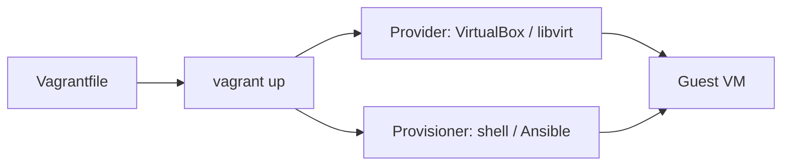

[Algorithms](algorithms.md) | [Apple](apple.md) | [AssemblyLanguage](assemblylanguage.md) |
[BASH](bash.md)  |   [Bash Cookbook](vikidsbashcookbook.md)  |
[C-Programmming](cprogramming.md) | [CommonLisp](commonlisp.md) | [Computer Security](computersecurity.md) | [CuisSmalltalk](cuissmalltalk.md) |
[Databases](databases.md) | [Emacs](emacs.md) |  [Exploitation](exploitation.md) | [Firewalls](firewalls.md) |
[Forth](forth.md) | [Fortran](fortran.md) | [Functional Programming](functional.md) |
[Git](git.md) | [GNUSmalltalk](gnusmalltalk.md) | [Haskell](haskell.md) |  [Javascript](javascript.md) |  [Julia](julia.md) |
[Linux](linux.md) | [Machine Learning](machinelearning.md) | [Metasploit](metasploit.md) |[Machine Learning](machinelearning.md) |
[Networking](networking.md) | [Operating Systems](os.md) | [Open Data Science](opendatascience.md) | [Odin](odin.md) |
[Picolisp](picolisp.md) | [Pharo Smalltalk](pharo.md) | [Purescript](purescript.md) | [Python](python.md) |
[Racket](racket.md) | [Rust](rust.md)| [Scheme](scheme.md)  | [Social Engineering](internetexploitation.md)  |
[Unity](unity.md) | [vagrant](vagrant.md) | [vim](vim.md) | [virtualbox](virtualbox.md) | [V](vlang.md) |
[Web Development](webdevelopment.md) | [Windows](windows.md) |[Zig](ziglang.md)

# Vagrant

Here is the truth about Vagrant: **it is a script that builds a disposable computer.** Point it at VirtualBox (or another provider), write a few lines of Ruby, and every teammate gets the same Linux box with the same packages – recreateable from nothing.

### What it is, in plain words

**Vagrant**, by HashiCorp, drives hypervisors from a `Vagrantfile`. One command – `vagrant up` – downloads a base image (**box**), creates a VM, sets networking and shared folders, and runs **provisioners** (shell, Ansible, Puppet). `vagrant ssh` drops you in; `vagrant destroy` melts it down.

It sits one layer above [VirtualBox](virtualbox.md) / libvirt / Hyper-V / VMware: the hypervisor runs the VM; Vagrant makes the VM *repeatable*.

### Why it matters

"Works on my machine" dies when the machine is code. Vagrant was the gateway drug to infrastructure-as-code for a generation of developers; Docker later took the lightweight niche, but Vagrant still wins when you need a real systemd, a real kernel module, or a Windows guest. For security labs and distro experiments it remains excellent.

### An everyday analogy: a prefab cabin kit

Docker is a tent – pitch it anywhere, same canvas. Vagrant is a prefab cabin: heavier, proper walls and plumbing (a full OS), but still from numbered parts you can rebuild after a storm.



### A hands-on example

```bash
sudo xbps-install -S vagrant           # plus VirtualBox or libvirt
mkdir lab && cd lab
vagrant init generic/ubuntu2204
```

Edit `Vagrantfile`:

```ruby
Vagrant.configure("2") do |config|
  config.vm.box = "generic/ubuntu2204"
  config.vm.hostname = "lab"
  config.vm.network "private_network", ip: "192.168.56.20"
  config.vm.provider "virtualbox" do |vb|
    vb.memory = 2048
    vb.cpus = 2
  end
  config.vm.provision "shell", inline: <<-SHELL
    apt-get update
    apt-get install -y nginx
  SHELL
end
```

```bash
vagrant up
vagrant ssh
vagrant snapshot save clean
vagrant destroy -f
```

Multi-machine files define whole labs (attacker + target) for [penetration testing](penetrationtesting.md). When VirtualBox isn't what you want, `vagrant up --provider=libvirt` on Linux is fast and scriptable.

### Shared folders and networking tips

By default Vagrant mounts the project directory at `/vagrant` in the guest – edit on the host, run in the guest. For heavy `node_modules` or builds, that mount can be slow on VirtualBox; use `rsync` synced folders or build inside the VM.

Networking modes mirror VirtualBox's: port forwarding (`config.vm.network "forwarded_port", guest: 80, host: 8080`), private host-only networks for labs, and public bridged networks when the VM must look like another machine on your LAN. Prefer private networks for vulnerable targets.

### Packer and custom boxes

When a public box isn't enough, **Packer** builds a box from an ISO and provisioners, then Vagrant consumes it. That pipeline – Packer builds golden images, Vagrant spins them for work – still underpins a lot of enterprise lab automation.

### Common misconceptions

- **"Vagrant is a hypervisor."** It *drives* hypervisors.
- **"Docker replaced Vagrant."** For many app workflows, yes. For full-OS labs, no.
- **"Boxes are trusted by default."** Only use boxes you trust; prefer official/`generic` images.
- **"`vagrant halt` deletes the VM."** Halt stops it; `destroy` deletes it.
- **"Provisioning runs every boot."** Shell provisioners run on first `up` unless `--provision` or run-always options say otherwise.

### Day-to-day commands worth muscle memory

```bash
vagrant up [--provision]
vagrant reload
vagrant suspend / resume
vagrant halt
vagrant destroy -f
vagrant box update
vagrant global-status
vagrant plugin list
```

Keep `Vagrantfile` in Git with the project. Pin box versions (`config.vm.box_version`) so a rebuild next year doesn't surprise you. When CI needs the same guest, the same file that boots your laptop lab boots the pipeline.

### Connections

- [VirtualBox](virtualbox.md), [Virtualization](virtualization.md).
- [Penetration Testing](penetrationtesting.md) – lab topologies.
- [Ubuntu Common Tasks](ubuntucommontask.md), [SSH Login](sshlogin.md).

- [archlinux: Vagrant Installation](https://wiki.archlinux.org/title/Vagrant)
- ```
  TERM=xterm-256color ssh
  ```
- `vagrant init jasonc/centos7`
  this will create a Vagrant File
- Configure said file:
  ```
  Vagrant.configure("2") do |config|
    # https://docs.vagrantup.com &  https://vagrantcloud.com/search.
    config.vm.box = "jasonc/centos7"
    config.vm.provider "virtualbox" do |vb|
      vb.customize ['modifyvm', :id, '--cableconnected1', 'on']
    end
    config.vm.define "server1" do |server1|
      server1.vm.hostname = "server1"
      server1.vm.network "private_network", ip: "192.168.56.10"
    end
    config.vm.define "server2" do |server2|
      server2.vm.hostname = "server2"
      server2.vm.network "private_network", ip: "192.168.56.11"
    end
  ```
- `vagrant up`
- `vagrant ssh`
- `vagrant destroy`
- <!-- 
  -{}
   -->
