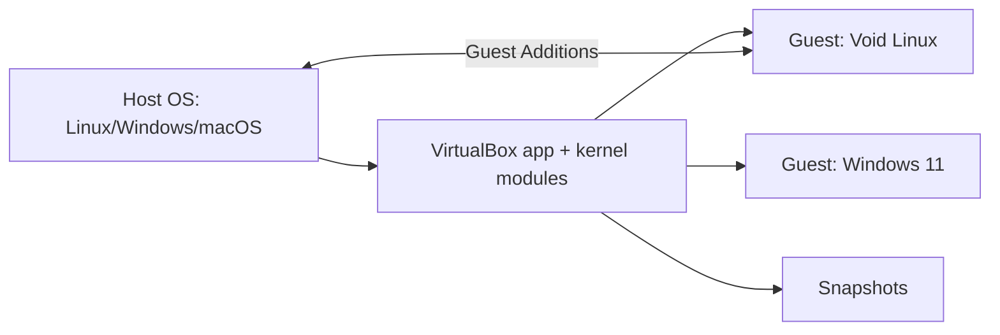

[Algorithms](algorithms.md) | [Apple](apple.md) | [AssemblyLanguage](assemblylanguage.md) |
[BASH](bash.md)  |   [Bash Cookbook](vikidsbashcookbook.md)  |
[C-Programmming](cprogramming.md) | [CommonLisp](commonlisp.md) | [Computer Security](computersecurity.md) | [CuisSmalltalk](cuissmalltalk.md) |
[Databases](databases.md) | [Emacs](emacs.md) |  [Exploitation](exploitation.md) | [Firewalls](firewalls.md) |
[Forth](forth.md) | [Fortran](fortran.md) | [Functional Programming](functional.md) |
[Git](git.md) | [GNUSmalltalk](gnusmalltalk.md) | [Haskell](haskell.md) |  [Javascript](javascript.md) |  [Julia](julia.md) |
[Linux](linux.md) | [Machine Learning](machinelearning.md) | [Metasploit](metasploit.md) |[Machine Learning](machinelearning.md) |
[Networking](networking.md) | [Operating Systems](os.md) | [Open Data Science](opendatascience.md) | [Odin](odin.md) |
[Picolisp](picolisp.md) | [Pharo Smalltalk](pharo.md) | [Purescript](purescript.md) | [Python](python.md) |
[Racket](racket.md) | [Rust](rust.md)| [Scheme](scheme.md)  | [Social Engineering](internetexploitation.md)  |
[Unity](unity.md) | [vagrant](vagrant.md) | [vim](vim.md) | [virtualbox](virtualbox.md) | [V](vlang.md) |
[Web Development](webdevelopment.md) | [Windows](windows.md) |[Zig](ziglang.md)

# Virtualbox

The truth about VirtualBox: **it's the easiest way to have a spare computer you can't break.** Install it, click through a wizard, and you've got a whole extra machine in a window – one you can snapshot, wreck and restore in seconds.

### What it is, in plain words

**Oracle VirtualBox** is a free, open-source (GPLv3) **type 2 hypervisor**: an application that runs on your normal operating system (Linux, Windows, macOS, Solaris) and lets you create **virtual machines** inside it. Each VM gets virtual CPUs, memory, disks (`.vdi` files), network cards and a screen, and you install a full guest operating system on it.

Where it stands in 2026:

- **VirtualBox 7.x** is the current line. Since 7.1 it runs on **Apple silicon Macs** with ARM64 guests, and the UI has a simplified "basic" mode and an "expert" mode.
- The **Guest Additions**, installed inside each guest, add shared folders, clipboard sharing, automatic screen resizing and better graphics.
- The **Extension Pack** (free for personal and educational use, separately licensed by Oracle) adds things like disk encryption and the VirtualBox RDP server. Commercial use needs a licence – check before you install it at work.

### Why it matters

You learn operating systems by breaking them, and you don't want to break the machine you're writing on. VirtualBox lets you try Void, Arch, BSD or Windows, set up a [penetration testing](penetrationtesting.md) lab, test an install script, or keep an old OS for one legacy program – all without repartitioning anything. Its point-and-click setup makes it the gentlest entry into [virtualization](virtualization.md).

### An everyday analogy: a model railway

A real railway is expensive and dangerous to experiment with. A model railway on a table lets you lay track, crash trains, and rebuild – and when you've got a layout you like, you photograph it so you can always put it back. A VirtualBox VM is the model railway; snapshots are the photographs.



### A hands-on example: a disposable Void Linux VM

Install VirtualBox. On Void (the kernel modules are built with DKMS, so install headers for your kernel too):

```bash
sudo xbps-install -S virtualbox-ose linux-headers
sudo usermod -aG vboxusers $USER
sudo modprobe vboxdrv
```

On Arch/Manjaro it's `virtualbox` plus `virtualbox-host-modules-arch` (or the DKMS variant); on Debian/Ubuntu download the `.deb` from virtualbox.org. Windows and macOS: run the installer.

Everything in the GUI can be scripted with **VBoxManage**, which is handy to keep in your notes:

```bash
VM=voidtest
VBoxManage createvm --name $VM --ostype Linux_64 --register
VBoxManage modifyvm $VM --memory 4096 --cpus 2 --nic1 nat --firmware efi \
  --graphicscontroller vmsvga
VBoxManage createmedium disk --filename ~/VirtualBox\ VMs/$VM/$VM.vdi --size 20000
VBoxManage storagectl $VM --name SATA --add sata --controller IntelAhci
VBoxManage storageattach $VM --storagectl SATA --port 0 --type hdd \
  --medium ~/VirtualBox\ VMs/$VM/$VM.vdi
VBoxManage storageattach $VM --storagectl SATA --port 1 --type dvddrive \
  --medium ~/Downloads/void-live-x86_64.iso
VBoxManage startvm $VM
```

After installing the guest OS, take a snapshot:

```bash
VBoxManage snapshot $VM take clean --description "fresh install"
VBoxManage snapshot $VM restore clean     # (with the VM powered off)
```

Forward SSH from the host to the guest:

```bash
VBoxManage modifyvm $VM --natpf1 "ssh,tcp,,2222,,22"
ssh -p 2222 user@localhost
```

### Networking modes in one table

| Mode | Guest can reach internet | Host can reach guest | Other guests |
|------|---|---|---|
| NAT (default) | yes | only via port forwarding | no |
| NAT Network | yes | via port forwarding | yes |
| Bridged | yes, as a real LAN device | yes | yes |
| Host-only | no | yes | yes |
| Internal | no | no | yes |

For a pentest lab, *Host-only* or *Internal* keeps vulnerable machines off your real network.

### Common misconceptions

- **"The Extension Pack is free for everyone."** It's under Oracle's PUEL: free for personal/educational use, not for commercial use.
- **"VirtualBox is too slow to be useful."** With VT-x/AMD-V, virtio or SATA disks and Guest Additions, it's fine for desktops and labs. For heavy server work, KVM is faster.
- **"Snapshots are backups."** They depend on the base disk. Lose the base `.vdi` and the snapshots go with it. Export (`VBoxManage export`) for real backups.
- **"It conflicts with Hyper-V on Windows."** Modern versions can run on top of the Windows Hypervisor Platform, though more slowly. Disabling Hyper-V gives full speed.
- **"Vagrant is a different hypervisor."** [Vagrant](vagrant.md) is a tool that drives VirtualBox (and others) from a config file.

### Connections

- [Virtualization](virtualization.md) – how hypervisors work.
- [Vagrant](vagrant.md) – reproducible VirtualBox machines from code.
- [Penetration Testing](penetrationtesting.md) – labs built from VMs.
- [Windows WSL](windowswsl.md) – Microsoft's own VM-based approach.
- [Linux](linux.md) – what you'll most likely run inside.

- https://www.virtualbox.org/wiki/Downloads virtualbox.org
- https://wiki.manjaro.org/index.php/VirtualBox manjaro: VirtualBox
