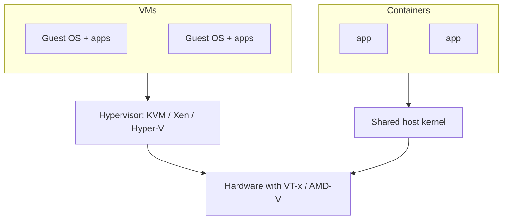

[computingFreedom](computingfreedom.md) |
  [Build](bciyh.md) |
  [Picolisp](picolisp.md) | [Picolisp Machine](pilmachine.md) | [Pil Sources](pilsource.md) |
  [Linux](linux.md) | [BASH](bash.md) |
  [C-Programmming](cprogramming.md) |
  [Operating Systems](os.md) |
  [Javascipt](javascript.md) |
  [Emacs](emacs.md)  | [vim](vim.md) |
  [Pharo Smalltalk](pharo.md) |
  [Computer Security](computersecurity.md) |
  [Python](python.md) |
  [The Compiler](thecompiler.md) |
  [Identifiers](identifier.md) |
  [Literals](literals.md) |
  [storage_linkage](storagelinkage.md) |

# Operating Systems

## Virtualization

Here's the truth behind virtualization: **an operating system is just a program that thinks it owns the hardware.** Give it something that *looks* like hardware, and it will happily run – alongside a dozen others on the same machine. That simple trick underpins the cloud, CI pipelines and most server rooms on Earth.

### What it is, in plain words

**Virtualization** means running a complete computer – CPU, memory, disks, network card – in software, on top of a real one. The software that does this is a **hypervisor**, and each pretend computer is a **virtual machine (VM)** with its own **guest** operating system.

There are two classic kinds of hypervisor:

- **Type 1 (bare metal)** – runs directly on the hardware: KVM (inside Linux), Xen, VMware ESXi, Microsoft Hyper-V. Platforms like **Proxmox VE** package KVM with a web UI, storage and clustering.
- **Type 2 (hosted)** – runs as an app on a normal OS: [VirtualBox](virtualbox.md), VMware Workstation, Parallels, UTM.

Modern CPUs make this fast with hardware extensions – **Intel VT-x / AMD-V** for the CPU, **EPT/NPT** for memory, and **VT-d / AMD-Vi (IOMMU)** for handing real devices to guests. Guests use **virtio** paravirtual drivers to talk to the hypervisor efficiently instead of pretending to be old hardware.

A lighter cousin is **containers** (Docker, Podman, LXC): no separate kernel, just isolated processes sharing the host kernel. Somewhere in between sit **microVMs** like Firecracker, which boot a tiny VM in a fraction of a second.

### Why it matters

- **Isolation** – break a VM and the host is fine. Perfect for testing malware, new distros or risky upgrades.
- **Consolidation** – one big server runs many small machines.
- **Snapshots** – freeze a whole computer, experiment, roll back.
- **Portability** – a VM image moves between machines and clouds.
- **The cloud itself** – every AWS, Google Cloud or Hetzner server you rent is a VM (or a container in a VM).

### An everyday analogy: a block of flats

A physical server is a plot of land. Without virtualization you build one house per plot. With it you build a block of flats: each tenant has their own front door, kitchen and locks (their own OS), but they share the foundations, the water main and the electricity (CPU, RAM, disks). The building manager – the hypervisor – makes sure nobody uses more than their share or walks into a neighbour's flat. Containers are more like rooms in a shared house: lighter, cheaper, but you share the kitchen (the kernel).



### A hands-on example: KVM on your own Linux box

Check your CPU supports it:

```bash
grep -cE 'vmx|svm' /proc/cpuinfo   # > 0 means yes
ls -l /dev/kvm                      # the KVM device should exist
```

Install QEMU and libvirt. On Void Linux:

```bash
sudo xbps-install -S qemu libvirt virt-manager
sudo ln -s /etc/sv/libvirtd /var/service/
sudo ln -s /etc/sv/virtlockd /var/service/
sudo ln -s /etc/sv/virtlogd /var/service/
sudo usermod -aG libvirt,kvm $USER
```

Quick and raw – boot an ISO straight from QEMU:

```bash
qemu-img create -f qcow2 disk.qcow2 20G
qemu-system-x86_64 -enable-kvm -m 4G -smp 2 -cpu host \
  -drive file=disk.qcow2,if=virtio \
  -cdrom void-live-x86_64.iso -boot d \
  -nic user,model=virtio-net-pci
```

Or the managed way, with `virt-install` (or the virt-manager GUI):

```bash
virt-install --name voidtest --memory 4096 --vcpus 2 \
  --disk size=20 --cdrom void-live-x86_64.iso --os-variant generic
virsh list --all
virsh snapshot-create-as voidtest clean "fresh install"
```

Snapshots are where virtualization pays for itself: try a risky change, and `virsh snapshot-revert voidtest clean` if it goes wrong.

### Common misconceptions

- **"VMs are slow."** With hardware extensions and virtio, CPU-bound work runs at near-native speed. Disk and graphics are where overhead shows.
- **"Containers are lightweight VMs."** They share the host kernel. A Linux container can't run a Windows kernel, and isolation is weaker.
- **"Installing two hypervisors is harmless."** On Linux, VirtualBox and KVM have long competed for VT-x. Recent kernels and VirtualBox 7.x relax this, but running both at once is still asking for trouble. Pick one.
- **"A VM is perfectly isolated."** Escapes are rare but real, and side channels like Spectre crossed VM boundaries. Patch the host.
- **"You need a server for Proxmox."** An old desktop with enough RAM makes a fine home lab.

### Connections

- [VirtualBox](virtualbox.md) – the friendliest desktop hypervisor.
- [Windows WSL](windowswsl.md) – a VM disguised as a subsystem.
- [Operating Systems](os.md) and [Modern Operating Systems](modernoperatingsystems.md) – what's being virtualized.
- [Penetration Testing](penetrationtesting.md) – labs are built from VMs.
- [Online VPS](onlinevps.md) and [Linode](linode.md) – renting someone else's VMs.

- [Proxmox VE - Virtualization Management Platform](https://www.proxmox.com/en/proxmox-ve)
