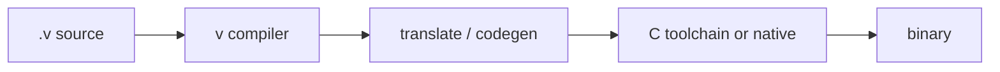

[Read This!](caveatemptor.md) | | [Quick Links](quicklinks.md) | [Algorithms](algorithms.md) | [AssemblyLanguage](assemblylanguage.md) | [BASH](bash.md) |   [C-Programmming](cprogramming.md) |
[CommonLisp](commonlisp.md) |
[Computer Security](computersecurity.md) |  [Databases](databases.md) | [Emacs](emacs.md) |  [Exploitation](exploitation.md) |
[Functional Programming](functional.md) |
[Firewalls](firewalls.md) |   [Git](git.md) | [Haskell](haskell.md) | [Javascript](javascript.md) | [Julia](julia.md) | [Social Engineering](internetexploitation.md) |
[Picolisp](picolisp.md) | [Pharo Smalltalk](pharo.md) |
[Linux](linux.md) |
[Python](python.md) |
[Operating Systems](os.md) |
[Machine Learning](machinelearning.md) | [Metasploit](metasploit.md) |  [Open Data Science](opendatascience.md) |
[Networking](networking.md) | [Machine Learning](machinelearning.md) | [Racket](racket.md) | [Scheme](scheme.md) |
[Unity](unity.md) | [vim](vim.md) | [V](vlang.md) |
[Web Development](webdevelopment.md) | [Windows WSL](windowswsl.md)

# The V Programming Language

Here is the truth about V: **it wants to be the language you can learn in a weekend and ship with on Monday – Go's simplicity, C's speed, Rust's safety goals, without the steepest parts of any of them.** Whether it fully delivers depends on what you need, but the ambition is clear and the tooling is pleasant.

### What it is, in plain words

**V** (vlang.io) is a statically typed, compiled language created by Alexander Medvednikov, publicly announced in 2019. It compiles to native code via C (or its own backends), emphasises fast compilation, and aims for a small, readable language surface:

- Go-like syntax and `defer`, but with generics, sum types and immutability by default;
- **no null** – `?Type` optionals instead;
- **no global state** by default (with escape hatches);
- a built-in formatter, tester, package manager and `v web` framework;
- C interop by design – you can `#include` and call C with little ceremony;
- a memory model that offers a GC, manual management, and growing autofree experiments.

V is still young (pre-1.0 for a long time, now maturing through 0.4.x). The compiler and stdlib move quickly; pin versions in real projects.

### Why it matters

There's a gap between "I want something simpler than Rust" and "I don't want Go's empty `interface{}` years". V aims at that gap, and its compile times are genuinely impressive. For CLI tools, small web services and people coming from scripting languages who want native binaries, it's worth a look alongside [Zig](ziglang.md), [Odin](odin.md) and Go.

### An everyday analogy: a well-labelled toolkit

Rust's toolkit comes with a lockout system and a thick manual. C's toolkit has unmarked sharp tools. V tries to be the toolkit where every tool is labelled, the dangerous ones have sheaths, and you can build a shelf before lunch.



### A hands-on example

```bash
# install via upstream instructions, then:
v version
mkdir hi && cd hi && v init
```

```v
module main

struct Machine {
    name string
    wm   string
mut:
    uptime_days int
}

fn (m Machine) describe() string {
    return '${m.name} runs ${m.wm}'
}

fn (mut m Machine) tick() {
    m.uptime_days++
}

fn safe_div(a f64, b f64) !f64 {
    if b == 0 {
        return error('division by zero')
    }
    return a / b
}

fn main() {
    mut box := Machine{
        name: 'vikix'
        wm: 'StumpWM'
        uptime_days: 12
    }
    box.tick()
    println(box.describe())

    nums := [3, 1, 4, 1, 5]
    squares := nums.map(it * it)
    println(squares)

    if x := safe_div(10, 4) {
        println(x)
    } else {
        println(err)
    }
}
```

```bash
v run .
v -prod .
```

`v fmt`, `v test`, `v install <module>` cover the everyday loop. `v up` updates the compiler.

### Where V feels good today

- Small CLI tools and scripts you'd rather ship as a single binary.
- Learning systems programming without C's full footgun kit.
- Wrapping C libraries quickly.
- Experiments with `v web` for modest HTTP services.

Where I'd pause: very large teams, ecosystems that need mature async story or heavy package depth, and anything that needs long-term API freezes. Match the language's age to the project's risk.

### Common misconceptions

- **"V is vapourware / lied about features."** Early marketing overpromised (especially autofree). The language today is real and usable; read current docs, not 2019 threads.
- **"It's just Go."** Similar readability goals; different type system (sum types, optionals), different memory story, different ecosystem.
- **"No GC means Rust-level safety."** V's safety model is simpler and still evolving. Don't assume what you haven't tested.
- **"It's ready to replace C everywhere."** For many tools, yes. For the Linux kernel, no. Match the tool to the job.
- **"The ecosystem is tiny."** Smaller than Go/Rust, growing; C interop fills many gaps.

### Connections

- [Zig](ziglang.md), [Odin](odin.md), [Rust](rust.md), [Go](https://go.dev) – the neighbourhood.
- [C Programming](cprogramming.md) – what V compiles through and interops with.
- [Web Development](webdevelopment.md) – `v web`.

## Variable

Variable are **immutable** by default

```
  x:= 100
```

use the ` mut ` keyword to make it mutable.

### Naming Convetions

- start with lower case
- no uppercase alphabet
- no special chars except _
- names can end in numbers or _
- use snake_case

Declare variable with ` := `, use ` = ` to reassign.

#### Parallel Declaration and Assignment

```
  a, b, c := 1, 2 3
    mut d, mut e := "hello" , "hi"
```

reassign with the same type only:

```
d, e = "what" , "who"
```
