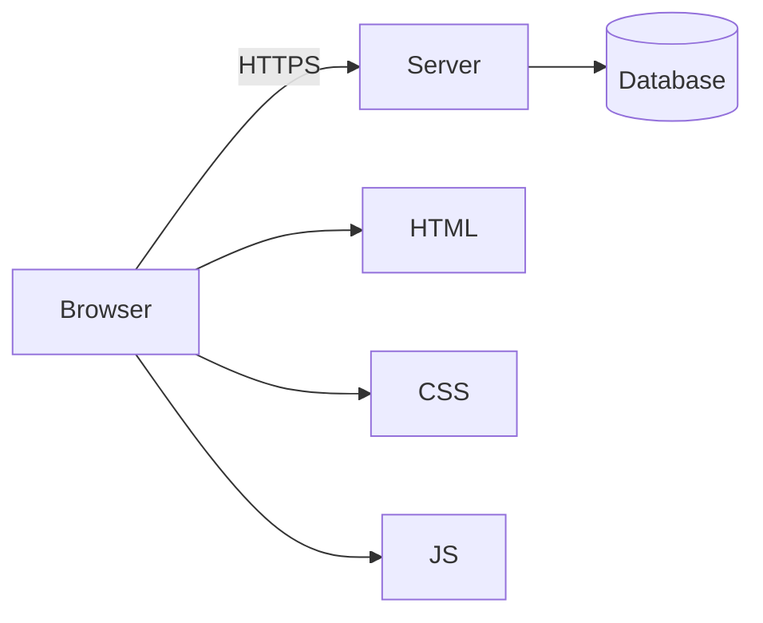

[Read This!](caveatemptor.md) |
  [Picolisp](picolisp.md) | [Picolisp Machine](pilmachine.md) | [Pil Sources](pilsource.md) | [Pil Tutorials](piltutorials.md) |
  [Linux](linux.md) | [BASH](bash.md) |
  [C-Programmming](cprogramming.md) | [Javascipt](javascript.md) | [Python](python.md) | [Scheme](scheme.md) |
  [Operating Systems](os.md) | [AssemblyLanguage](assemblylanguage.md) |
  [Computer Security](computersecurity.md) |
  [Firewalls](firewalls.md) |
  [Exploitation](exploitation.md) | [Social Engineering](internetexploitation.md) | [Metasploit](metasploit.md) |
  [Emacs](emacs.md) | [vim](vim.md) |
  [Pharo Smalltalk](pharo.md) |
  [Databases](databases.md) | [Networking](networking.md) | [Machine Learning](machinelearning.md) |
  [Git](git.md) |
  [Algorithms](algorithms.md) |
  [Open Data Science](opendatascience.md) |
  [Unity](unity.md) |
  [Web Development](webdevelopment.md) | [Web Development Reading List](webdevelopmentreadinglist.md)

# Web Development

Here is the truth about web development in 2026: **the web is still three languages in a trench coat – HTML, CSS and JavaScript – and everything else is tooling piled on to keep those three under control at scale.** Learn the three deeply; treat frameworks as temporary.

### What it is, in plain words

**Web development** is building applications that run in or talk to a browser. Conventionally:

- **Front end** – what runs in the browser (HTML structure, CSS presentation, JS behaviour).
- **Back end** – what runs on a server (HTTP APIs, databases, auth).
- **Full stack** – both, plus the glue (build tools, deploy, observability).

The browser speaks HTTP(S), renders a Document Object Model, and runs JS on an event loop. Everything fashionable – React, Svelte, HTMX, WASM – sits on that foundation.

### Why it matters

The web is the most widely deployed application runtime on Earth. A page you ship today runs on phones, laptops and kiosks without an install step. That reach is why so much software is now a website, and why understanding the platform beats chasing the framework of the month.

### An everyday analogy: a theatre

HTML is the script and the set pieces. CSS is lighting and costume. JavaScript is the actors reacting to the audience. The server is the backstage crew fetching props. Frameworks are touring companies with their own way of rehearsing – useful, but the play is still a play.



### A hands-on example: no framework first

```html
<!-- index.html -->
<!doctype html>
<html lang="en">
<meta charset="utf-8">
<title>Vikix status</title>
<link rel="stylesheet" href="style.css">
<h1>Vikix</h1>
<p>Uptime: <span id="days">…</span> days</p>
<button id="ping">Ping</button>
<script type="module" src="app.js"></script>
```

```css
/* style.css */
:root { font-family: system-ui, sans-serif; }
button { padding: 0.5rem 1rem; }
```

```js
// app.js
const days = document.querySelector("#days");
days.textContent = "12";
document.querySelector("#ping").addEventListener("click", async () => {
  const res = await fetch("/api/ping");
  const data = await res.json();
  days.textContent = data.uptimeDays;
});
```

A tiny Node server:

```js
// server.js
import http from "node:http";
import { readFile } from "node:fs/promises";
const server = http.createServer(async (req, res) => {
  if (req.url === "/api/ping") {
    res.writeHead(200, { "content-type": "application/json" });
    res.end(JSON.stringify({ uptimeDays: 12 }));
    return;
  }
  const path = req.url === "/" ? "./index.html" : `.${req.url}`;
  try {
    const body = await readFile(path);
    res.end(body);
  } catch {
    res.writeHead(404); res.end("nope");
  }
});
server.listen(3000, () => console.log("http://localhost:3000"));
```

```bash
node server.js
```

From here, add what pain demands: a bundler when modules grow, a framework when UI state gets hard, a real [database](databases.md) when memory isn't enough. HTMX and server-rendered HTML are a valid 2026 path too – especially if you like [PicoLisp](picolisp.md) or simple backends.

### The modern toolkit (pick lightly)

- **Languages** – HTML/CSS/JS; TypeScript if the app lives long; WASM for heavy compute.
- **UI** – vanilla, HTMX, React, Svelte, Solid – one is enough to learn well.
- **Back end** – [Node](nodejs.md), Python, Go, Rust, PicoLisp – speak HTTP clearly.
- **Data** – PostgreSQL first; Redis when you need a cache/queue.
- **Deploy** – a VPS with Caddy/nginx, or a small PaaS. HTTPS everywhere ([TLS](tls.md)).

### Accessibility and performance are features

A pretty UI that a screen reader can't use, or that waits five seconds for a megabyte of JavaScript, is an unfinished UI. Learn semantic HTML (`button` not `div onclick`), keep images sized, and measure with Lighthouse or WebPageTest. These skills age better than any framework release note.

### Common misconceptions

- **"I must start with React."** You must start with HTTP and the DOM. React is optional.
- **"SSR vs SPA is settled."** It isn't. Use SPA for app-like UI; server-render for content and simplicity.
- **"Web means JavaScript everywhere."** The browser runs JS (or WASM). The server can be anything.
- **"A website isn't a real program."** Tell that to the browser's process manager and the CDN that ships it.
- **"Look once, learn forever."** The platform evolves; the fundamentals (HTTP, HTML, CSS, JS event loop) age slowly.

### Connections

- [Javascript](javascript.md), [Node JS](nodejs.md), [JS pages](jsvariable.md).
- [Web Development Reading List](webdevelopmentreadinglist.md).
- [Securing Web Apps](securingwebapps.md), [TLS](tls.md), [Databases](databases.md).
- [PicoLisp](picolisp.md) – small web apps without a framework zoo.

## Run a Local Web Server

```
python3 -m http.server --bind 127.0.0.1 9000
```

### Bootstrap

[Bootstrap from Scratch - YouTube](https://www.youtube.com/watch?v=FvjPYx7K3UQ) 

### Links

- [Short, instructional screencast video tutorials for web developers on @eggheadio](https://egghead.io/)
- [Render · The Easiest Cloud For All Your Apps and Websites](https://render.com/)
- [Web Development Reading List](webdevelopmentreadinglist.md)
- [Color Picker](https://colorpicker.me/)
- [Traversy Media's Web Dev Tutorials](https://www.youtube.com/c/TraversyMedia?app=desktop)
