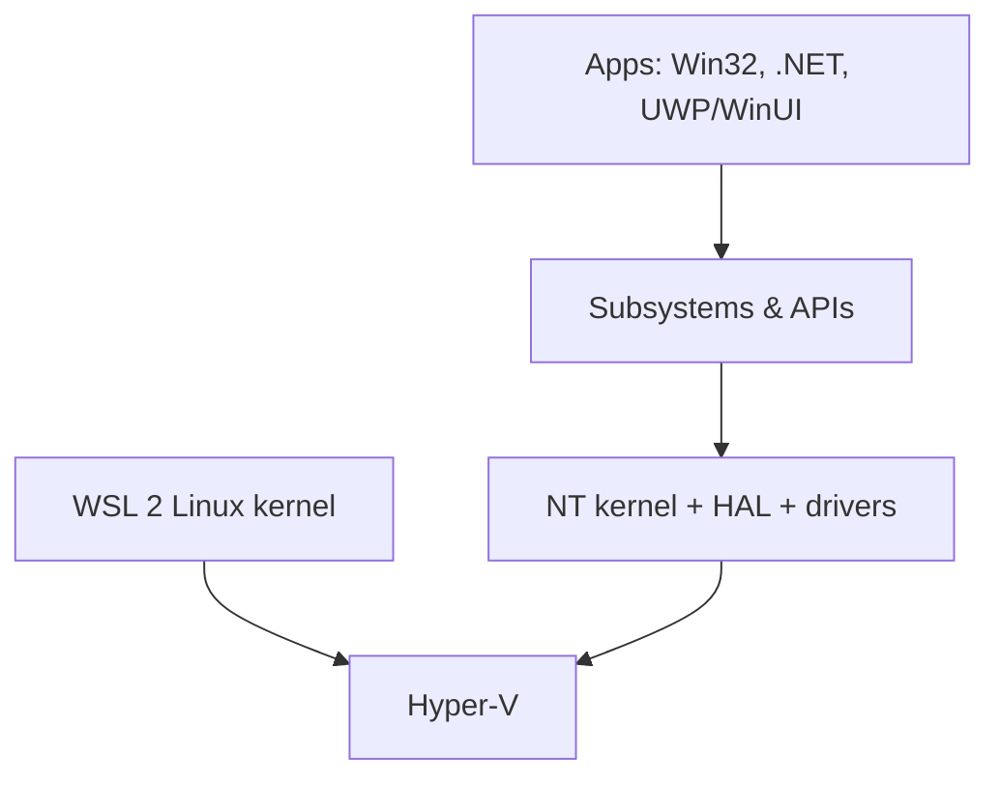

[Windows](windows.md) | [Windows WSL](windowswsl.md) | [Operating Systems](os.md)

# Windows

Here's the plain truth about Windows for someone who lives in Linux: **it's not the enemy, it's just a different set of assumptions.** Once you know where Windows keeps its equivalents of a shell, a package manager and a config file, you can be productive on it in an afternoon – and that's often all you need.

### What it is, in plain words

**Windows** is Microsoft's operating system, built on the **NT kernel** (the design that started with Windows NT in 1993; every version since XP uses it). In 2026 the current desktop release is **Windows 11**; Windows 10 reached end of support in October 2025, so unpatched Windows 10 machines are now a real security risk unless enrolled in paid extended updates.

A few structural differences from Linux worth knowing:

| Idea | Linux | Windows |
|------|-------|---------|
| Kernel | Linux (monolithic, modules) | NT (hybrid) |
| Paths | `/home/me/file` | `C:\Users\me\file` |
| Config | text files in `/etc`, `~/.config` | the **Registry**, plus files in `%AppData%` |
| Shell | Bash, Zsh, ... | **PowerShell**, cmd |
| Packages | xbps, pacman, apt | **winget**, Scoop, Chocolatey, MS Store |
| Services | runit, systemd | Service Control Manager (`services.msc`, `sc`) |
| Executables | ELF | PE (`.exe`, `.dll`) |
| Line endings | `\n` | `\r\n` |

### Why it matters

Windows still runs most of the world's desktops, nearly all office environments, and a huge number of games. Sooner or later you'll fix a relative's laptop, need a Windows-only tool, or work somewhere Windows is mandatory. Knowing the modern toolset means you're not reduced to clicking through dialog boxes – Windows today is far more scriptable and developer-friendly than its reputation.

### An everyday analogy: driving on the other side of the road

You already know how to drive. In a country that drives on the left, the pedals are the same, the rules are mostly the same, but the gear stick is on the other side and roundabouts go the other way. Give it a day of concentration and it becomes normal. Windows is a different side of the road, not a different vehicle.



### A hands-on example: a Linux user's Windows setup

The modern toolset is mostly built in. Open **Windows Terminal** (default terminal in Windows 11 – it replaces older third-party consoles like ConEmu and Cmder, which still exist but are no longer needed) and run **PowerShell 7**.

Install software with **winget** (preinstalled):

```powershell
winget search emacs
winget install --id GNU.Emacs -e
winget install --id Git.Git -e
winget install --id Microsoft.PowerShell -e   # PowerShell 7
winget upgrade --all                          # update everything
winget export -o apps.json                    # your "package list" dotfile
```

Get to know PowerShell – it passes **objects**, not text, between commands:

```powershell
Get-Process | Sort-Object CPU -Descending | Select-Object -First 5 Name, CPU, Id
Get-ChildItem C:\Users -Recurse -File -ErrorAction SilentlyContinue |
  Sort-Object Length -Descending | Select-Object -First 10 FullName, Length
Get-Service | Where-Object Status -eq 'Running'
Get-NetIPAddress -AddressFamily IPv4
```

Compare with Bash: there is no `awk '{print $3}'` step, because each result already has named properties.

Useful built-ins: **`sudo`** for Windows (added in Windows 11 24H2, enable it in Settings → System → For developers), **OpenSSH** client and server, `curl` and `tar`.

Want a real Linux userland too? That's [WSL](windowswsl.md).

### Tiling and keyboards

If you're used to StumpWM, the stock window snapping (Win+arrow, Snap Layouts) will feel limited. **PowerToys** (FancyZones, a launcher, keyboard remapping) helps; **GlazeWM** and **komorebi** are proper tiling window managers for Windows. KMonad and kanata run on Windows too, so your keyboard layout can follow you.

### Common misconceptions

- **"Windows has no command line."** PowerShell is a serious, object-based shell, and it's open source and cross-platform.
- **"You need admin for everything."** winget installs many apps per-user; Scoop installs everything per-user by design.
- **"Windows Defender isn't real security."** Microsoft Defender is a capable built-in antivirus; keeping Windows updated matters far more than adding third-party suites.
- **"Windows 10 is fine forever."** Support ended October 2025. No security patches means no safety online.
- **"Linux tools can't run on Windows."** Through WSL, MSYS2 or native ports, almost all of them can.

### Connections

- [Windows WSL](windowswsl.md) – Linux inside Windows.
- [Operating Systems](os.md) – how NT and Linux differ in theory.
- [Virtualization](virtualization.md) and [VirtualBox](virtualbox.md) – running one OS on another.
- [KMonad](kmonad.md) – a keyboard layout that travels with you.
- [Computing Freedom](computingfreedom.md) – why some of us still prefer free systems.

[Windows WSL](windowswsl.md)
[ConEmu Windows Terminal](https://conemu.github.io/en/TableOfContents.html)
[Cmder](https://cmder.app)
