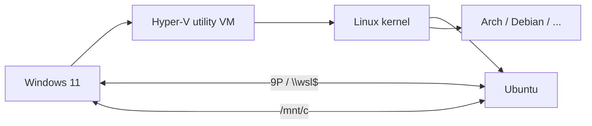

[Read This!](caveatemptor.md) | | [Quick Links](quicklinks.md) | [Algorithms](algorithms.md) | [AssemblyLanguage](assemblylanguage.md) | [BASH](bash.md) |   [C-Programmming](cprogramming.md) |
[Computer Security](computersecurity.md) |  [Databases](databases.md) | [Emacs](emacs.md) |  [Exploitation](exploitation.md) |
[Functional Programming](functional.md) |
[Firewalls](firewalls.md) |   [Git](git.md) | [Haskell](haskell.md) | [Javascipt](javascript.md) | [Julia](julia.md) | [Social Engineering](internetexploitation.md) |
[Picolisp](picolisp.md) | [Pharo Smalltalk](pharo.md) |
[Linux](linux.md) |
[Python](python.md) |
[Operating Systems](os.md) |
[Machine Learning](machinelearning.md) | [Metasploit](metasploit.md) |  [Open Data Science](opendatascience.md) |
[Networking](networking.md) | [Machine Learning](machinelearning.md) | [Racket](racket.md) | [Scheme](scheme.md) |
[Unity](unity.md) | [vim](vim.md) |
[Web Development](webdevelopment.md) | [Windows WSL](windowswsl.md)

# Working with Windows WSL

Here is the truth about WSL: **it isn't Linux "emulated" on Windows – it's a real Linux kernel running in a lightweight virtual machine, wired so tightly into Windows that it feels native.** Once you know that, its quirks (networking, file speed, memory) all make sense.

### What it is, in plain words

**WSL** – the Windows Subsystem for Linux – lets you run Linux distributions directly on Windows 10 and 11, with no dual booting. There are two generations:

- **WSL 1** (2016) translated Linux system calls into Windows ones. Clever, but incomplete and slow for file-heavy work.
- **WSL 2** (2019, now the default) runs a genuine Microsoft-maintained Linux kernel inside a small Hyper-V utility VM. Full system-call compatibility, Docker works, and Linux GUI apps work too through **WSLg** (Wayland and X11 windows appear on your Windows desktop).

Since 2022 WSL ships as an app from the Microsoft Store rather than as part of Windows, so it updates independently, and in 2025 Microsoft open-sourced most of it on GitHub. Recent versions support **systemd**, a **mirrored networking** mode, and automatic memory reclaim.

### Why it matters

Plenty of people have to use Windows for work but want a proper Unix toolchain: Bash, Git, compilers, Emacs, SSH, package managers. WSL gives you that in seconds, sharing files and the clipboard with Windows. It's also a gentle way for Windows users to try Linux before committing – a stepping stone towards running it for real, the way I run Void Linux on Vikix.

### An everyday analogy: a flat inside a house

Think of Windows as a house, and WSL 2 as a self-contained flat built inside it. The flat has its own kitchen and front door (its own kernel and filesystem), but it shares the house's electricity and plumbing (CPU, memory, network), and there's an internal door between them (`/mnt/c` one way, `\\wsl$` the other). Carrying things through that door is slower than moving them within one room.



All distros share one kernel and VM; each distro is a separate container-like environment inside it.

### A hands-on example

In an administrator PowerShell or Windows Terminal:

```powershell
wsl --install                  # installs WSL and Ubuntu by default
wsl --list --online            # distributions available
wsl --install -d Debian        # add another one
wsl -l -v                      # list installed distros and WSL version
wsl --set-default-version 2
wsl --update                   # update the WSL kernel/app
wsl --shutdown                 # stop all distros (frees memory)
```

Inside Linux, check what you're on:

```bash
uname -r          # ...-microsoft-standard-WSL2
cat /etc/os-release
hostname -I       # the VM's IP (in NAT mode)
```

From Windows, the same last check is `wsl hostname -I`.

Enable systemd in a distro by adding to `/etc/wsl.conf`:

```ini
[boot]
systemd=true
```

Tune the VM globally in `%UserProfile%\.wslconfig`:

```ini
[wsl2]
memory=8GB
processors=4
networkingMode=mirrored    # share Windows' network interfaces and localhost
[experimental]
autoMemoryReclaim=gradual
```

Then `wsl --shutdown` and start again.

Want a distro that isn't in the store – Void, for instance? Import a root filesystem tarball:

```powershell
wsl --import Void C:\WSL\Void .\void-x86_64-ROOTFS.tar.xz
wsl -d Void
```

### Speed tip: keep files on the right side

Accessing Windows files from Linux (`/mnt/c/...`) or Linux files from Windows goes across the VM boundary and is much slower. Keep your projects **inside** the Linux filesystem (`~/projects`) when you build with Linux tools. Editors like VS Code's WSL extension, or Emacs running inside WSL with WSLg, work there directly.

### Common misconceptions

- **"WSL is an emulator."** WSL 2 runs a real Linux kernel in a VM. Nothing is emulated.
- **"Each distro is its own VM."** One VM, one kernel, many distros.
- **"`localhost` always just works."** In the default NAT mode, Windows can reach Linux servers on `localhost`, but the reverse needs the host IP. Mirrored mode fixes that.
- **"WSL replaces a Linux install."** No direct hardware access (USB needs `usbipd-win`), no choice of init by default, and Windows sits underneath. It's a great tool, not a full replacement.
- **"WSL eats all my RAM."** The VM grows on demand; enable `autoMemoryReclaim` or cap it with `.wslconfig`.

### Connections

- [Windows](windows.md) – the host side.
- [Linux](linux.md) and [BASH](bash.md) – what you get inside.
- [Virtualization](virtualization.md) and [VirtualBox](virtualbox.md) – other ways to run Linux on another OS.
- [Git](git.md) – usually the first thing people install in WSL.

Check your WSL instances

```
C:> wsl -l -v
```

```
C:> wsl hostname -I
```

[Source](https://dev.to/agiboire/find-the-ip-address-of-your-wsl-instance-4kog)
