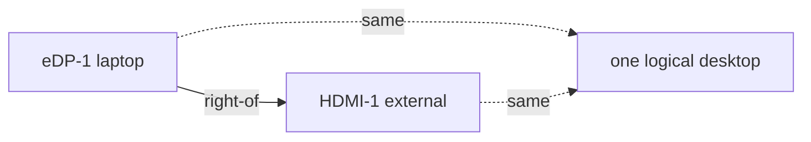

# xrandr

Here is the truth about multi-monitor Linux: **the compositor draws, but `xrandr` decides what exists to draw on.** One command can rearrange your whole desk – and a bad one can leave you staring at a black screen, so it's worth learning carefully.

### What it is, in plain words

**`xrandr`** (X Resize And Rotate) is the command-line tool for configuring displays under **X11**: resolution, refresh rate, rotation, and how multiple monitors sit relative to each other. It talks to the X server via the RandR extension. On a laptop it is how you enable an external monitor; on a desktop, how you arrange three screens into one desktop.

On **Wayland**, `xrandr` does not control the real displays – each compositor has its own tool (`wlr-randr` for wlroots, `gnome-randr` / Settings for GNOME, `kscreen-doctor` for KDE). If you run StumpWM, XMonad or most classic tiling WMs, you are on X11 and `xrandr` is your friend.

### Why it matters

Laptops move. Projectors appear. Docking stations rearrange everything. Being able to fix the layout in two seconds from a terminal – or from a StumpWM keybinding – is the difference between flow and fumbling through a GUI. Scripting `xrandr` also means your docked and undocked layouts can be one keypress each.

### An everyday analogy: rearranging picture frames

Each monitor is a picture frame on a wall. `xrandr` lets you move the frames left or right, hang one above another, or take one down. The painting inside (your windows) moves with the frame. Wayland compositors are walls with their own rules; X11 is the wall `xrandr` knows.



### A hands-on example

List what's connected:

```bash
xrandr
# eDP-1 connected 1920x1080+0+0 ...
# HDMI-1 connected 2560x1440+1920+0 ...
# DP-1 disconnected
```

Put an external monitor to the right of the laptop, at its preferred mode:

```bash
xrandr --output HDMI-1 --auto --right-of eDP-1
```

Common arrangements:

```bash
xrandr --output HDMI-1 --auto --left-of  eDP-1
xrandr --output HDMI-1 --auto --above    eDP-1
xrandr --output HDMI-1 --auto --same-as  eDP-1   # mirror
xrandr --output eDP-1  --off                     # lid closed, external only
xrandr --output HDMI-1 --mode 1920x1080 --rate 60
xrandr --output HDMI-1 --rotate left             # portrait
```

A "docked" script I bind in StumpWM:

```bash
#!/bin/sh
# ~/bin/dock.sh
xrandr --output eDP-1  --auto --pos 0x0 \
       --output HDMI-1 --auto --right-of eDP-1 --primary
```

```bash
#!/bin/sh
# ~/bin/undock.sh
xrandr --output HDMI-1 --off --output eDP-1 --auto --primary
```

```lisp
;; .stumpwmrc
(define-key *root-map* (kbd "d") "exec ~/bin/dock.sh")
(define-key *root-map* (kbd "u") "exec ~/bin/undock.sh")
```

If you ever set a bad mode and the screen goes dark: wait for the timeout, or switch to a virtual console with `Ctrl+Alt+F2`, log in, and run `xrandr --auto` against the X display (`DISPLAY=:0 xrandr --auto`).

### HiDPI and scaling

On a mixed laptop+4K desk, scales differ. Classic X11 has no per-monitor DPI scaling; people use:

- `xrandr --output HDMI-1 --scale 0.8x0.8` (blurry but simple);
- putting only the HiDPI screen at 2× (`Xft.dpi: 192` in `~/.Xresources`) and using a lower-resolution mode on the other;
- moving to a Wayland compositor with real per-monitor scaling.

Know the limitation before you buy a mixed-DPI setup for an X11 tiling WM.

### Finding output names and modelines

Laptop panels are often `eDP-1`, HDMI is `HDMI-1` or `HDMI-A-0` (AMD), DisplayPort `DP-1`. Names are stable per driver but not across machines – always check `xrandr` first.

If a monitor's preferred mode is missing (old EDID), you can add one:

```bash
cvt 1920 1080 60
xrandr --newmode "1920x1080_60.00" 173.00 1920 2048 2248 2576 1080 1083 1088 1120 -hsync +vsync
xrandr --addmode HDMI-1 "1920x1080_60.00"
xrandr --output HDMI-1 --mode "1920x1080_60.00"
```

Persist across boots with a startup script or an Xorg config snippet, not by retyping.

### Common misconceptions

- **"`xrandr` works on Wayland."** Only for XWayland apps' imaginary screen. Use the compositor's tool for real displays.
- **"`--auto` always picks the best mode."** It picks the preferred mode. Sometimes you want a lower one for bandwidth or refresh reasons.
- **"Turning an output off disables the hardware forever."** `--auto` brings it back.
- **"You need NVIDIA settings / GUI."** For layout, `xrandr` is enough on almost every driver, including NVIDIA's.
- **"Refresh rate doesn't matter."** On modern LCDs, 60 vs 144 Hz is obvious in daily use. Set it explicitly if auto gets it wrong.

### Connections

- [Build](bciyh.md) – Vikix / StumpWM desktop setup.
- [Linux Tools](linuxtools.md), [Simple Linux Configuration](simplelinuxconfig.md).
- [Keyboard Config](keyboardconfig.md) – the other half of making a desk yours.

# Find Connected Screen

```
xrandr -q | grep ' connected' | head -n 1 | cut -d ' ' -f1
```

## Changing Screen Brightness

```
xrandr --output SCREEN --brightness 0.6
```

for 60% brightness
[using xrandr and creating a small script](https://bbs.archlinux.org/viewtopic.php?id=134972)
[archwiki:Backlight](https://wiki.archlinux.org/title/Backlight)
