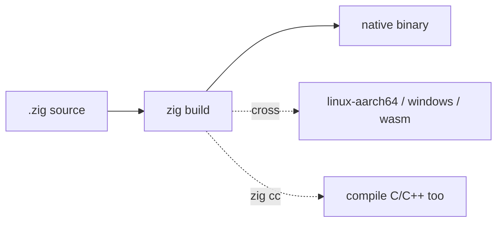

[Read This!](caveatemptor.md) | | [Quick Links](quicklinks.md) | [Algorithms](algorithms.md) | [AssemblyLanguage](assemblylanguage.md) | [BASH](bash.md) |   [C-Programmming](cprogramming.md) |
[CommonLisp](commonlisp.md) |
[Computer Security](computersecurity.md) |  [Databases](databases.md) | [Emacs](emacs.md) |  [Exploitation](exploitation.md) |
[Functional Programming](functional.md) |
[Firewalls](firewalls.md) |   [Git](git.md) | [Haskell](haskell.md) | [Javascript](javascript.md) | [Julia](julia.md) | [Social Engineering](internetexploitation.md) |
[Picolisp](picolisp.md) | [Pharo Smalltalk](pharo.md) | [Purescript](purescript.md) |
[Linux](linux.md) |
[Python](python.md) |
[Operating Systems](os.md) |
[Machine Learning](machinelearning.md) | [Metasploit](metasploit.md) |  [Open Data Science](opendatascience.md) |
[Networking](networking.md) | [Machine Learning](machinelearning.md) | [Racket](racket.md) | [Scheme](scheme.md) |
[Unity](unity.md) | [vim](vim.md) | [V](vlang.md) |
[Web Development](webdevelopment.md) | [Windows WSL](windowswsl.md) | [Zig](ziglang.md)

# Zig Language

Here is the truth Zig is aimed at: **C is still the lingua franca of systems, but its undefined behaviour, header files and build story are a tax everyone pays.** Zig keeps C's honesty about memory and lays that tax down.

### What it is, in plain words

**Zig** is a general-purpose systems language created by Andrew Kelley, first appearing around 2016, still pre-1.0 (the 0.13/0.14 line in 2025–2026) but already used in real tools – including the [ncdu 2](ncdu.md) rewrite and parts of Bun's toolchain. Its pitch:

- **No hidden control flow** – no exceptions, no invisible allocations, no overloaded operators that surprise you.
- **Manual memory management** with explicit **allocators** passed as arguments (similar in spirit to [Odin](odin.md)).
- **First-class build system** – `build.zig` replaces make/cmake for most projects; the compiler can also act as a **cross-compiling C/C++ toolchain**.
- **`comptime`** – a large slice of the language runs at compile time, giving you generics and conditional compilation without a separate macro language.
- **Error sets** – errors are values; `try` and `catch` make handling them local and visible.
- **Optional pointers** (`?T`) instead of nullable-by-default.

Zig can compile C code, import C headers directly with `@cImport`, and link against C libraries with almost no glue – which makes it a practical "better C" migration path.

### Why it matters

If you write anything close to the metal – kernels, embedded, game engines, CLI tools, language runtimes – C and C++ still dominate, and their footguns still cause CVEs. Zig is one of the serious attempts (alongside [Rust](rust.md) and Odin) to keep the control and drop the undefined behaviour. Even if you never ship Zig, its compiler as a portable C toolchain is already useful.

### An everyday analogy: a transparent gearbox

C is a classic sports car: fast, direct, and if you miss a shift you blow the engine (undefined behaviour). Rust adds a gearbox with a lockout that won't let you miss a shift (the borrow checker). Zig keeps the manual gearbox but puts a clear cover on it and labels every cable – you still shift yourself, but you *see* every linkage and nothing moves unless you move it.



### A hands-on example

Install from the official tarball (distro packages often lag; Zig moves fast):

```bash
# example: unpack a release and put it on PATH
curl -L https://ziglang.org/download/0.13.0/zig-linux-x86_64-0.13.0.tar.xz | tar -xJ
export PATH="$PWD/zig-linux-x86_64-0.13.0:$PATH"
zig version
```

```zig
// hello.zig
const std = @import("std");

pub fn main() !void {
    const stdout = std.io.getStdOut().writer();
    try stdout.print("hello from {s}\n", .{"vikix"});

    var gpa = std.heap.GeneralPurposeAllocator(.{}){};
    defer _ = gpa.deinit();
    const allocator = gpa.allocator();

    var list = std.ArrayList(i32).init(allocator);
    defer list.deinit();
    try list.append(3);
    try list.append(1);
    try list.append(4);

    // comptime: this loop runs at compile time
    const squares = comptime blk: {
        var arr: [5]i32 = undefined;
        for (&arr, 0..) |*slot, i| slot.* = @intCast(i * i);
        break :blk arr;
    };
    try stdout.print("squares: {any}\n", .{squares});
    try stdout.print("list: {any}\n", .{list.items});
}
```

```bash
zig run hello.zig
zig build-exe hello.zig -O ReleaseFast
```

A tiny `build.zig` for a real project:

```zig
const std = @import("std");
pub fn build(b: *std.Build) void {
    const target = b.standardTargetOptions(.{});
    const optimize = b.standardOptimizeOption(.{});
    const exe = b.addExecutable(.{
        .name = "hello",
        .root_source_file = b.path("src/main.zig"),
        .target = target,
        .optimize = optimize,
    });
    b.installArtifact(exe);
}
```

```bash
zig build
zig build -Dtarget=aarch64-linux-gnu   # cross-compile, no extra toolchain
```

That last line is a Zig party trick: the same compiler produces binaries for other platforms without you installing a cross-GCC.

### Zig, C and Rust

| | C | Zig | Rust |
|---|---|---|---|
| Memory | manual | manual, explicit allocators | ownership, borrow checker |
| Safety | unchecked | bounds checks in safe modes; `unreachable` is loud | prevents most memory bugs at compile time |
| Build | make/cmake | built in | Cargo |
| C interop | – | best-in-class | good via `bindgen` |
| Errors | return codes | error sets, `try` | `Result`, `?` |

### Common misconceptions

- **"It's ready to replace C everywhere."** It's pre-1.0; expect breaking changes between releases. Pin your Zig version in CI.
- **"No hidden allocations means no heap."** You allocate – you just pass the allocator in, so you *see* it.
- **"Comptime is just macros."** It's the actual language running at compile time, with types and loops.
- **"Zig and Odin are the same."** Similar goals, different aesthetics and ecosystems. Try both.
- **"You need Cargo/npm for packages."** Zig's package story is still evolving (`zig fetch`); many projects vendor dependencies.

### Connections

- [C Programming](cprogramming.md) – the language Zig is in conversation with.
- [Rust](rust.md), [Odin](odin.md), [V](vlang.md) – neighbours.
- [ncdu](ncdu.md) – a widely used tool rewritten in Zig.
- [objdump](objdump.md) – inspect what `zig build` emits.

## Links

- [Zinglang Learn Zig](https://ziglang.org/learn/)
- [Ziglearn.org](https://ziglearn.org/chapter-1/)
- [Language Reference](https://ziglang.org/documentation/master/)
- [Zig Overview](https://ziglang.org/learn/overview/)
- [Why Zig?](https://ziglang.org/learn/why_zig_rust_d_cpp/)
- [Samples](https://ziglang.org/learn/samples/)
- [Tools](https://ziglang.org/learn/tools/)
