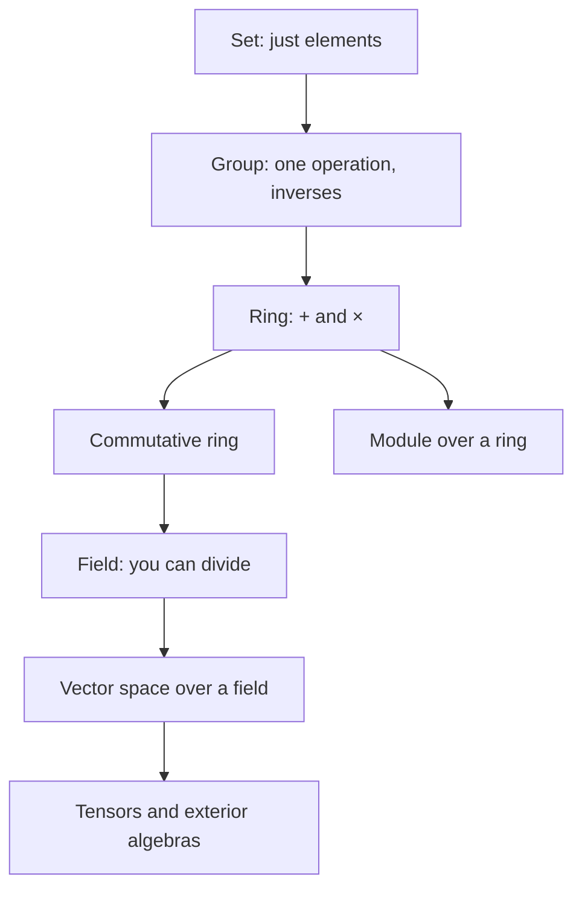

[Abstract Algebra](abstractalgebra.md) | [ZF Axioms](zf.md) | [Math](math.md)
[Set Theory](settheory.md) |
[Number Theory](numbertheory.md) |
[Groups](groups.md) |
[Quotient Groups](quotientgroups.md) |
[Rings](rings.md) |
[Commutative Rings](commutativerings.md) |
[Fields](fields.md) |
[Group Actions](group.md) |
[Modules](modulesalegbra.md) |
[Vector Spaces](vectorspaces.md) |
[Linear Operators and Matrices](linearoperators.md) |
[Inner Product Spaces](innerproductspaces.md) |
[Tensors](tensors.md) |
[Exterior Algebras](exterioralgebras.md) |
[Theory](galois.md "MISSING PAGE") |
[Polynomial Rings](multivariable.md "MISSING PAGE") |
[Category Theory](categorytheory.md) |

{.center}

# Abstract Algebra

To me, Algebra is a branch of Mathematics that deals with **symbols** and **the rules for manipulating those symbols**.
It really is the **foundation of all Mathematics** because it sets up and sets out the **written language of math**. Without algebra we
would have **no powerful method of communicating** our Mathematical ideas (to humans or computers)
and progress would essentially ground to a halt.

### The plain idea

School algebra is about solving for \(x\). Abstract algebra asks a bolder question: **what are the rules of the game itself?** Instead of working with particular numbers, it studies *operations* (ways of combining things) and the laws they obey: is order important, is there a "do nothing" element, can every move be undone? Any system that obeys a given list of laws gets a name, a *group*, a *ring*, a *field*, and every theorem about that name applies to every system that wears it.

### Why it matters

It is the great economy of modern mathematics. Prove something once about groups and you have proved it for clock arithmetic, for the symmetries of a crystal, for Rubik's cubes and for the particles of the Standard Model. Abstract algebra also explains *why* things are impossible: why there is no general formula for degree-five equations (Galois), why you can't trisect an angle with ruler and compass, and why some codes can correct errors and others can't. Today it is the working language of cryptography, coding theory, quantum physics and computer graphics.

### An everyday analogy: board games

Chess and draughts use the same board, but different rules make them different games. Abstract algebra is like studying games by their rules alone. Two games with identical rules are, for all practical purposes, the same game, whatever the pieces look like. Mathematicians call that being **isomorphic**.

### A worked example: one law, two worlds

Take the rule "every element has an inverse". Under ordinary addition of integers it holds: the inverse of \(5\) is \(-5\). Under multiplication of integers it fails: nothing whole times \(2\) gives \(1\). Allow fractions (the rationals without \(0\)) and it holds again: the inverse of \(2\) is \(\tfrac12\). So the *same set-like stuff* can be a group under one operation and not under another, and enlarging the set can repair a broken law. That is the whole history of number systems (negatives, fractions, complex numbers) seen through algebraic eyes: each new kind of number was invented to give some operation its missing inverses.

### The ladder of structures

Each step adds a law or an operation. Below, the main stops on the ladder, each with a link to its own page.

### [Set Theory](settheory.md)

The raw material. A set is a collection defined by its members and nothing else; everything below is a set with rules attached.

### [Number Theory](numbertheory.md)

The integers and primes, the oldest source of algebraic structure. Arithmetic modulo \(n\) is where groups and rings first become concrete.

### [Groups](groups.md)

One operation, with closure, associativity, an identity and inverses. The mathematics of doing and undoing, and the language of symmetry.

### [Quotient Groups](quotientgroups.md)

Squash a group by declaring some elements "the same" (a normal subgroup) and you get a smaller group. Clock arithmetic is the integers with multiples of 12 squashed to zero: \(\mathbb{Z}/12\mathbb{Z}\).

### [Rings](rings.md)

Two operations, addition and multiplication, linked by the distributive law \(a(b+c) = ab + ac\). The integers and the \(n \times n\) matrices are rings.

### [Commutative Rings](commutativerings.md)

Rings where \(ab = ba\). Integers and polynomials are commutative; matrices are not. Most of number theory and algebraic geometry lives here.

### [Fields](fields.md)

Commutative rings where every non-zero element can be divided by: the rationals, the reals, the complex numbers, and the finite fields \(\mathbb{Z}_p\) that power cryptography.

### [Group Actions](group.md)

A group *doing* something to another object, like the rotations of a square moving its corners. This is how groups touch the world.

### [Modules](modulesalegbra.md)

Vector spaces where the scalars come from a ring instead of a field. Losing division makes them wilder and richer.

### [Vector Spaces](vectorspaces.md)

Things you can add and scale by numbers from a field: arrows, polynomials, sound waves, quantum states. The setting of [Linear Algebra](linearalgebra.md).

### [Linear Operators and Matrices](linearoperators.md)

The structure-preserving maps between vector spaces. Matrices are their spreadsheets.

### [Inner Product Spaces](innerproductspaces.md)

Vector spaces with a way to measure lengths and angles, the dot product. Where geometry comes back into algebra.

### [Tensors](tensors.md)

Multi-linear objects that generalise vectors and matrices; the language of general [relativity](relativity.md) and of modern machine learning.

### [Exterior Algebras](exterioralgebras.md)

The algebra of oriented areas and volumes, with the wedge product \(a \wedge b = -\,b \wedge a\). Determinants and differential forms live here.

### [Theory](galois.md "MISSING PAGE")

Galois theory links the symmetries (a group) of the roots of a polynomial to the fields those roots generate. It proves there is no general formula in radicals for degree five and above.

### [Polynomial Rings](multivariable.md "MISSING PAGE")

Polynomials like \(x^2 y - 3z\) form a commutative ring. Studying their solution sets is algebraic geometry.

### [Category Theory](categorytheory.md)

Step back and look at all these structures and the maps between them at once: [category theory](categorytheory.md).

### Common misconceptions

- **"Abstract algebra is harder algebra."** It is different algebra. The calculations are often easier; the shift is in what you are paying attention to.
- **"Commutativity is normal."** In most interesting structures (matrices, rotations, symmetries) order matters.
- **"These definitions are arbitrary."** Each was distilled from many examples that kept behaving the same way. The axioms are the pattern, written down.

### How it connects

Down to [Set Theory](settheory.md) and the [ZF Axioms](zf.md); sideways to [Number Theory](numbertheory.md) and [Linear Algebra](linearalgebra.md); up to [Category Theory](categorytheory.md); and out to physics, where symmetry groups organise [Quantum Mechanics](qm.md).

The truth revealed: algebra is not about \(x\). It is about the rules, and the rules turn out to be the same in places you would never expect.
