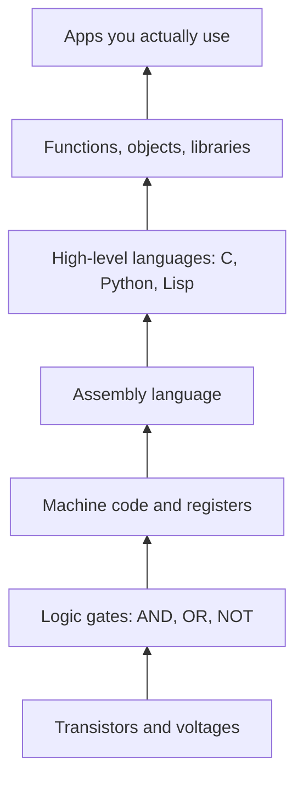

[Abstract Algebra](abstractalgebra.md) | [ZF Axioms](zf.md) | [Math on Computers](mathoncomputers.md) | [Computing](computing.md)

abstract

# viKid Abstraction

What is **Abstraction**?

Abstraction is at the heart of both Mathematics and Computer Science.

In fact I believe both Mathematics and Computer Science are the embodiment of forms of Abstraction.

I will save you from technical definitions, you can find that with a cursory [search](http://startpage.com) or at the
links at the bottom of the page.

What I want to discuss here is more philosophical and I think we can begin to look at the subject from,

- [Epistemological](epistemology.md "MISSING PAGE"),
- [Ontological](ontology.md "MISSING PAGE")
- [Pragmatic](pragmatism.md "MISSING PAGE")
- [Ethical](ethics.md)

points of view.

### The plain idea

To abstract is to **throw information away on purpose**. You look at a pile of particular things, decide which details don't matter for the question you are asking, and keep only the pattern that is left. The word itself comes from the Latin *abs-trahere*, "to drag away". You drag away the irrelevant until only the relevant is standing there.

That sounds like a loss, and it is. But it is the most profitable loss in human thought. What you lose in detail you gain in **reach**: the pattern you kept now applies to every situation that shares it, including ones you have never seen.

### Why it matters

Every time you use a word you are abstracting. "Dog" covers a chihuahua and a wolfhound, two animals that have almost nothing in common except the thing the word points at. Without abstraction we would need a separate name for every single object, and we could never learn anything that transfers from one case to the next.

From the four points of view above:

- **Epistemologically**, abstraction is how we *know* anything general at all. Experience hands us particulars; knowledge is made of patterns.
- **[Ontologically](ontology.md)**, it raises the old question of whether the pattern is *real*. Is "three" out there in the world, or only in our heads? Plato said the forms are more real than the things; nominalists say there are only things and names. Mathematics forces you to take a side, or at least to notice that there is one.
- **Pragmatically**, abstraction is a tool for managing complexity. You cannot hold a whole city in your head, but you can hold a map.
- **Ethically**, abstraction cuts both ways. Treating people as statistics lets a government plan a vaccine programme; it also lets a bureaucrat forget there are people behind the numbers. The map is not the territory, and it pays to remember what you dragged away.

### An everyday analogy: the London Tube map

Harry Beck's 1931 Underground map is wrong about almost everything. Distances are distorted, the river is a tidy curve, stations that are a five-minute walk apart look far away. And yet it is one of the most useful pictures ever drawn, because Beck threw away geography and kept only **connection**: which station follows which, and where you change lines. For a passenger, that is all that matters. A perfectly accurate map would be *worse* for the job.

That is abstraction in one picture: a deliberate simplification that becomes more useful *because* it is less detailed.

## Abstraction in Math

Mathematics is abstraction done in layers, each layer standing on the one below.

1. **Counting.** Three apples, three stones, three days. Drag away the apples, stones and days and you are left with *three*: the first great abstraction, a number.
2. **Algebra.** Notice that \(2 + 3 = 3 + 2\), and \(7 + 10 = 10 + 7\), and so on forever. Drag away the particular numbers and write \(a + b = b + a\). Now you are talking about *all* numbers at once.
3. **Structures.** Notice that adding numbers, composing rotations, and shuffling cards all obey the same four rules: closure, associativity, an identity and inverses. Drag away *what* is being combined and you get a [group](groups.md). Now you are talking about all *systems* that behave like that.
4. **Categories.** Notice that groups, sets, vector spaces and topological spaces all come with "structure-preserving maps" between them. Drag away what the objects are made of and keep only the arrows, and you get [category theory](categorytheory.md), sometimes affectionately called "general abstract nonsense".

#### A worked example

Take three facts:

- \(5 + 0 = 5\)
- \(5 \times 1 = 5\)
- rotating a square by \(0^\circ\) leaves it where it was.

Abstract them, and they are the same fact: *there is an element that does nothing*. Call it the identity \(e\), with \(e \cdot a = a\). Now prove one theorem about identities, for example that **a group has only one identity**:

$$ e = e \cdot e' = e' $$

The first step uses that \(e'\) is an identity, the second that \(e\) is. Two lines. And because we proved it in the abstract, it is now true for numbers, matrices, rotations, Rubik's cubes and any system nobody has invented yet. One proof, infinitely many payoffs. That is the whole bargain of mathematical abstraction.

## Abstraction in Computing

Computing is the same trick pointed at machines. A modern computer is billions of transistors switching on and off, and nobody could program it at that level. So we build a tower of abstractions:

Each layer hides the one beneath it. When you write a function `area(r)` you stop caring *how* it computes and care only *what* it promises. That promise is called an **interface**, and it is the programmer's version of the mathematician's axiom: a short list of rules that everything above is allowed to rely on.

The link between the two worlds is deeper than a resemblance. The lambda calculus, Alonzo Church's 1930s logic of functions, is *literally* both a piece of mathematics and the ancestor of Lisp and of [functional languages](haskell.md). In typed functional programming the Curry–Howard correspondence says that a type is a proposition and a program is a proof. Mathematics and computing are two dialects of one language of abstraction.

### Common misconceptions

- **"Abstract means vague."** The opposite. An abstraction is *more* precise than the thing it came from, because it states exactly which features count. "A group" is far sharper than "some kind of symmetry".
- **"Abstract means useless."** Group theory was abstract nonsense in 1830. Today it classifies elementary particles and secures your bank card through elliptic-curve cryptography.
- **"More abstract is always better."** An abstraction is only as good as the question it answers. Throw away the wrong details and you get a map that leads you off a cliff. Programmers call this a *leaky abstraction*: the hidden layer pokes through, as when a "simple" file copy fails because the disk is full.
- **"Abstractions are invented, so they are arbitrary."** We choose which ones to make, but once made, their consequences are not up to us. Nobody voted on whether there are infinitely many primes.

### How it connects

- Down to [Set Theory](settheory.md), which tries to build every abstraction out of one primitive idea, the set, and to the [ZF Axioms](zf.md) that pin it down.
- Across to [Abstract Algebra](abstractalgebra.md), the art of studying operations without caring what is being operated on.
- Up to [Category Theory](categorytheory.md), abstraction about abstractions.
- Out to [Computing](computing.md), where the same idea runs on silicon.

The truth revealed: abstraction is not running away from reality. It is choosing what to look at so that you can finally see it.

## Links, Sources & Further Reading

- [Abstraction (Stanford Encyclopedia of Philosophy entry on abstract objects)](https://plato.stanford.edu/entries/abstract-objects/)
- [Abstraction in computer science @ Wikipedia](https://en.wikipedia.org/wiki/Abstraction_(computer_science))
- Harold Abelson & Gerald Jay Sussman, *Structure and Interpretation of Computer Programs*, chapter 1, "Building Abstractions with Procedures"
- Eugenia Cheng, *The Joy of Abstraction* (2022), a gentle road into category theory

