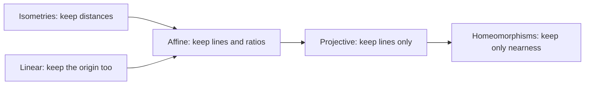

**An affine transformation** is any transformation that preserves:

- **collinearity** (i.e., all points lying on a line initially still lie on a line after transformation) and
- **ratios of distances**

That's the textbook line. Here's the truth behind it: **an affine transformation is a linear transformation that's allowed to move the origin.** Stretch, rotate, shear, flip, and then slide the whole picture somewhere else.

### The core idea, in plain words

A [linear map](linearoperators.md) must send the origin to the origin. That's too strict for everyday geometry: simply sliding a drawing two centimetres to the right isn't linear, because the origin moves. So we allow one extra term:

$$ T(\mathbf{x}) = A\mathbf{x} + \mathbf{b}, $$

where \(A\) is a matrix (the linear part) and \(\mathbf{b}\) is a fixed vector (the shift, or **translation**).

That's it. And the two promises at the top of the page follow:

- **Lines stay lines** (collinearity): the points \(\mathbf{p} + t\mathbf{d}\) go to \((A\mathbf{p} + \mathbf{b}) + t(A\mathbf{d})\), another line.
- **Ratios along a line survive**: the midpoint of a segment goes to the midpoint of the image segment. Parallel lines stay parallel.

What is *not* promised: lengths and angles. A shear turns squares into slanted parallelograms. (When lengths are kept too, it's called an **isometry**, the rigid motions, as on the [Topology](topology.md) page.)

### An everyday analogy: a projector on a wall

Put a slide in an old overhead projector. Adjust the zoom, rotate the slide, tilt the image sideways as a shear, and slide the whole thing across the wall. Straight lines on the slide stay straight on the wall, parallel lines stay parallel, and the middle of a line stays in the middle. That's affine. What an affine map *can't* do is the keystone effect you get when the projector points up at an angle, where parallel lines start to converge. That's a **projective** map, one level further out.

### A worked example: rotate about a point other than the origin

Rotate the plane 90° anticlockwise about the point \(\mathbf{c} = (2, 1)\). The trick: slide \(\mathbf{c}\) to the origin, rotate, slide back.

The rotation matrix is \(R = \begin{pmatrix} 0 & -1 \\ 1 & 0 \end{pmatrix}\). So

$$ T(\mathbf{x}) = R(\mathbf{x} - \mathbf{c}) + \mathbf{c} = R\mathbf{x} + (\mathbf{c} - R\mathbf{c}). $$

\(R\mathbf{c} = (-1, 2)\), so \(\mathbf{b} = (2, 1) - (-1, 2) = (3, -1)\) and

$$ T(x, y) = (-y + 3,\ x - 1). $$

Check: \(T(2, 1) = (2, 1)\). The centre stays put. ✔ And \(T(3, 1) = (2, 2)\): the point one step to the right of the centre swings to one step above it. ✔

Here's a beautiful trick computer graphics uses every frame. Write a point as \((x, y, 1)\), with an extra 1 on the end. Then the affine map becomes one \(3 \times 3\) matrix:

$$ \begin{pmatrix} 0 & -1 & 3 \\ 1 & 0 & -1 \\ 0 & 0 & 1 \end{pmatrix} \begin{pmatrix} x \\ y \\ 1 \end{pmatrix} = \begin{pmatrix} -y + 3 \\ x - 1 \\ 1 \end{pmatrix}. $$

Translation, which wasn't linear, has become linear one dimension up. Chaining moves is now just multiplying matrices.

### A picture in words: graph paper on a sliding rubber sheet

Draw a square grid on a rubber sheet pinned to a table. A linear map stretches and turns the sheet with the pin held fixed. An affine map lets you also pull the pin out and slide the whole sheet. Either way the grid stays a grid of identical parallelograms, every square becomes the same slanted shape, and the area of every one is scaled by \(|\det A|\).

### Common misconceptions

- **"\(f(x) = 2x + 3\) is linear."** It's affine. Its graph is a straight line, but \(f(0) \neq 0\) and \(f(1 + 1) \neq f(1) + f(1)\).
- **"Affine maps keep shapes."** They keep *lines* and *ratios along lines*, not angles or lengths. Circles become ellipses.
- **"Affine maps keep all ratios of distances."** Only ratios along the same line (or parallel lines). Under a stretch in one direction, two equal segments pointing different ways can end up different lengths.
- **"Composition of affine maps is messy."** It's another affine map: \(A_2(A_1\mathbf{x} + \mathbf{b}_1) + \mathbf{b}_2 = (A_2A_1)\mathbf{x} + (A_2\mathbf{b}_1 + \mathbf{b}_2)\). The invertible ones form a [Group](groups.md).

### How it connects

- **Down** to [Linear Operators and Matrices](linearoperators.md) and [Vector Spaces](vectorspaces.md): affine = linear + shift.
- **Sideways** to [Topology](topology.md), which keeps even less (only nearness), and to [Group Actions](group.md): the affine group acts on the plane.
- **Up** to [Inner Product Spaces](innerproductspaces.md), where the affine maps with orthogonal \(A\) are the rigid motions.
- **Out** to [Math on Computers](mathoncomputers.md): every game, map app and photo editor runs on \(3 \times 3\) and \(4 \times 4\) affine matrices.

The truth revealed: geometry without a fixed origin is still linear algebra. You just have to look one dimension higher.
