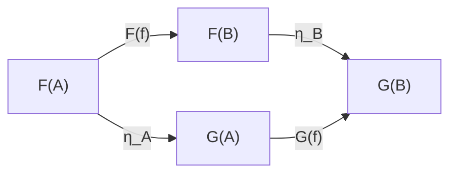

{.center}

# Category Theory

Category theory is abstract, about as abstract as mathematics gets.

It is the study of **systems of related objects**. The relations between the
objects under study are called **maps** (also **arrows** or **[morphisms](morphisms.md "MISSING PAGE")**)

**Maps bind Objects together** in a relationship.

Often Objects are Represented by Letters and Maps by Arrow, such as:

```
       f       g
   A  ---> B  -->  C
```

where we have objects A, B and C, and arrows f & g.

A and B are related through f & B and C are related through g.

Category theory born out of the studies in

[Algebraic Topology](algebraictopology.md "MISSING PAGE") was formulated precisely in the
**1940's** by
[Samuel Eilenberg](samueleilenberg.md "MISSING PAGE") & [Saunders Mac Lane](saundersmaclane.md "MISSING PAGE").

**Categories are themselves Objects.**

**Functors are maps between Categories.**

**Natural Transformations are maps between Functors.**

Often the term **Homomorphism** is used, I like to think of it as nothing more
than meaning a **general morphism**.

## Categories

A **category** \(\mathcal{C}\) is just three things:

1. a collection of **objects** \(A, B, C, \dots\);
2. for each pair of objects, a collection of **arrows** \(f : A \to B\);
3. a way to **compose** arrows that line up: given \(f : A \to B\) and \(g : B \to C\), there is \(g \circ f : A \to C\).

And only two rules:

- **Identity:** every object has a "do nothing" arrow \(1_A : A \to A\) with \(f \circ 1_A = f\) and \(1_B \circ f = f\).
- **Associativity:** \(h \circ (g \circ f) = (h \circ g) \circ f\).

That is the whole definition. If it reminds you of [groups](groups.md), good: a group is exactly a category with **one object** in which every arrow can be undone.

### The plain idea

Here is the truth behind the abstraction: **category theory says you know a thing by its relationships, not by its insides.** Set theory asks "what is this made of?" Category theory asks "how does this connect to everything else?"

It is the difference between describing a person by their DNA and describing them by who they talk to, work with and love. Both are true descriptions. The second one is often more useful.

### Why it matters

Mathematics in the 20th century split into many specialised fields, each with its own objects and its own "structure-preserving maps": functions between sets, homomorphisms between groups, linear maps between [vector spaces](vectorspaces.md), continuous maps between spaces. Eilenberg and Mac Lane noticed that the *same arguments* kept being repeated in each field. Category theory lets you make the argument once, at the level of arrows, and get every special case for free.

It has since leaked out of pure maths:

- In programming, Haskell's `Functor` and `Monad` come straight from category theory, and the idea of composing small functions into pipelines is categorical thinking.
- In physics, monoidal categories give a picture language for quantum processes.
- In science more widely, "applied category theory" is used to model databases, circuits and systems that plug together.

### An everyday analogy: plumbing

Think of objects as pipe fittings and arrows as lengths of pipe. You can join two pipes only if the end of the first matches the start of the second (composition needs matching ends). There is a zero-length connector that changes nothing (the identity). And if you join three pipes, it doesn't matter which joint you tighten first (associativity). Category theory is the study of what can be built from fittings and pipes, without ever asking what the pipes are made of.

### Some examples

| Category | Objects | Arrows |
|---|---|---|
| **Set** | sets | functions |
| **Grp** | groups | group homomorphisms |
| **Vect** | vector spaces | linear maps |
| **Top** | topological spaces | continuous maps |
| a preorder | elements \(x\) | one arrow \(x \to y\) whenever \(x \le y\) |

The last one is a surprise: any ordering is a category. Composition is just transitivity (if \(x \le y\) and \(y \le z\) then \(x \le z\)), and identity is reflexivity (\(x \le x\)). See [Transitivity](transitivityrelation.md) and [Reflexivity](reflexivityrelation.md): those relation properties are category axioms in disguise.

## Functors

A **functor** \(F : \mathcal{C} \to \mathcal{D}\) is a map between categories. It sends each object \(A\) to an object \(F(A)\), and each arrow \(f : A \to B\) to an arrow \(F(f) : F(A) \to F(B)\), while respecting the structure:

$$ F(g \circ f) = F(g) \circ F(f), \qquad F(1_A) = 1_{F(A)} $$

### A worked example: the "list" functor

Let \(\mathcal{C}\) be the category **Set**. Define \(L(A)\) to be the set of finite lists of elements of \(A\). Given a function \(f : A \to B\), define \(L(f)\) to apply \(f\) to every entry:

$$ L(f)([a_1, a_2, a_3]) = [f(a_1), f(a_2), f(a_3)] $$

Check the rules with \(f(x) = x + 1\) and \(g(x) = 2x\) on whole numbers:

- \(L(g \circ f)([1,2]) = [g(f(1)), g(f(2))] = [4, 6]\)
- \(L(g)(L(f)([1,2])) = L(g)([2,3]) = [4, 6]\) ✔

Mapping twice is the same as mapping the composite once. Programmers write this as `map g . map f == map (g . f)`, and compilers use it to fuse two loops into one. That is a categorical law saving real CPU time.

## Natural Transformations

A **natural transformation** \(\eta : F \Rightarrow G\) between two functors \(F, G : \mathcal{C} \to \mathcal{D}\) picks, for each object \(A\), an arrow \(\eta_A : F(A) \to G(A)\), such that for every \(f : A \to B\) this square commutes:

$$ G(f) \circ \eta_A = \eta_B \circ F(f) $$



Example: "reverse a list" is a natural transformation from \(L\) to \(L\). Reversing and then adding one to every entry gives the same answer as adding one and then reversing. It works *uniformly*, without peeking at what the entries are. Mac Lane said category theory was invented precisely to define this word "natural".

## Common misconceptions

- **"Category theory is just notation."** It proves real theorems. The Yoneda lemma, for instance, makes precise the slogan above: an object is completely determined by the arrows into it.
- **"You need it before anything else."** No. It pays off once you already know two or three fields and want to see what they share.
- **"Arrows are functions."** Often, but not always. In a preorder an arrow is just the fact \(x \le y\); there is nothing to "apply".
- **"It replaces set theory."** It can serve as an alternative foundation (Lawvere's ETCS, and homotopy type theory), but most working mathematicians use both.

## How it connects

- [Abstraction](abstraction.md): category theory is the top floor of the abstraction tower.
- [Groups](groups.md), [Group Actions](group.md), [Vector Spaces](vectorspaces.md) and [Linear Operators](linearoperators.md) are all categories, or objects living in them.
- [Set Relations](setrelations.md): every preorder is a small category.
- [Haskell](haskell.md): functors and monads in everyday code.

The truth revealed: stop staring at the thing. Look at its arrows.

## Further Reading

- Saunders Mac Lane, *Categories for the Working Mathematician* (1971, 2nd ed. 1998)
- Tom Leinster, *Basic Category Theory* (2014), free on arXiv
- Eugenia Cheng, *The Joy of Abstraction* (2022)
- Bartosz Milewski, *Category Theory for Programmers*
