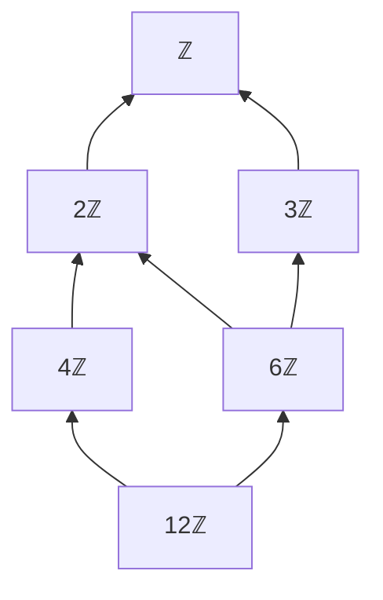

[Abstract Algebra](abstractalgebra.md) | [ZF Axioms](zf.md) | [Math](math.md)
[Set Theory](settheory.md) |
[Number Theory](numbertheory.md) |
[Groups](groups.md) |
[Quotient Groups](quotientgroups.md) |
[Rings](rings.md) |
[Commutative Rings](commutativerings.md) |
[Fields](fields.md) |
[Group Actions](group.md) |
[Modules](modulesalegbra.md) |
[Vector Spaces](vectorspaces.md) |
[Linear Operators and Matrices](linearoperators.md) |
[Inner Product Spaces](innerproductspaces.md) |
[Tensors](tensors.md) |
[Exterior Algebras](exterioralgebras.md) |
[Theory](galois.md "MISSING PAGE") |
[Polynomial Rings](multivariable.md "MISSING PAGE") |
[Category Theory](categorytheory.md) |

{.center}

# Commutative Rings

The truth about commutative rings is a simple one: **they are the rings where the order of multiplication doesn't matter, and that one small courtesy makes almost all of school algebra possible.**

Every time you expanded \((x + 1)^2\) into \(x^2 + 2x + 1\), you were quietly relying on it.

### The core idea, in plain words

A [ring](rings.md) has addition, subtraction and multiplication tied together by the distributive law. A **commutative ring** adds one rule:

$$ ab = ba \quad \text{for all } a, b. $$

That's it. The integers \(\mathbb{Z}\), the clock numbers \(\mathbb{Z}_n\), the polynomials \(\mathbb{R}[x]\) are all commutative. Matrices are not.

Why does one rule matter so much? Because now the familiar formulas work. In any ring \((a + b)^2 = a^2 + ab + ba + b^2\). Only when \(ab = ba\) does that collapse to \(a^2 + 2ab + b^2\). The binomial theorem, factoring, "collect like terms": all of it needs commutativity.

Once multiplication commutes, the interesting questions change. We stop worrying about order and start asking about **divisibility**:

- Does \(a\) divide \(b\)? (Is there a \(c\) with \(b = ac\)?)
- Are there **zero divisors**, non-zero \(a, b\) with \(ab = 0\)? If not, the ring is an **integral domain**.
- Which elements are **units**, the ones with a multiplicative undo?
- What are the **ideals**, the subsets that swallow multiplication?

### An everyday analogy: mixing paint

Mixing blue into yellow gives the same green as mixing yellow into blue. The order doesn't matter, only the ingredients. That's a commutative world. Now compare getting dressed: socks then shoes is not shoes then socks. That's the non-commutative world of matrices and rotations. Commutative algebra is the mathematics of paint pots, where all that counts is *what* went in and *how much*.

### A worked example: ideals in the integers

An **ideal** \(I\) in a commutative ring \(R\) is a subset that:

1. is closed under addition and negatives, and
2. **absorbs** multiplication: if \(a \in I\) and \(r \in R\), then \(ra \in I\).

Take the even numbers \(2\mathbb{Z} = \{\dots, -4, -2, 0, 2, 4, \dots\}\). Add two evens, you get an even. Multiply an even by *anything*, you get an even. So \(2\mathbb{Z}\) is an ideal. It's like a black hole: once you're inside, multiplication can't get you out.

Now the lovely part. Every ideal of \(\mathbb{Z}\) is of the form \(n\mathbb{Z}\), all multiples of one number. And:

- \(6\mathbb{Z} \subseteq 3\mathbb{Z}\) because 3 divides 6. **Bigger ideal means smaller number.** "Containing" is "dividing".
- The ideal generated by 4 and 6 together is \(2\mathbb{Z}\), and 2 is \(\gcd(4, 6)\). The greatest common divisor *is* an ideal.

Squash \(\mathbb{Z}\) by the ideal \(n\mathbb{Z}\) and you get the clock \(\mathbb{Z}_n\), exactly as with [Quotient Groups](quotientgroups.md). The deep fact:

$$ \mathbb{Z}/n\mathbb{Z} \text{ is a field} \iff n \text{ is prime.} $$

\(\mathbb{Z}_5\) has no zero divisors and every non-zero element has an inverse (\(2 \times 3 = 6 \equiv 1\), \(4 \times 4 = 16 \equiv 1\)). \(\mathbb{Z}_6\) has \(2 \times 3 = 0\). Primes are exactly the numbers that don't break.

### A picture in words: ideals as zoom levels

Imagine the integers laid out along a line. The ideal \(2\mathbb{Z}\) lights up every second point. \(4\mathbb{Z}\) lights up every fourth, a sparser pattern sitting *inside* the first. \(1\mathbb{Z}\) lights up everything. Squashing by an ideal is like putting on glasses that can't tell lit points from each other: the integers curl up into a clock with \(n\) hours.

That's the divisor lattice of 12 drawn as ideals, each arrow meaning "sits inside". The prime ideals \(2\mathbb{Z}\) and \(3\mathbb{Z}\) are the ones just below the top. The **maximal** ideals, the ones you can't enlarge without swallowing everything, are exactly the ones whose quotient is a field.

### Common misconceptions

- **"Commutative means no surprises."** Not at all. \(\mathbb{Z}_6\) is commutative and still has \(2 \times 3 = 0\). Commutativity removes the order problem, not the zero-divisor problem.
- **"Unique factorisation always holds."** It holds in \(\mathbb{Z}\), but not everywhere. In the ring \(\mathbb{Z}[\sqrt{-5}]\), \(6 = 2 \times 3 = (1 + \sqrt{-5})(1 - \sqrt{-5})\), two genuinely different factorisations. This failure is what drove Kummer and Dedekind to invent ideals in the first place.
- **"An ideal is just a subring."** An ideal must absorb multiplication by *every* element of the ring. The integers sit inside the rationals as a subring, but \(\tfrac{1}{2} \times 1 = \tfrac{1}{2}\) is not an integer, so \(\mathbb{Z}\) is not an ideal of \(\mathbb{Q}\).
- **"Commutativity is a minor detail."** It's the dividing line between two entire subjects: commutative algebra (number theory, algebraic geometry) and non-commutative algebra (matrices, quantum mechanics).

### How it connects

- **Down** to [Rings](rings.md) and [Groups](groups.md): a commutative ring is a ring with one extra courtesy.
- **Sideways** to [Number Theory](numbertheory.md): gcds, primes and modular arithmetic are commutative-ring theory in work clothes.
- **Up** to [Multivariable Polynomial Rings](multivariablepolynomialrings.md), the commutative rings of geometry, and to [Fields](fields.md), where every non-zero element is a unit.
- **Out** to [Quantum Mechanics](qm.md), whose whole strangeness lives in the fact that position and momentum *don't* commute.

The truth revealed: when order stops mattering, the only question left is who divides whom.
