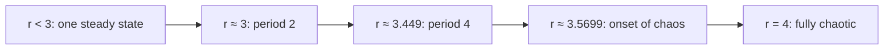

[Math](math.md) | [Physics](physics.md) | [Science](science.md)

# Dynamics

**Dynamics** is the study of **how systems change over time**. Dynamics Started as a formal
system of study with the works of Leibniz and Newton in the [17th Century](history.md).

### The plain idea

A dynamical system is two things: a **state** (everything you need to know about the system right now) and a **rule** that says how the state changes. Give the rule a starting state and it hands you the whole future. The state of a swinging pendulum is its angle and its speed; the rule is Newton's second law. The state of a rabbit population is the number of rabbits; the rule is births minus deaths.

That is the entire framework. What makes dynamics deep is how much variety comes out of such a small recipe: steady states, cycles, explosions, and chaos.

### Why it matters

Almost every law of nature is written as a dynamical rule. Planetary orbits, the spread of an epidemic, interest on a loan, the firing of a neuron, the weather, the climate, the price of an asset: all are "state plus rule". Dynamics is the part of [mathematics](math.md) that asks the honest follow-up question: *given the rule, what actually happens in the long run?*

The great 20th-century surprise was that a rule can be perfectly deterministic and still unpredictable in practice. That is chaos, and it changed what scientists mean by "prediction".

### An everyday analogy: a ball in a landscape

Picture a marble rolling on a hilly table. Valleys are **stable equilibria**: nudge the marble and it rolls back. Hilltops are **unstable equilibria**: the tiniest nudge and it is gone. A circular groove is a **limit cycle**: the marble goes round and round forever. Dynamics draws this landscape for a system so you can see its future at a glance, without solving every equation. Poincaré's great move in the 1890s was exactly this switch, from formulas to pictures.

## A Sketch on the History of Dynamics

- **17th Century**
- - **1666-1696** - Invention of Calculus - [Newton & Leibniz](https://en.wikipedia.org/wiki/Leibniz%E2%80%93Newton_calculus_controversy)
    - Major Developments in Calculus and Classical Mechanics
- **18th Century**
- - Analytical Works of Planetary Motion
- **19th Century**
- - **1890's** Poincare works on Geometric Approach
- **20th Century**
- - **Birkhoff**
    - **Kolmogrov**
    - **Arnol'd**
    - **Moser**
    - **Lorenz**
    - **Ruelle**
    - **Takens**
    - **May**
    - **Feigenbaum**
    - **Winfree**
    - **Mandelbrot**
- - [Ordinary Differential Equations](ode.md "MISSING PAGE") 
          the study of changes with respect to only 
           **one variable**, mostly **time**
    - [Partial Differential Equations](pde.md "MISSING PAGE") 
          the study of changes with respect to 
           **two or more variables**, mostly **time & space**

## A worked example: the logistic map

Let \(x_n\) be a population as a fraction of the maximum the environment can hold. A classic simple rule, popularised by the ecologist Robert May in 1976, is

$$ x_{n+1} = r\,x_n\,(1 - x_n) $$

The \(r x_n\) part is growth; the \((1 - x_n)\) part is crowding. Watch what the single knob \(r\) does, starting at \(x_0 = 0.5\):

- **\(r = 2.5\)**: \(0.5 \to 0.625 \to 0.586 \to 0.607 \to \dots\) settling on \(0.6\). One steady state. You can check it: a fixed point satisfies \(x = r x (1-x)\), so \(x^* = 1 - 1/r = 0.6\).
- **\(r = 3.2\)**: the population no longer settles; it flips between about \(0.513\) and \(0.799\) forever. A 2-cycle: boom year, bust year.
- **\(r = 3.5\)**: a 4-cycle. Then 8, 16, 32... the period doubles faster and faster.
- **\(r = 4\)**: chaos. Start at \(0.3\) and at \(0.3000001\): within about 25 steps the two runs bear no resemblance to each other.

Feigenbaum discovered in 1975 that the gaps between successive doublings shrink by the same ratio, about \(4.669\), in a huge range of systems, not just this one. A universal constant of chaos, hiding in a population model you can run on a pocket calculator.

## Continuous versus discrete

The logistic map moves in jumps: year 1, year 2. That is a **discrete** system, a *map*. Newton's planets move smoothly, so they are a **continuous** system, a *flow*, written with derivatives:

$$ \frac{dx}{dt} = f(x) $$

Lorenz's 1963 weather model is a flow in three variables, and it was the first chaotic system people really noticed. A one-dimensional smooth flow can never be chaotic (the trajectory can only go up or down a line), and by the Poincaré–Bendixson theorem neither can a two-dimensional one. You need at least three dimensions for a flow to become chaotic, which is why Lorenz's model has exactly three.

## Common misconceptions

- **"Chaos means random."** No. A chaotic system follows its rule exactly; the same start always gives the same future. What fails is *our* ability to know the start precisely enough.
- **"The butterfly effect means anything can cause anything."** It means small errors grow exponentially, so long-range forecasts degrade. Weather forecasts are good for days, not months, but climate averages can still be predicted, because they are a different question.
- **"Complex behaviour needs a complex rule."** The logistic map is one line of algebra.
- **"Dynamics is just differential equations."** Those are one tool. Modern dynamics is more about geometry: fixed points, attractors, stability and how they change as you turn a knob (bifurcations).

## How it connects

- [Physics](physics.md): classical mechanics, [Quantum Mechanics](qm.md) (the Schrödinger equation is a dynamical rule for the wavefunction) and [Relativity](relativity.md).
- [Linear Algebra](linearalgebra.md): near a fixed point, every smooth system looks linear, and the eigenvalues of that linear part decide whether the point is stable.
- [Climate](climate.md) science: climate models are enormous dynamical systems.
- [History](history.md): the story of Newton, Leibniz and Poincaré.

The truth revealed: a simple rule plus time is enough to produce order, rhythm or chaos. The future is written in the rule, but you may not be able to read it.

## Further Reading

- Steven Strogatz, *Nonlinear Dynamics and Chaos* (2nd ed. 2015), the best first textbook
- James Gleick, *Chaos: Making a New Science* (1987)
- Robert May, "Simple mathematical models with very complicated dynamics", *Nature* 261 (1976)
