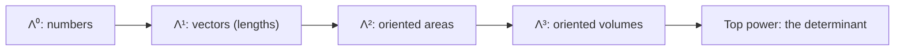

[Abstract Algebra](abstractalgebra.md) | [ZF Axioms](zf.md) | [Math](math.md)
[Set Theory](settheory.md) |
[Number Theory](numbertheory.md) |
[Groups](groups.md) |
[Quotient Groups](quotientgroups.md) |
[Rings](rings.md) |
[Commutative Rings](commutativerings.md) |
[Fields](fields.md) |
[Group Actions](group.md) |
[Modules](modulesalegbra.md) |
[Vector Spaces](vectorspaces.md) |
[Linear Operators and Matrices](linearoperators.md) |
[Inner Product Spaces](innerproductspaces.md) |
[Tensors](tensors.md) |
[Exterior Algebras](exterioralgebras.md) |
[Theory](galois.md "MISSING PAGE") |
[Polynomial Rings](multivariable.md "MISSING PAGE") |
[Category Theory](categorytheory.md) |

{.center}

# Exterior Algebras

The truth hiding behind this intimidating name is a lovely one: **exterior algebra is the algebra of oriented areas and volumes. It's what the determinant was secretly trying to be all along.**

### The core idea, in plain words

Take a [Vector Space](vectorspaces.md) \(V\). We invent a new product, the **wedge** \(u \wedge v\), which stands for the little parallelogram spanned by \(u\) and \(v\), with a direction of travel round its edge. The rules:

1. It's bilinear: \((au + bw) \wedge v = a(u \wedge v) + b(w \wedge v)\).
2. **It's antisymmetric:** \(u \wedge v = -\,v \wedge u\).
3. So, in particular, \(v \wedge v = 0\).

Rule 3 says a parallelogram made from one vector twice is squashed flat: zero area. Rule 2 says going round the parallelogram the other way flips the sign, like clockwise versus anticlockwise.

Wedge three vectors and you get an oriented parallelepiped, \(u \wedge v \wedge w\). In general the wedges of \(k\) vectors make up \(\Lambda^k V\), the "\(k\)-vectors". In an \(n\)-dimensional space, \(\Lambda^k V\) has dimension \(\binom{n}{k}\), and the top one, \(\Lambda^n V\), is 1-dimensional: just volumes, measured in one unit.

### An everyday analogy: a revolving door

A revolving door sweeps out area as it turns. What matters isn't the shape of the region but its **size and its sense of turning**. Push it one way and it sweeps "positive" area; push the other way and the same area counts as negative. Push it straight at the hinge, along itself, and it sweeps nothing. That's the wedge product: \(u \wedge v\) is the area swept by \(u\) moving along \(v\), with a sign for the direction, and \(v \wedge v = 0\).

### A worked example: discovering the determinant

In the plane, let \(e_1, e_2\) be the standard basis, and take \(u = a e_1 + b e_2\), \(v = c e_1 + d e_2\). Expand with the rules:

$$ u \wedge v = ac\,(e_1 \wedge e_1) + ad\,(e_1 \wedge e_2) + bc\,(e_2 \wedge e_1) + bd\,(e_2 \wedge e_2). $$

The first and last terms die (\(e_i \wedge e_i = 0\)), and \(e_2 \wedge e_1 = -\,e_1 \wedge e_2\). So

$$ u \wedge v = (ad - bc)\, e_1 \wedge e_2. $$

There it is: \(ad - bc\), the determinant of \(\begin{pmatrix} a & c \\ b & d \end{pmatrix}\), falls out of three innocent rules. With numbers, \(u = (3, 1)\), \(v = (1, 2)\) gives \(3 \cdot 2 - 1 \cdot 1 = 5\): the parallelogram has area 5, oriented anticlockwise. Swap them and get \(-5\).

This is the real definition of the determinant: a [Linear Operator](linearoperators.md) \(T\) on an \(n\)-dimensional space acts on the one-dimensional space \(\Lambda^n V\), and it can only do so by multiplying by a number. **That number is \(\det T\).** It's why \(\det(ST) = \det S \cdot \det T\) without any messy calculation: stretching volumes by one factor then another multiplies the factors.

### A picture in words: the cross product unmasked

In 3D, \(\Lambda^2 V\) has dimension \(\binom{3}{2} = 3\), with basis \(e_2 \wedge e_3,\ e_3 \wedge e_1,\ e_1 \wedge e_2\). Picture each little parallelogram as a tile, and stick a pin through it at right angles: the tile \(e_1 \wedge e_2\) gets the pin \(e_3\), and so on. That pin is the **cross product**. Picture \(u \times v\) as the arrow sticking out of the parallelogram \(u \wedge v\), as long as the area.

That's why the cross product only exists in three dimensions: only there does a plane have exactly one perpendicular direction. In 4D, \(\Lambda^2\) is 6-dimensional and there's no arrow to stand in for a plane. The wedge works everywhere; the cross product was a 3D coincidence.

### Common misconceptions

- **"The wedge is just the cross product."** The cross product is the wedge translated into an arrow, a trick available only in 3D with an inner product.
- **"Area is always positive."** Oriented area has a sign. Throwing away the sign throws away the information about handedness, which is exactly what flips under a mirror.
- **"\(u \wedge v = 0\) means one of them is zero."** It means they're parallel: \(u\) and \(2u\) span no area.
- **"Exterior algebra is just tensors."** It's the *antisymmetric* part of [Tensors](tensors.md): you take tensor products and then insist that swapping two neighbours flips the sign.

### How it connects

- **Down** to [Vector Spaces](vectorspaces.md) and [Linear Operators and Matrices](linearoperators.md): the determinant is the action on the top exterior power.
- **Sideways** to [Tensors](tensors.md), of which exterior powers are a quotient, and [Inner Product Spaces](innerproductspaces.md), which turn areas into arrows.
- **Up** to differential forms, the language of modern calculus, where Stokes' theorem unifies Green's, Gauss's and the fundamental theorem of calculus.
- **Out** to [Quantum Mechanics](qm.md): electrons are fermions, and the antisymmetry \(u \wedge u = 0\) is the Pauli exclusion principle, which is why two electrons can't share a state, and so why chemistry exists.

The truth revealed: the determinant was never a formula. It's the volume of a wedge.
