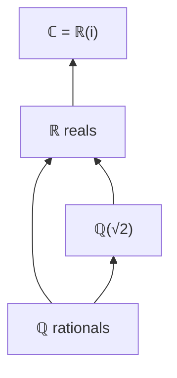

[Abstract Algebra](abstractalgebra.md) | [ZF Axioms](zf.md) | [Math](math.md)
[Set Theory](settheory.md) |
[Number Theory](numbertheory.md) |
[Groups](groups.md) |
[Quotient Groups](quotientgroups.md) |
[Rings](rings.md) |
[Commutative Rings](commutativerings.md) |
[Fields](fields.md) |
[Group Actions](group.md) |
[Modules](modulesalegbra.md) |
[Vector Spaces](vectorspaces.md) |
[Linear Operators and Matrices](linearoperators.md) |
[Inner Product Spaces](innerproductspaces.md) |
[Tensors](tensors.md) |
[Exterior Algebras](exterioralgebras.md) |
[Theory](galois.md "MISSING PAGE") |
[Polynomial Rings](multivariable.md "MISSING PAGE") |
[Category Theory](categorytheory.md) |

{.center}

# Fields

The truth about fields is the one I wish I had heard first: **a field is a number system where you can add, subtract, multiply and divide (by anything except zero) and never get thrown out.**

It's the arithmetic you thought you were doing all along. Groups, rings, commutative rings: every one of them was a step on the way here.

### The core idea, in plain words

A field is a [Commutative Ring](commutativerings.md) \(F\) with \(1 \neq 0\) in which **every non-zero element has a multiplicative inverse**: for each \(a \neq 0\) there is \(a^{-1}\) with \(a \cdot a^{-1} = 1\).

Put differently, a field is two [Groups](groups.md) glued together:

1. \((F, +)\) is an abelian group, with identity \(0\).
2. \((F \setminus \{0\}, \times)\) is an abelian group, with identity \(1\).
3. The distributive law \(a(b + c) = ab + ac\) ties them together.

The examples you know: the rationals \(\mathbb{Q}\), the reals \(\mathbb{R}\), the complex numbers \(\mathbb{C}\). The examples you might not: the finite clocks \(\mathbb{Z}_p\) for \(p\) prime. The integers \(\mathbb{Z}\) are *not* a field, because \(2\) has no integer inverse.

A neat consequence: a field has **no zero divisors**. If \(ab = 0\) and \(a \neq 0\), multiply by \(a^{-1}\) to get \(b = 0\). The ability to divide forces the ability to cancel.

### An everyday analogy: sharing a pizza fairly

In the whole numbers you can't share 3 pizzas between 2 people evenly. Switch to fractions and suddenly you can: \(\tfrac{3}{2}\) each. A field is a world where **any fair-share question has an answer**: any amount can be split into any non-zero number of equal parts, and the parts are still in your world. The one exception is sharing among zero people, a question that doesn't even make sense.

### A worked example: arithmetic on a 5-hour clock

Take \(\mathbb{Z}_5 = \{0, 1, 2, 3, 4\}\), adding and multiplying then keeping the remainder after dividing by 5. Find all the inverses:

- \(1 \times 1 = 1\), so \(1^{-1} = 1\).
- \(2 \times 3 = 6 \equiv 1\), so \(2^{-1} = 3\) and \(3^{-1} = 2\).
- \(4 \times 4 = 16 \equiv 1\), so \(4^{-1} = 4\).

Every non-zero element has an inverse. ✔ \(\mathbb{Z}_5\) is a field.

Now solve an equation in it: \(3x + 4 = 2\).

$$ 3x = 2 - 4 = -2 \equiv 3, \qquad x = 3^{-1} \cdot 3 = 2 \cdot 3 = 6 \equiv 1. $$

Check: \(3 \cdot 1 + 4 = 7 \equiv 2\). ✔ Exactly the steps from school, done on a clock.

Compare \(\mathbb{Z}_6\): there \(2 \times 3 = 0\), and 2 has no inverse (its multiples are only 0, 2, 4). So \(\mathbb{Z}_n\) is a field **exactly when \(n\) is prime**. In fact every finite field has a prime-power number of elements, \(p^k\), and there is essentially one field of each such size.

### A picture in words: building \(\mathbb{C}\) from \(\mathbb{R}\)

Over the real numbers, \(x^2 + 1 = 0\) has no solution. So *invent* one. Take polynomials in \(x\) with real coefficients, and declare \(x^2 + 1 = 0\), which means squashing \(\mathbb{R}[x]\) by the ideal generated by \(x^2 + 1\), just as we squashed groups in [Quotient Groups](quotientgroups.md). Call the leftover \(x\) by the name \(i\). What you get is

$$ \mathbb{R}[x]/(x^2 + 1) \;\cong\; \mathbb{C} = \{\, a + bi \,\}. $$

Picture the real number line, and then a second line through zero at right angles to it. That plane is the new field, and multiplying by \(i\) rotates the plane by 90°. Every polynomial over \(\mathbb{C}\) has a root (the Fundamental Theorem of Algebra), so you'll never need to invent again.

Each arrow is a **field extension**: a bigger field containing a smaller one. The extension \(\mathbb{C} \supset \mathbb{R}\) has **degree 2** because every complex number is \(a \cdot 1 + b \cdot i\), two real coordinates. Here's the first hint of [Vector Spaces](vectorspaces.md): a bigger field is a vector space over a smaller one.

### Common misconceptions

- **"Division by zero is just forbidden by convention."** It's forced. In any ring \(0 \cdot a = 0\), so \(0 \cdot a = 1\) has no solution unless \(1 = 0\), and then the whole field collapses to one point.
- **"Fields are infinite."** \(\mathbb{Z}_2 = \{0, 1\}\) is a field, and it runs every computer: addition is XOR, multiplication is AND.
- **"In every field, \(1 + 1 \neq 0\)."** In \(\mathbb{Z}_2\), \(1 + 1 = 0\). The smallest number of 1s that add to 0 is the field's **characteristic**; for \(\mathbb{Q}, \mathbb{R}, \mathbb{C}\) it never happens and we say characteristic 0.
- **"Real numbers are the 'complete' field."** \(\mathbb{R}\) is complete for limits, but not algebraically: \(x^2 + 1\) has no real root. Different kinds of completeness, different fields.

### How it connects

- **Down** to [Rings](rings.md), [Commutative Rings](commutativerings.md) and [Groups](groups.md): a field is all of them at once, done perfectly.
- **Sideways** to [Multivariable Polynomial Rings](multivariablepolynomialrings.md): coefficients come from a field, and new fields are made by adjoining roots of polynomials.
- **Up** to [Vector Spaces](vectorspaces.md) (vectors scaled by elements of a field) and [Linear Algebra](linearalgebra.md), and to Galois theory, which uses groups of field symmetries to show why the quintic has no formula.
- **Out** to [Number Theory](numbertheory.md) and cryptography, which run on finite fields.

The truth revealed: a field is the place where every fair question of arithmetic has an answer.
