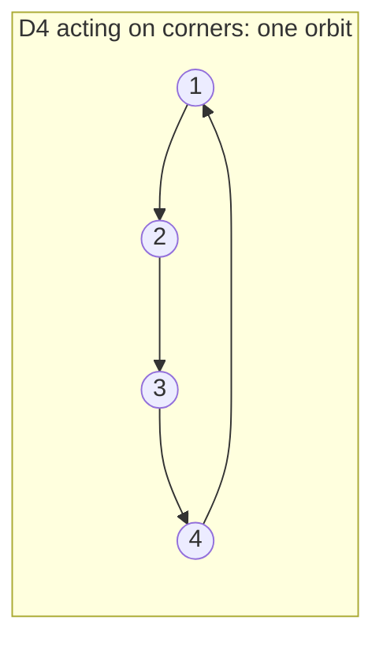

[Abstract Algebra](abstractalgebra.md) | [ZF Axioms](zf.md) | [Math](math.md)
[Set Theory](settheory.md) |
[Number Theory](numbertheory.md) |
[Groups](groups.md) |
[Quotient Groups](quotientgroups.md) |
[Rings](rings.md) |
[Commutative Rings](commutativerings.md) |
[Fields](fields.md) |
[Group Actions](group.md) |
[Modules](modulesalegbra.md) |
[Vector Spaces](vectorspaces.md) |
[Linear Operators and Matrices](linearoperators.md) |
[Inner Product Spaces](innerproductspaces.md) |
[Tensors](tensors.md) |
[Exterior Algebras](exterioralgebras.md) |
[Theory](galois.md "MISSING PAGE") |
[Polynomial Rings](multivariable.md "MISSING PAGE") |
[Category Theory](categorytheory.md) |

{.center}

# Group Actions

In [Groups](groups.md) I said a group is the mathematics of "doing and undoing". Here's the follow-up truth: **a group action is when those doings actually *do something to something*.**

A group on its own is a bag of abstract moves. An action lets the moves loose on a set (corners, colourings, points, solutions of an equation) and asks what happens to it.

### The core idea, in plain words

An **action** of a group \(G\) on a set \(X\) assigns to every \(g \in G\) and \(x \in X\) a point \(g \cdot x \in X\), such that

1. **Doing nothing does nothing:** \(e \cdot x = x\).
2. **Doing two things is doing their product:** \(g \cdot (h \cdot x) = (gh) \cdot x\).

From these, every \(g\) shuffles \(X\) without losing or merging points (its inverse undoes it), so an action is the same thing as a homomorphism from \(G\) into the permutations of \(X\).

Two questions you can ask about a point \(x\):

- **Orbit:** where can it go? \(\ \operatorname{Orb}(x) = \{\, g \cdot x : g \in G \,\}\).
- **Stabiliser:** which moves leave it put? \(\ \operatorname{Stab}(x) = \{\, g \in G : g \cdot x = x \,\}\). This is always a subgroup of \(G\).

And the headline result, the **orbit–stabiliser theorem** (for finite \(G\)):

$$ |G| = |\operatorname{Orb}(x)| \times |\operatorname{Stab}(x)| $$

More precisely, the orbit is in one-to-one correspondence with the cosets of the stabiliser, so \(|\operatorname{Orb}(x)| = [G : \operatorname{Stab}(x)]\).

### An everyday analogy: a carousel

The group is "rotate the carousel by some number of seats". The set is the riders. Your orbit is every seat you could end up in. Your stabiliser is the rotations that leave you exactly where you are: only "rotate by zero". Many moves, every one sends you somewhere different, so the number of moves equals the number of places you can reach. That's orbit–stabiliser with a stabiliser of size 1.

### A small worked example: the square's symmetries acting on its corners

Label the corners of a square 1, 2, 3, 4 going round. Its symmetry group \(D_4\) has 8 elements: 4 rotations (0°, 90°, 180°, 270°) and 4 reflections (2 diagonals, 2 through midpoints of opposite edges).

- **Orbit of corner 1:** rotations alone carry it to 1, 2, 3, 4. So \(|\operatorname{Orb}(1)| = 4\).
- **Stabiliser of corner 1:** the identity, and the reflection across the diagonal through corners 1 and 3. Nothing else keeps 1 fixed. So \(|\operatorname{Stab}(1)| = 2\).
- **Check:** \(4 \times 2 = 8 = |D_4|\). ✔

### A bigger one: rotating a cube

The rotations of a cube form a group of order 24. Let's *count* it without listing anything, using the action on the 8 vertices:

- Any vertex can be rotated to any other: orbit size \(8\).
- Rotations fixing a vertex are the turns about the long diagonal through it, by 0°, 120°, 240°: stabiliser size \(3\).

$$ |G| = 8 \times 3 = 24. $$

Do it again with faces (orbit 6; stabiliser = 4 quarter-turns about that face's axis): \(6 \times 4 = 24\). And with edges (orbit 12; stabiliser = identity and the 180° flip about the axis through that edge's midpoint): \(12 \times 2 = 24\). Three different counts, one answer. That's the theorem doing the arithmetic for you. (Include reflections too and you get the full symmetry group of order 48.)

### A picture in words

Imagine the set \(X\) as dots, and draw an arrow \(x \to g\cdot x\) for every move. The dots fall into **separate clusters**: within a cluster you can reach every dot, between clusters there are no arrows. Those clusters are the orbits. Because "is in the same orbit as" is an [equivalence relation](setrelations.md) (reflexive by the identity, symmetric by inverses, transitive by composition), the orbits **partition** \(X\).

(Arrows show the 90° rotation; it alone already links all four corners.)

### Common misconceptions

- **"The stabiliser is the set of points that don't move."** No: that's the *fixed-point set* of a move. The stabiliser is a set of *group elements* for a given *point*.
- **"Bigger orbit means bigger stabiliser."** The opposite: their product is fixed at \(|G|\), so they trade off.
- **"Points in the same orbit have the same stabiliser."** Same *size*, but generally different subgroups: they are conjugate, \(\operatorname{Stab}(g\cdot x) = g\,\operatorname{Stab}(x)\,g^{-1}\).
- **"Different group elements always act differently."** Not necessarily: an action need not be *faithful*. Let the cube's rotations act on its 3 pairs of opposite faces. The 180° turn about a face axis keeps every pair as a pair, so on this set it acts exactly like the identity.

### How it connects

- **Back** to [Groups](groups.md) (the square was secretly an action all along) and to [Quotient Groups](quotientgroups.md): the orbit of \(x\) matches the cosets \(G/\operatorname{Stab}(x)\).
- **Sideways** to [Set Relations](setrelations.md): orbits are equivalence classes.
- **Onward:** counting orbits gives Burnside's lemma (how many genuinely different necklaces?), Sylow theorems come from groups acting on themselves, and [Vector Spaces](vectorspaces.md) with a group acting linearly are *representations*, the language of symmetry in [Quantum Mechanics](qm.md).

The truth revealed: a group shows you what it *is* by what it *does*. Watch where a point can go and what holds it still, and the size of the whole group falls out.
