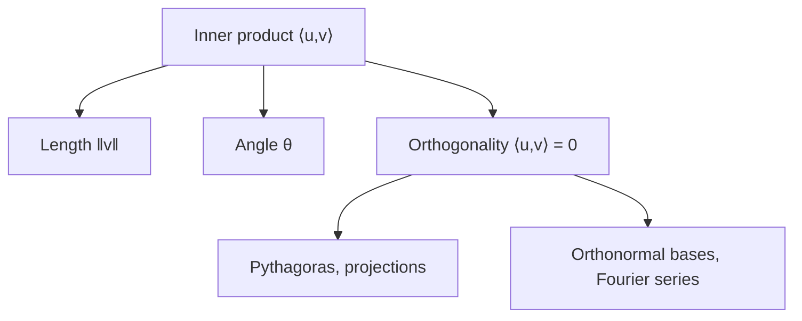

[Abstract Algebra](abstractalgebra.md) | [ZF Axioms](zf.md) | [Math](math.md)
[Set Theory](settheory.md) |
[Number Theory](numbertheory.md) |
[Groups](groups.md) |
[Quotient Groups](quotientgroups.md) |
[Rings](rings.md) |
[Commutative Rings](commutativerings.md) |
[Fields](fields.md) |
[Group Actions](groupactions.md "MISSING PAGE") |
[Modules](modulesalegbra.md) |
[Vector Spaces](vectorspaces.md) |
[Linear Operators and Matrices](linearoperators.md) |
[Inner Product Spaces](innerproductspaces.md) |
[Tensors](tensors.md) |
[Exterior Algebras](exterioralgebras.md) |
[Galois Theory](galois.md "MISSING PAGE") |
[Multivariable Polynomial Rings](multivariablepolynomialrings.md) |
[Category Theory](categorytheory.md) |

{.center}

# Inner Product Spaces

Here's the truth about inner products: **a plain vector space has no idea how long anything is or what angle two vectors make. An inner product is the ruler and protractor you hand it.**

Give a vector space that one extra tool, and geometry, from Pythagoras to quantum probability, comes flooding in.

### The core idea, in plain words

An **inner product** on a real [Vector Space](vectorspaces.md) \(V\) is a rule that takes two vectors and gives a number \(\langle u, v \rangle\), such that:

1. **Symmetric:** \(\langle u, v \rangle = \langle v, u \rangle\).
2. **Linear** in each slot: \(\langle au + bw, v \rangle = a\langle u, v \rangle + b\langle w, v \rangle\).
3. **Positive:** \(\langle v, v \rangle > 0\) for every \(v \neq \mathbf{0}\).

(Over the complex numbers, symmetry becomes \(\langle u, v \rangle = \overline{\langle v, u \rangle}\).)

From this one rule you get:

- **Length:** \(\|v\| = \sqrt{\langle v, v \rangle}\).
- **Angle:** \(\cos\theta = \dfrac{\langle u, v \rangle}{\|u\|\,\|v\|}\).
- **Perpendicular** (orthogonal): \(\langle u, v \rangle = 0\).

The everyday example is the dot product on \(\mathbb{R}^n\): \(\langle u, v \rangle = u_1v_1 + \dots + u_nv_n\).

### An everyday analogy: how much one push helps another

You're pushing a stalled car down a road. Your friend pushes at an angle. How much of their effort actually moves the car forward? Push straight along the road and all of it helps. Push sideways at right angles, and none of it does, however hard they try. The inner product measures exactly this: **how much one vector goes along with another.** Perpendicular vectors are completely independent efforts; they don't help or hinder each other at all.

### A worked example: Pythagoras, angles and projections

Take \(u = (3, 4)\) and \(v = (4, -3)\) in \(\mathbb{R}^2\).

- \(\langle u, v \rangle = 3 \cdot 4 + 4 \cdot (-3) = 0\). They are perpendicular.
- \(\|u\| = \sqrt{9 + 16} = 5\), and \(\|v\| = 5\).
- \(\|u + v\|^2 = \|(7, 1)\|^2 = 49 + 1 = 50 = 25 + 25 = \|u\|^2 + \|v\|^2\).

That last line is [Pythagoras](pythagoras.md), and in an inner product space it holds for *any* two orthogonal vectors, in any dimension, even for functions.

Now **projection**: how much of \(w = (2, 1)\) points along \(u\)?

$$ \operatorname{proj}_u w = \frac{\langle w, u \rangle}{\langle u, u \rangle}\, u = \frac{6 + 4}{25}(3, 4) = (1.2,\ 1.6). $$

The leftover \(w - \operatorname{proj}_u w = (0.8, -0.6)\) is perpendicular to \(u\) (check: \(2.4 - 2.4 = 0\)). Every vector splits uniquely into "the part along \(u\)" plus "the part perpendicular to \(u\)". Repeating that trick, the **Gram–Schmidt process** turns any basis into an **orthonormal** one, where every basis vector has length 1 and each is perpendicular to the others. In such a basis, coordinates are just inner products: the \(k\)-th coordinate of \(w\) is \(\langle w, e_k \rangle\).

### A picture in words: functions as vectors with angles

Here's where it gets wonderful. Take all continuous functions on \([-\pi, \pi]\) and define

$$ \langle f, g \rangle = \int_{-\pi}^{\pi} f(x)\,g(x)\,dx. $$

Then \(\langle \sin x, \cos x \rangle = 0\): sine and cosine are *perpendicular*. So are \(\sin x\) and \(\sin 2x\). Picture a sound wave as a single arrow in an infinite-dimensional space, and the pure tones \(\sin nx, \cos nx\) as perpendicular axes. Finding the Fourier coefficients of a sound, the strength of each pure tone in it, is just reading off its coordinates with inner products. Your music app's equaliser is doing projections.

### Common misconceptions

- **"Every vector space comes with a dot product."** No, it has to be chosen, and different choices give different geometries. Polynomials have no single "natural" one.
- **"Perpendicular means at 90° on paper."** It means \(\langle u, v \rangle = 0\) for the chosen inner product. Sine and cosine aren't "at right angles" on any graph, yet they are orthogonal.
- **"An inner product is a vector."** It's a number. (The cross product, which gives a vector, is a different beast that lives in [Exterior Algebras](exterioralgebras.md).)
- **"\(|\langle u, v \rangle|\) can exceed \(\|u\|\,\|v\|\)."** Never: that's the Cauchy–Schwarz inequality, and it's exactly why \(\cos\theta\) always lands between \(-1\) and \(1\).

### How it connects

- **Down** to [Vector Spaces](vectorspaces.md) and [Fields](fields.md): an inner product space is a vector space over \(\mathbb{R}\) or \(\mathbb{C}\) with one extra structure.
- **Sideways** to [Linear Operators and Matrices](linearoperators.md): the operators that preserve inner products are rotations and reflections (orthogonal and unitary), and symmetric operators always have a perpendicular basis of eigenvectors.
- **Up** to [Tensors](tensors.md): an inner product is the metric tensor, the thing that tells [Relativity](relativity.md) how to measure spacetime.
- **Out** to [Quantum Mechanics](qm.md): the probability of a measurement outcome is \(|\langle \phi, \psi \rangle|^2\), the squared overlap of two state vectors.

The truth revealed: geometry is not built into space. It's a choice of ruler, and the inner product is that choice.
