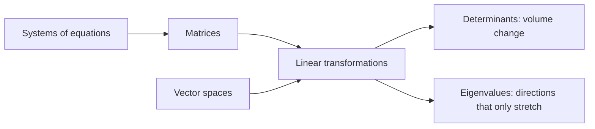

# Linear Algebra

Here is the one truth that ties every topic on this page together: **linear algebra is the study of things that can be added and scaled, and of the machines that respect adding and scaling.**

Straight lines, flat planes, arrows, sound waves, quantum states, the pixels in a photograph: the same handful of ideas runs through all of them.

### The core idea, in plain words

The word "linear" means one thing: a machine \(T\) is linear when

$$ T(u + v) = T(u) + T(v) \quad \text{and} \quad T(c\,u) = c\,T(u). $$

Double the input, double the output. Combine two inputs, and the output is the combination of the two outputs. No surprises, no curving, no thresholds.

Everything on the list below hangs off that sentence:

- **[Vectors](vectorspaces.md)** are the things that get added and scaled.
- **[Vector Spaces](vectorspaces.md)** are the worlds they live in, built over a [Field](fields.md) of scalars.
- **Linear transformations** are the machines, and **matrices** are how we write them down once we pick coordinates ([Linear Operators and Matrices](linearoperators.md)).
- **Systems of linear equations** ask: which input gives this output?
- **Determinants** measure how much a machine stretches area or volume.
- **Eigenvalues** find the directions a machine merely stretches without turning.

### An everyday analogy: a recipe calculator

A smoothie recipe calls for 2 bananas and 1 cup of milk per serving. The calorie count is linear: two servings have twice the calories, and a banana smoothie plus a strawberry smoothie have the sum of their calories. Your recipe book is a matrix: ingredients go in, nutrition comes out. And asking "how much of each fruit do I need to hit exactly 500 calories and 20 g of protein?" is a system of linear equations.

### A worked example: solving a system three ways

Solve

$$ \begin{aligned} x + 2y &= 5 \\ 3x + 4y &= 11 \end{aligned} $$

**As equations:** subtract 3 times the first from the second: \(-2y = -4\), so \(y = 2\) and \(x = 1\).

**As a matrix:** this is \(A\mathbf{v} = \mathbf{b}\) with

$$ A = \begin{pmatrix} 1 & 2 \\ 3 & 4 \end{pmatrix}, \quad \mathbf{b} = \begin{pmatrix} 5 \\ 11 \end{pmatrix}. $$

Its determinant is \(1 \cdot 4 - 2 \cdot 3 = -2 \neq 0\), which promises exactly one solution.

**As vectors:** we want \(x\) copies of the column \((1, 3)\) plus \(y\) copies of \((2, 4)\) to land on \((5, 11)\). Indeed \(1 \cdot (1,3) + 2 \cdot (2,4) = (5, 11)\). ✔

Three viewpoints, one answer. That's linear algebra in miniature: the same fact seen as equations, as a machine, and as a combination of arrows.

### A picture in words: the grid that stays a grid

Draw graph paper on a rubber sheet. A linear transformation stretches, rotates, shears or flips the sheet, but with three promises: the origin stays put, straight lines stay straight, and the evenly spaced grid lines stay evenly spaced and parallel. The squares may become slanted parallelograms. The determinant is the area of one of those parallelograms. If it's zero, the sheet has been squashed flat onto a line, and some information has been lost forever.

### Common misconceptions

- **"Linear means 'a straight line graph'."** The function \(f(x) = 2x + 3\) has a straight graph but is *not* linear in this sense: \(f(0) = 3\), and a linear map must send 0 to 0. It is **affine** (see [Affine Transformations](affinetransformation.md)).
- **"Vectors are arrows."** Arrows are one example. Polynomials, functions and signals are vectors too, because they can be added and scaled.
- **"A matrix *is* a transformation."** A matrix is a transformation *written in a chosen basis*. Change the basis and the same transformation gets a different matrix.
- **"Linear algebra is just computation."** The computation is the surface. Underneath is geometry, and underneath that is algebra: [Modules](modulesalegbra.md), [Groups](groups.md), [Fields](fields.md).

### How it connects

- **Down** to [Fields](fields.md) for scalars and [Groups](groups.md) for the addition of vectors.
- **Sideways** to [Modules](modulesalegbra.md), linear algebra over a ring instead of a field.
- **Up** to [Inner Product Spaces](innerproductspaces.md) (length and angle), [Tensors](tensors.md) and [Exterior Algebras](exterioralgebras.md) (multi-linear machines and volumes).
- **Out** to [Quantum Mechanics](qm.md), which is linear algebra on complex vector spaces, and [Relativity](relativity.md), which runs on tensors.

The truth revealed: wherever doubling the cause doubles the effect, linear algebra is already at work.

### Where to go next

The topic list below is the road map. If you're new, I'd walk it in this order: systems of equations first (they're the oldest and most concrete), then vectors and matrices, then [Vector Spaces](vectorspaces.md) as the abstract home for all of it, then linear transformations, determinants and eigenvalues. Representations, proofs and the reference pages come last, once the pictures in your head are solid.

### The topics

- [Systems of Linear Equations](systemsoflinearequations.md "MISSING PAGE")
- [Vectors](vectors.md "MISSING PAGE")
- [Matrices](matrices.md "MISSING PAGE")
- [VectorSpaces](vectorspaces.md)
- [Determinants](determinants.md "MISSING PAGE")
- [EigenValues](eigenvalues.md "MISSING PAGE")
- [LinearTransformations](lineartransformations.md "MISSING PAGE")
- [Representations](representations.md "MISSING PAGE")
- [Sets](sets.md "MISSING PAGE")
- [ComplexNumbers](complexnumbers.md "MISSING PAGE")
- [ProofTechniques](prooftechniques.md "MISSING PAGE")
- [Archetypes](archetypes.md "MISSING PAGE")
- [Definitions](definitions.md "MISSING PAGE")
- [Theorems](theorems.md "MISSING PAGE")
- [Notation](notation.md "MISSING PAGE")
