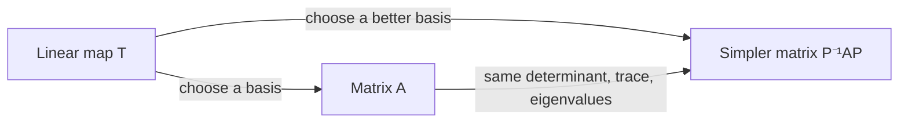

[Abstract Algebra](abstractalgebra.md) | [ZF Axioms](zf.md) | [Math](math.md)
[Set Theory](settheory.md) |
[Number Theory](numbertheory.md) |
[Groups](groups.md) |
[Quotient Groups](quotientgroups.md) |
[Rings](rings.md) |
[Commutative Rings](commutativerings.md) |
[Fields](fields.md) |
[Group Actions](groupactions.md "MISSING PAGE") |
[Modules](modulesalegbra.md) |
[Vector Spaces](vectorspaces.md) |
[Linear Operators and Matrices](linearoperators.md) |
[Inner Product Spaces](innerproductspaces.md) |
[Tensors](tensors.md) |
[Exterior Algebras](exterioralgebras.md) |
[Theory](galois.md "MISSING PAGE") |
[Polynomial Rings](multivariable.md "MISSING PAGE") |
[Category Theory](categorytheory.md) |

{.center}

# Linear Operators and Matrices

Here is the truth that finally made matrices make sense to me: **a matrix is not a box of numbers. It is a photograph of a machine, taken from one particular angle.**

The machine is the linear operator. The angle is your choice of basis. Change the angle and the photo changes, but the machine doesn't.

### The core idea, in plain words

A **linear map** \(T : V \to W\) between [Vector Spaces](vectorspaces.md) is a function that respects adding and scaling:

$$ T(u + v) = T(u) + T(v), \qquad T(c\,v) = c\,T(v). $$

When \(V = W\), so the machine feeds its output back into the same space, it's called a **linear operator**.

Here's the key fact. Because every vector is a combination of basis vectors, **a linear map is completely determined by what it does to a basis.** Choose a basis \(e_1, \dots, e_n\). Write \(T(e_1)\) in coordinates and make it the first column; write \(T(e_2)\) and make it the second column; and so on. That table is the **matrix** of \(T\).

Matrix multiplication isn't an arbitrary rule handed down from on high. It is exactly what you get when you run one machine after another: the matrix of "\(S\) after \(T\)" is \(ST\). And since "rotate then flip" differs from "flip then rotate", matrix multiplication is not commutative. Square matrices form a [Ring](rings.md), and the invertible ones form a [Group](groups.md).

### An everyday analogy: currency exchange

Think of a money changer converting a basket of currencies. Double the basket, double what you get back; combine two baskets, get the sum of what each would give. That's linear. The exchange-rate board is the matrix: each column says what one unit of a currency turns into. Now describe the same exchange using different currencies as your units and the board's numbers all change, yet the actual trade is the same. That's a **change of basis**.

### A worked example: a reflection, seen two ways

Let \(T\) reflect the plane across the line \(y = x\). It sends \((1, 0)\) to \((0, 1)\) and \((0, 1)\) to \((1, 0)\). Those images become the columns:

$$ A = \begin{pmatrix} 0 & 1 \\ 1 & 0 \end{pmatrix}. $$

Check: \(A \begin{pmatrix} 3 \\ 5 \end{pmatrix} = \begin{pmatrix} 5 \\ 3 \end{pmatrix}\). The point swapped sides of the mirror. ✔

Now look at the same reflection from a cleverer angle. Use the basis \(f_1 = (1, 1)\), which lies *on* the mirror, and \(f_2 = (1, -1)\), which is perpendicular to it. The reflection leaves \(f_1\) alone and flips \(f_2\): \(T(f_1) = f_1\), \(T(f_2) = -f_2\). In this basis the matrix is

$$ D = \begin{pmatrix} 1 & 0 \\ 0 & -1 \end{pmatrix}. $$

Same machine, much simpler photograph. The directions \(f_1\) and \(f_2\) are **eigenvectors**: \(T\) only stretches them, by the **eigenvalues** \(1\) and \(-1\). Finding such a basis is called **diagonalising**, and it's the single most useful trick in linear algebra. The two photos are related by \(D = P^{-1} A P\), where \(P\) has \(f_1, f_2\) as its columns.

Notice the things that didn't change: the determinant (\(-1\) both times, meaning area is kept but orientation flipped) and the trace (\(0\) both times). Quantities that survive a change of basis belong to the machine, not to the photograph.

### A picture in words: kernel and image

Picture a machine that projects 3D space flat onto the floor, like the sun casting shadows at noon. Every point lands on the floor: that floor is the **image** of the machine. Every point straight above the origin, the whole vertical line, lands on the origin: that line is the **kernel**, everything the machine crushes to zero.

The rank–nullity theorem says the dimensions always balance:

$$ \dim(\ker T) + \dim(\operatorname{im} T) = \dim V. $$

Here, \(1 + 2 = 3\). What's crushed plus what survives is everything you started with.

### Common misconceptions

- **"A matrix and a linear map are the same thing."** A matrix is the map *in coordinates*. Different bases, different matrices, same map.
- **"\(AB = BA\)."** Almost never. Rotate 90° then reflect is not reflect then rotate 90°.
- **"Every matrix can be diagonalised."** No. The shear \(\begin{pmatrix} 1 & 1 \\ 0 & 1 \end{pmatrix}\) has only one line of eigenvectors. Jordan normal form is the best you can do.
- **"A zero determinant means the matrix is zero."** It means the machine squashes space into a lower dimension and has a non-zero kernel, so it can't be undone.

### How it connects

- **Down** to [Vector Spaces](vectorspaces.md), [Rings](rings.md) (square matrices form one) and [Groups](groups.md) (invertible matrices form one).
- **Sideways** to [Modules](modulesalegbra.md): an operator turns its vector space into a module over the polynomial ring, and that's where Jordan form comes from.
- **Up** to [Inner Product Spaces](innerproductspaces.md), where special operators (symmetric, orthogonal, unitary) behave beautifully, and to [Tensors](tensors.md) and [Exterior Algebras](exterioralgebras.md), where the determinant gets its true meaning.
- **Out** to [Quantum Mechanics](qm.md): every measurable quantity is a linear operator, and the possible measurement results are its eigenvalues.

The truth revealed: don't stare at the numbers. Find the angle from which the machine looks simple.
