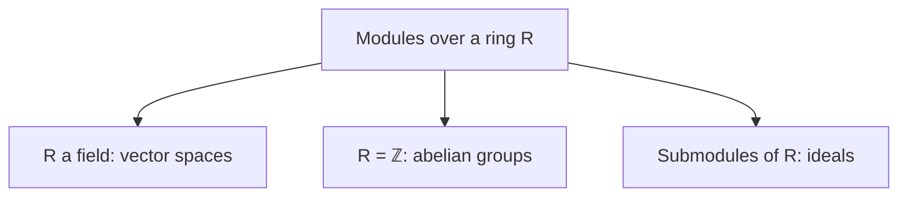

[Abstract Algebra](abstractalgebra.md) | [ZF Axioms](zf.md) | [Math](math.md)
[Set Theory](settheory.md) |
[Number Theory](numbertheory.md) |
[Groups](groups.md) |
[Quotient Groups](quotientgroups.md) |
[Rings](rings.md) |
[Commutative Rings](commutativerings.md) |
[Fields](fields.md) |
[Group Actions](group.md) |
[Modules](modulesalegbra.md) |
[Vector Spaces](vectorspaces.md) |
[Linear Operators and Matrices](linearoperators.md) |
[Inner Product Spaces](innerproductspaces.md) |
[Tensors](tensors.md) |
[Exterior Algebras](exterioralgebras.md) |
[Theory](galois.md "MISSING PAGE") |
[Polynomial Rings](multivariable.md "MISSING PAGE") |
[Category Theory](categorytheory.md) |

{.center}

# Modules

Here's a truth that tidied up half of algebra for me: **a module is a vector space where the scalars are only allowed to come from a ring, so you can scale but not always unscale.**

Change that one word, field to ring, and a surprising amount of new behaviour appears.

### The core idea, in plain words

Take a [Ring](rings.md) \(R\) (think of the integers \(\mathbb{Z}\)). An **\(R\)-module** is an abelian [Group](groups.md) \((M, +)\) together with a way to multiply elements of \(M\) by elements of \(R\), written \(r \cdot m\), such that for all \(r, s \in R\) and \(m, n \in M\):

1. \(r(m + n) = rm + rn\)
2. \((r + s)m = rm + sm\)
3. \((rs)m = r(sm)\)
4. \(1 \cdot m = m\)

If \(R\) is a [Field](fields.md), this is word for word the definition of a [Vector Space](vectorspaces.md). So modules generalise vector spaces. They also generalise abelian groups: every abelian group is automatically a \(\mathbb{Z}\)-module, with \(3 \cdot m\) meaning \(m + m + m\) and \((-2) \cdot m\) meaning \(-(m + m)\). And they generalise ideals: an ideal of \(R\) is just a module sitting inside \(R\) itself.

That's the beauty of it. Three ideas from three pages turn out to be one idea.

### An everyday analogy: buying in packs

Imagine a shop that only sells things in whole packs. You can buy 3 packs or 7 packs, you can return packs (negative amounts), but you can never buy half a pack. Your shopping basket is a module over \(\mathbb{Z}\): you can scale it by any whole number, but "divide the basket by 2" might have no answer. A vector space is a deli counter where you can ask for any amount by weight. A module is the packaged-goods aisle.

### A worked example: the 6-hour clock as a \(\mathbb{Z}\)-module

Take \(M = \mathbb{Z}_6 = \{0, 1, 2, 3, 4, 5\}\) under clock addition. As a \(\mathbb{Z}\)-module, \(n \cdot m\) means "add \(m\) to itself \(n\) times, mod 6".

- \(4 \cdot 5 = 20 \equiv 2\).
- \(6 \cdot m = 0\) for **every** \(m\). Something non-zero in the ring kills the whole module.

That never happens in a vector space: if \(c \neq 0\) is a scalar and \(cv = 0\), multiply by \(c^{-1}\) to get \(v = 0\). But in a module you can't divide, so non-zero scalars can kill non-zero elements. Such elements are called **torsion**.

Now try to find a **basis** of \(\mathbb{Z}_6\), a set of elements that every element is a unique combination of with integer coefficients. Try \(\{1\}\): every element is \(n \cdot 1\), but not uniquely, since \(0 \cdot 1 = 6 \cdot 1\). In fact \(\mathbb{Z}_6\) has **no basis at all**. Modules that do have a basis are called **free**, like \(\mathbb{Z}^2\) with basis \((1,0), (0,1)\). Every vector space is free. Most modules are not.

The crowning result for nice rings like \(\mathbb{Z}\) is the structure theorem: every finitely generated abelian group looks like

$$ \mathbb{Z}^r \oplus \mathbb{Z}_{n_1} \oplus \mathbb{Z}_{n_2} \oplus \dots \oplus \mathbb{Z}_{n_k} $$

a free part plus a torsion part. For instance \(\mathbb{Z}_6 \cong \mathbb{Z}_2 \oplus \mathbb{Z}_3\).

### A picture in words: a lattice in the plane

Picture the plane \(\mathbb{R}^2\), a vector space: you can stretch any arrow by any real amount. Now keep only the points with integer coordinates, a square grid of dots like an orchard. That's \(\mathbb{Z}^2\), a free \(\mathbb{Z}\)-module. You can add dots and scale by whole numbers, but halving the dot \((1, 1)\) lands you between the trees.

Now stand at the origin and choose a sub-orchard: only the dots \((a, b)\) with \(a\) and \(b\) both even. Squash the orchard by it, as in [Quotient Groups](quotientgroups.md), and what's left is four classes of dots: \(\mathbb{Z}_2 \oplus \mathbb{Z}_2\), a little torsion module.

### Common misconceptions

- **"Every module has a basis."** Only free ones. \(\mathbb{Z}_6\) and \(\mathbb{Q}\) (as \(\mathbb{Z}\)-modules) have none.
- **"Bases all have the same size, so dimension is always defined."** For free modules over commutative rings, yes. Over strange non-commutative rings, even that can fail.
- **"A subset that spans and is minimal is a basis."** In vector spaces, yes. In \(\mathbb{Z}\), the set \(\{2, 3\}\) spans (since \(3 - 2 = 1\)) and removing either element breaks it, yet it is not a basis, because \(3 \cdot 2 - 2 \cdot 3 = 0\) is a non-trivial relation.
- **"Modules are an exotic abstraction."** They are everywhere: a [Linear Operator](linearoperators.md) \(T\) on a vector space turns it into a module over the polynomial ring \(k[x]\), with \(x\) acting as \(T\). Jordan normal form is the structure theorem applied to that module.

### How it connects

- **Down** to [Rings](rings.md), [Commutative Rings](commutativerings.md) and [Groups](groups.md): a module is a ring acting on an abelian group, just as in [Group Actions](group.md) a group acts on a set.
- **Sideways** to [Fields](fields.md): over a field, every module is a free vector space.
- **Up** to [Vector Spaces](vectorspaces.md), [Linear Operators and Matrices](linearoperators.md) and [Tensors](tensors.md), where tensor products are defined for modules in general.
- **Out** to [Category Theory](categorytheory.md), whose early life was spent studying categories of modules.

The truth revealed: a vector space is a module that got lucky. Take away division, and you find out how much of linear algebra was luck.
