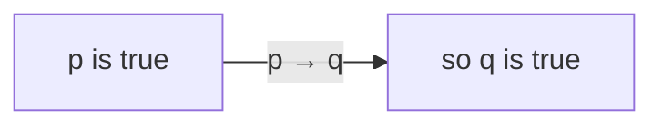

# Logic - Modus Ponens

[Everything Else](misc.md) | [Philosophy](philosophy.md) | [Logic](logic.md) | [Economics](economics.md) | [Politics](politics.md)
| [Ethics](ethics.md) | [Aesthetics](aesthetics.md "MISSING PAGE") | [Articles](articles.md)

- [Modus Ponens](modusponens.md)
- [Modus Tollens](modustolens.md)

**Modus Ponens is latin for "mode that affirms"**

```
     p→q
     p
    _____
   ∴ q
```

Modus ponens is the rule of reasoning we all use a hundred times a day without naming it. The truth: **it is the engine that turns an "if" into a "therefore".**

### The core idea, in plain words

If you know a conditional "if \(p\) then \(q\)" is true, and you know \(p\) is true, you may conclude \(q\).

$$ \frac{p \to q \qquad p}{\therefore\ q} $$

It is **valid**: there is no possible situation where both premises are true and the conclusion false. Check the truth table. The only row with \(p\) true and \(p \to q\) true is the row where \(q\) is true.

| \(p\) | \(q\) | \(p \to q\) |
|---|---|---|
| T | T | T ← both premises true, \(q\) true |
| T | F | F |
| F | T | T |
| F | F | T |

### An everyday analogy

"If it's raining, the pavement is wet. It's raining. So the pavement is wet." You didn't need to look outside at the pavement; the conditional plus the fact did the work.

### A small worked example

1. If \(n\) is divisible by 4, then \(n\) is even. (True for every integer.)
2. \(28\) is divisible by 4.
3. ∴ \(28\) is even.

Proofs are chains of exactly this: each step applies a known "if" to a known fact.

### A picture in words

Think of \(p \to q\) as a **one-way door** from room \(p\) to room \(q\). Modus ponens: you're standing in room \(p\), so you can walk into \(q\). Nothing about the door lets you walk *backwards*.



### The impostor: affirming the consequent

$$ \frac{p \to q \qquad q}{\therefore\ p} \quad \text{(INVALID)} $$

"If it's raining, the pavement is wet. The pavement is wet. So it's raining." Maybe someone washed their car. In the truth table, row 3 (\(p\) false, \(q\) true) has both premises true and the conclusion false. One counter-example row is enough to kill an argument form.

### Common misconceptions

- **"Valid means true."** Validity is about *form*. "If the moon is cheese, I'm a pilot. The moon is cheese. So I'm a pilot" is perfectly valid, but unsound, because a premise is false. **Sound** = valid + true premises.
- **"\(p \to q\) means \(p\) causes \(q\)."** Material implication only rules out "\(p\) true and \(q\) false". It says nothing about causes.
- **"If \(p\) is false, the conditional is false."** No: a conditional with a false antecedent is (vacuously) true. That's rows 3 and 4.

### How it connects

- Its mirror image is [Modus Tollens](modustolens.md): from \(p \to q\) and \(\neg q\), conclude \(\neg p\).
- Chaining conditionals (\(p \to q\), \(q \to r\), so \(p \to r\)) is the hypothetical syllogism, i.e. [transitivity](transitivityrelation.md) of implication.
- In formal systems, modus ponens is often the *only* inference rule; everything else is axioms. See [Logic](logic.md).

The truth revealed: "if" plus "it is so" gives "therefore". And "therefore" never flows backwards.

## Further Reading

- [Philosophers to Study](philosophers2study.md)
