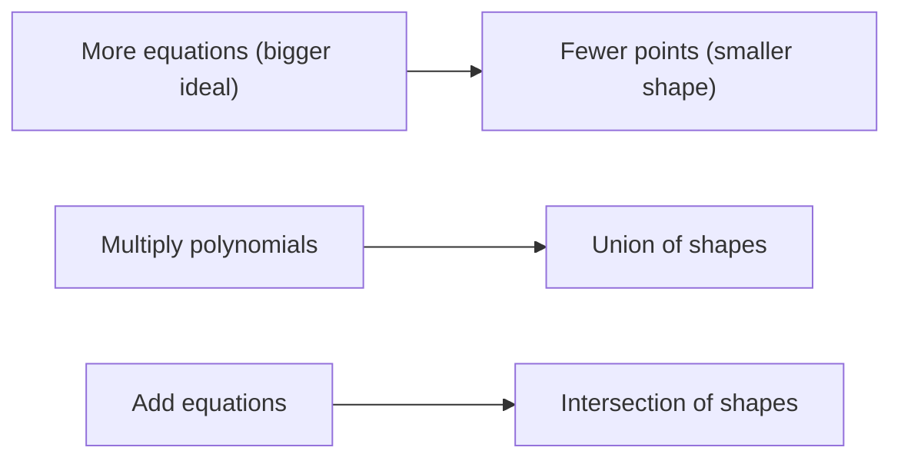

[Abstract Algebra](abstractalgebra.md) | [ZF Axioms](zf.md) | [Math](math.md)
[Set Theory](settheory.md) |
[Number Theory](numbertheory.md) |
[Groups](groups.md) |
[Quotient Groups](quotientgroups.md) |
[Rings](rings.md) |
[Commutative Rings](commutativerings.md) |
[Fields](fields.md) |
[Group Actions](groupactions.md "MISSING PAGE") |
[Modules](modulesalegbra.md) |
[Vector Spaces](vectorspaces.md) |
[Linear Operators and Matrices](linearoperators.md) |
[Inner Product Spaces](innerproductspaces.md) |
[Tensors](tensors.md) |
[Exterior Algebras](exterioralgebras.md) |
[Galois Theory](galois.md "MISSING PAGE") |
[Multivariable Polynomial Rings](multivariablepolynomialrings.md) |
[Category Theory](categorytheory.md) |

{.center}

# Multivariable Polynomial Rings

Here is a truth that took me far too long to see: **a polynomial in several variables is a description of a shape, and the ring of all such polynomials is the algebra of shapes.**

The circle is not just a picture. It is the equation \(x^2 + y^2 - 1 = 0\). And once shapes are equations, you can add them, multiply them and factor them.

### The core idea, in plain words

Start with a field of numbers \(k\) (think of the real numbers \(\mathbb{R}\) or the rationals \(\mathbb{Q}\)). The ring \(k[x, y]\) consists of every finite sum of terms like

$$ 3x^2y - 5xy^3 + 7y + 2 $$

with coefficients from \(k\) and whole-number powers of \(x\) and \(y\). More generally \(k[x_1, \dots, x_n]\) has \(n\) variables.

You add them by collecting like terms and multiply them by the distributive law, using \(x^a x^b = x^{a+b}\) and \(xy = yx\). That makes \(k[x_1, \dots, x_n]\) a [Commutative Ring](commutativerings.md). It has no zero divisors, so it is an integral domain. But almost nothing is a unit: only the non-zero constants have inverses, because \(\tfrac{1}{x}\) is not a polynomial.

Each term \(x^a y^b\) is a **monomial**, and its **degree** is \(a + b\). The big shift from one variable to many is this: in \(k[x]\) the monomials line up neatly by degree, but in \(k[x, y]\) there is no single obvious way to say which of \(x^2\) and \(xy\) comes "first". That small question has enormous consequences.

### An everyday analogy: recipes with several ingredients

A one-variable polynomial is like a recipe with one ingredient in various amounts. A multivariable polynomial is a real recipe: so much flour, so much sugar, so much flour-times-sugar mixed together. Adding polynomials is combining recipes. Multiplying them is like doing one recipe *on top of* another: every ingredient of the first meets every ingredient of the second. And just as different recipes can give the same cake, different-looking polynomials can cut out the same shape.

### A worked example: one variable divides cleanly, two don't

In \(k[x]\) you can always do long division: divide \(f\) by \(g\) and get a quotient and a remainder of smaller degree, and the answer is unique. That is why every ideal in \(k[x]\) is generated by a single polynomial (its gcd).

In \(k[x, y]\) things get stranger. Consider the ideal

$$ I = (x, y) = \{\, x f + y g \;:\; f, g \in k[x, y] \,\} $$

which is every polynomial with zero constant term. Can one polynomial generate it? Suppose \(I = (h)\). Then \(h\) divides both \(x\) and \(y\). The only common divisors of \(x\) and \(y\) are constants, but a constant generates the whole ring, including \(1\), which is not in \(I\). Contradiction. **This ideal needs two generators.**

So the cosy one-variable world, where every ideal is one polynomial, is gone. What saves us is **Hilbert's Basis Theorem**: every ideal of \(k[x_1, \dots, x_n]\) is generated by *finitely many* polynomials. Not one, but never infinitely many. Any system of polynomial equations, however huge, can be replaced by a finite one.

And there's a modern twist. If you fix a consistent way to order monomials (say "compare total degree, break ties by the power of \(x\)"), you can do a version of long division, and a special generating set called a **Gröbner basis** makes remainders unique again. That's how computer algebra systems like [Sage](mathoncomputers.md) solve systems of polynomial equations.

### A picture in words: equations cutting out shapes

Draw the plane. The polynomial \(x^2 + y^2 - 1\) vanishes exactly on the unit circle. The polynomial \(y - x\) vanishes on the diagonal line. Now:

- The **ideal** generated by both, \((x^2 + y^2 - 1,\ y - x)\), vanishes only where both are zero: the two points where the line crosses the circle, \(\pm(\tfrac{1}{\sqrt{2}}, \tfrac{1}{\sqrt{2}})\). **Bigger ideal, smaller shape.**
- The **product** \((x^2 + y^2 - 1)(y - x)\) vanishes where *either* is zero: the circle and the line together. **Multiplying polynomials takes the union of shapes.**

This dictionary between algebra and geometry is called algebraic geometry, and Hilbert's Nullstellensatz is the theorem that makes the dictionary exact (over the complex numbers).

### Common misconceptions

- **"It's just \(k[x]\) with more letters."** No. Long division, single generators for ideals, and unique remainders all break when you add a second variable.
- **"Irreducible polynomials of degree 2 or more can always be factored over \(\mathbb{C}\)."** True in one variable, false in many. \(x^2 + y^2 - 1\) is irreducible even over the complex numbers. The circle doesn't split into lines.
- **"Different polynomials mean different shapes."** \(x\) and \(x^2\) vanish on exactly the same line. Polynomials carry more information than their shapes: \(x^2\) knows the line "twice".
- **"\(xy\) and \(yx\) are different."** In this ring the variables commute. (There are non-commutative polynomial rings too, but that's another page.)

### How it connects

- **Down** to [Rings](rings.md) and [Commutative Rings](commutativerings.md): this is the most important example of a commutative ring after the integers.
- **Sideways** to [Fields](fields.md): the coefficients come from a field, and adjoining a root of a polynomial is how new fields are built.
- **Up** to [Modules](modulesalegbra.md) and to geometry, [Topology](topology.md) and beyond.
- **Out** to [Math on Computers](mathoncomputers.md), where Gröbner bases are how machines solve equations.

The truth revealed: every equation is a shape, and every shape you can write down is an ideal in disguise.
