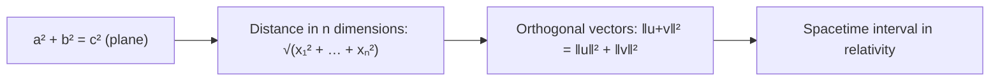

# Pythagoras

Here's the truth about the most famous theorem in the world: **Pythagoras' theorem isn't really about triangles. It's about how distance works when directions are independent of each other.**

### The core idea, in plain words

In a right-angled triangle with shorter sides \(a\) and \(b\) and longest side (the hypotenuse) \(c\),

$$ a^2 + b^2 = c^2. $$

Said plainly: walk \(a\) steps east and \(b\) steps north, and the straight-line distance back to where you started is \(\sqrt{a^2 + b^2}\). East and north don't interfere with each other, they're at right angles, and that's exactly when their squares simply add.

The man himself, Pythagoras of Samos (c. 570–495 BCE), led a half-mathematical, half-mystical brotherhood that believed "all is number". The Babylonians knew the rule over a thousand years earlier (the tablet Plimpton 322 lists triples like \(119, 120, 169\)), so the theorem's name is more tribute than history. What the Greeks added was the **proof**: the idea that you can *know* it's true for every right triangle, not just the ones you've measured.

### An everyday analogy: the shortcut across the park

You're at one corner of a rectangular park 30 metres by 40 metres and want the opposite corner. Walk around the edge: 70 metres. Cut across the grass: \(\sqrt{30^2 + 40^2} = \sqrt{2500} = 50\) metres. The theorem is the arithmetic of the shortcut, and that worn diagonal path in every park is people doing it by instinct.

### A worked example: a proof you can see

Take a big square of side \(a + b\). Inside it, place four copies of the right triangle, one in each corner, hypotenuses facing inwards. They leave a tilted square in the middle, of side \(c\). Count the area two ways:

$$ (a + b)^2 = 4 \cdot \tfrac{1}{2}ab + c^2. $$

Expand the left: \(a^2 + 2ab + b^2 = 2ab + c^2\). Cancel \(2ab\):

$$ a^2 + b^2 = c^2. \;\checkmark $$

Now use it. Is the triangle with sides 5, 12, 13 right-angled? \(25 + 144 = 169 = 13^2\). Yes. Whole-number solutions like this are **Pythagorean triples**, and there's a recipe for all of them: for whole numbers \(m > n > 0\),

$$ a = m^2 - n^2, \quad b = 2mn, \quad c = m^2 + n^2. $$

With \(m = 3, n = 2\): \(5, 12, 13\). With \(m = 2, n = 1\): \(3, 4, 5\). Infinitely many triangles from one formula.

### A picture in words: squares on the sides

Draw a right triangle and build a real square outward on each side, like tiles. Picture the square on the hypotenuse as a pond, and the two smaller squares as buckets. The theorem says: pour both buckets into the pond and it's exactly full. Not approximately, exactly, for every right triangle there ever was. And it doesn't even have to be squares: semicircles, or any similar shapes on the three sides, obey the same rule.

### Common misconceptions

- **"It works for any triangle."** Only right-angled ones. For others you need the law of cosines, \(c^2 = a^2 + b^2 - 2ab\cos C\), and Pythagoras is the case \(C = 90°\) where the extra term vanishes.
- **"Pythagoras discovered it."** The Babylonians and Indians used it centuries earlier. Pythagoras's school gets credit for the proof tradition.
- **"It's just about 2D."** In 3D the diagonal of a box is \(\sqrt{a^2 + b^2 + c^2}\), and the pattern continues into any number of dimensions.
- **"There's a whole-number version for every power."** \(a^n + b^n = c^n\) has no positive whole-number solutions for \(n \geq 3\). That's Fermat's Last Theorem, finally proved by Andrew Wiles in 1995, 358 years after Fermat scribbled it in a margin.

A historical aside the Pythagoreans hated: the diagonal of a unit square is \(\sqrt{2}\), which is **not** a ratio of whole numbers. Legend says the disciple who revealed this was drowned. "All is number" survived, but numbers had to grow to include the irrationals.

### How it connects

- **Sideways** to [Inner Product Spaces](innerproductspaces.md): Pythagoras holds for any two perpendicular vectors, even functions, which is why Fourier analysis works.
- **Up** to [Relativity](relativity.md), where the theorem gets a minus sign: the spacetime interval is \(-c^2t^2 + x^2 + y^2 + z^2\).
- **Down** to [Number Theory](numbertheory.md): Pythagorean triples and Fermat's Last Theorem.
- **Out** to [Thales of Miletos](thalesofmiletos.md), the earlier Greek whose geometry Pythagoras is said to have learned, and to the [Philosophers to Study](philosophers2study.md) page.

The truth revealed: wherever two directions don't interfere, their squares add. Pythagoras just noticed it first in a triangle.

## Links, Sources & Further Reading

http://www.cut-the-knot.org/pythagoras/index.shtml

http://www.cut-the-knot.org/pythagoras/PythagorasBySimilarity.shtml

http://jwilson.coe.uga.edu/emt669/Student.Folders/Morris.Stephanie/EMT.669/Essay.1/Pythagorean.html

https://betterexplained.com/articles/measure-any-distance-with-the-pythagorean-theorem/

http://www-history.mcs.st-and.ac.uk/~john/analysis/Lectures/L15.html

http://www.shmoop.com/squares-square-roots/pythagorean-theorem.html
