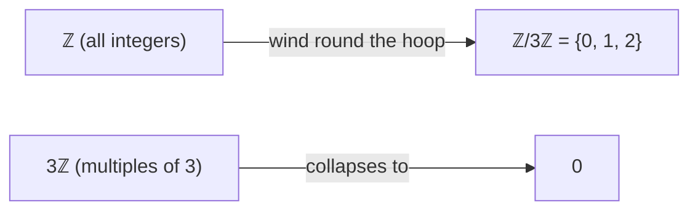

[Abstract Algebra](abstractalgebra.md) | [ZF Axioms](zf.md) | [Math](math.md)
[Set Theory](settheory.md) |
[Number Theory](numbertheory.md) |
[Groups](groups.md) |
[Quotient Groups](quotientgroups.md) |
[Rings](rings.md) |
[Commutative Rings](commutativerings.md) |
[Fields](fields.md) |
[Actions](group.md) |
[Modules](modulesalegbra.md) |
[Vector Spaces](vectorspaces.md) |
[Linear Operators and Matrices](linearoperators.md) |
[Inner Product Spaces](innerproductspaces.md) |
[Tensors](tensors.md) |
[Exterior Algebras](exterioralgebras.md) |
[Theory](galois.md "MISSING PAGE") |
[Polynomial Rings](multivariable.md "MISSING PAGE") |
[Category Theory](categorytheory.md) |


Quotient groups were the place where abstract algebra first made me dizzy. The symbols \(G/N\) look like division, and in a strange way they are. But here's the truth: **a quotient group is what you get when you deliberately go blurry.**

You decide some differences don't matter, you squint, and a smaller, simpler group comes into focus.

### The core idea, in plain words

Start with a [group](groups.md) \(G\) and pick a subgroup \(N\) of things you've decided to treat as "basically nothing". Then:

1. Lump together every pair of elements that differ by something in \(N\). Each lump is called a **coset**, written \(gN\) (or \(g + N\) when the operation is \(+\)).
2. Treat each lump as a single new element.
3. Combine lumps by combining any representatives: \((aN)(bN) = (ab)N\).

The lumps form a new group, \(G/N\) ("G mod N"). The catch: step 3 only works – gives the same answer no matter which representatives you pick – when \(N\) is **normal**, meaning \(gNg^{-1} = N\) for every \(g\) in \(G\). In an abelian group every subgroup is normal, so the catch never bites there.

### An everyday analogy: the days of the week

There have been tens of thousands of days in your life. But if all you care about is "which day of the week is it?", you've blurred them all into just 7 lumps. Day 3 and day 10 and day 17 are all "the same" – they differ by a multiple of 7, and multiples of 7 are your "basically nothing".

And the arithmetic still works on the lumps: *"It's Friday; what day is it in 10 days?"* Monday – you don't need to know the date. That is a quotient group: \(\mathbb{Z}/7\mathbb{Z}\).

### A small worked example: integers mod 3

Take \(G = \mathbb{Z}\) (all integers, under \(+\)) and \(N = 3\mathbb{Z} = \{\dots, -6, -3, 0, 3, 6, \dots\}\). The cosets are:

- \(0 + 3\mathbb{Z} = \{\dots, -3, 0, 3, 6, \dots\}\)
- \(1 + 3\mathbb{Z} = \{\dots, -2, 1, 4, 7, \dots\}\)
- \(2 + 3\mathbb{Z} = \{\dots, -1, 2, 5, 8, \dots\}\)

Every integer lives in exactly one of these. Now add two lumps by picking *any* members:

- Pick \(1\) and \(2\): \(1 + 2 = 3\), which is in the \(0\) lump.
- Pick \(4\) and \(-1\) instead (same lumps): \(4 + (-1) = 3\). Same lump. ✔
- Pick \(7\) and \(8\): \(15\) – a multiple of 3, the \(0\) lump again. ✔

So \((1 + 3\mathbb{Z}) + (2 + 3\mathbb{Z}) = 0 + 3\mathbb{Z}\), and \(\mathbb{Z}/3\mathbb{Z}\) is a group with three elements: a 3-hour clock. Infinitely many integers squashed into three.

### A picture in words

Imagine the integers as beads on an infinite straight string. Now wind the string around a hoop whose circumference is 3 beads. Every bead lands on one of just three positions. The string is \(G\), the winding is the quotient map, the three positions are \(G/N\) – and walking along the string corresponds exactly to walking round the hoop.

```
 ... -3 -2 -1  0  1  2  3  4  5 ...     (G = Z)
      \  |  /  \ |  /  \ |  /
        0, 1, 2  on the hoop            (G/N = Z/3Z)
```

### When the blur fails: why "normal" matters

Take the six symmetries of a triangle, \(S_3\), and the subgroup \(N = \{e, f\}\) where \(f\) is one flip. Try to lump by \(N\) and the rule \((aN)(bN) = (ab)N\) gives *different* answers depending on which representatives you grab – the blur is inconsistent, so there is no quotient group. (Flips aren't normal: conjugating one flip gives you a different flip.) The rotations \(\{e, r, r^2\}\), on the other hand, *are* normal, and \(S_3/\{e, r, r^2\}\) is a two-element group: "did this move flip the triangle over, or not?"

### Common misconceptions

- **"\(G/N\) is a subgroup of \(G\)."** No – its elements are *sets* (cosets), not elements of \(G\). \(\mathbb{Z}/3\mathbb{Z}\) is finite; \(\mathbb{Z}\) has no finite subgroups apart from \(\{0\}\).
- **"You can quotient by any subgroup."** Only by a normal one (see the triangle).
- **"It's just division of numbers."** The size does divide nicely for finite groups – \(|G/N| = |G| / |N|\) (Lagrange's theorem) – but the *structure* is the point, not the number.

### How it connects

- **Back** to [Set Relations](setrelations.md): "differ by something in \(N\)" is an [equivalence relation](setrelations.md) – [reflexive](reflexivityrelation.md), [symmetric](symmetryrelation.md), [transitive](transitivityrelation.md) – and cosets are exactly its equivalence classes. A quotient is equivalence classes plus a working operation.
- **Forward** to the *First Isomorphism Theorem*: for any group homomorphism \(\varphi: G \to H\), \(\;G/\ker\varphi \cong \operatorname{im}\varphi\). Every "blurring" map is secretly a quotient. Example: the determinant maps invertible matrices onto non-zero real numbers; squash out the matrices with determinant 1 and what's left *is* the non-zero reals under multiplication.
- **Sideways** to [Rings](rings.md) (quotient rings by ideals – the same trick, two operations), [Number Theory](numbertheory.md) (modular arithmetic is quotients all the way down), [Topology](topology.md) (glue the ends of a line segment together and you get a circle – a quotient space) and Galois theory, where normal subgroups match up with "nice" field extensions.

In one picture:

$$
G/\ker\varphi \;\cong\; \operatorname{im}\varphi, \qquad \left|G/N\right| = \frac{|G|}{|N|}
$$



The truth revealed: to see the shape of something, sometimes you have to stop looking at the details.
