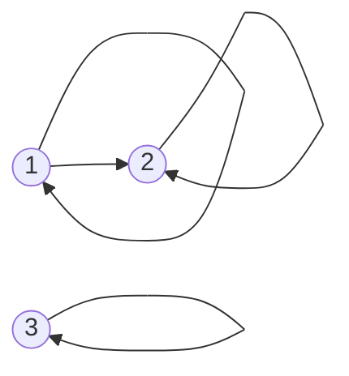

- Let **S** be a set and **~** a relation between any two objects in the set:
- **[Reflexivity](reflexivityrelation.md)** For every **a** in **S**, **a ~ a**
- **[Symmetry](symmetryrelation.md)** For any **a, b** in **S**, if **a ~ b** -> **b ~ a**
- **[Transitivity](transitivityrelation.md)** For any **a, b, c** in **S**, if **a ~ b** and **b ~ c** --> **a ~ c**

## Reflexivity: everything is related to itself

Reflexivity is the smallest of the three rules, and the easiest to wave past. Which is exactly why I want to slow down on it. **A relation is reflexive when nothing is a stranger to itself.**

### The core idea, in plain words

A relation \(\sim\) on a [set](settheory.md) \(S\) is just a rule that says, for each ordered pair \((a, b)\), whether \(a \sim b\) holds. It is **reflexive** when

$$ \forall a \in S,\quad a \sim a. $$

Every single element must be related to itself. Not most of them. Every one. A single element that isn't spoils it.

### An everyday analogy: "is the same height as"

Am I the same height as myself? Obviously. So is everyone else. "Is the same height as" is reflexive. Now try "is taller than". Am I taller than myself? No. Nobody is. That relation is not merely *not* reflexive; it is **irreflexive**: no element is related to itself.

### A small worked example

Let \(S = \{1, 2, 3\}\) and write a relation as a set of ordered pairs.

- \(R_1 = \{(1,1), (2,2), (3,3), (1,2)\}\): reflexive ✔ (all three "self-loops" are there; the extra pair \((1,2)\) does no harm).
- \(R_2 = \{(1,1), (2,2), (1,2)\}\): **not** reflexive ✘, because \((3,3)\) is missing.
- \(R_3 = \{(1,2), (2,3)\}\): irreflexive (no self-loops at all).
- \(R_2\) is also a useful warning: it is neither reflexive nor irreflexive. These two words are not opposites.

Some familiar ones on the integers:

| Relation | Reflexive? | Why |
|---|---|---|
| \(a = b\) | ✔ | \(a = a\) |
| \(a \le b\) | ✔ | \(a \le a\) |
| \(a < b\) | ✘ (irreflexive) | \(a < a\) never holds |
| \(a \mid b\) on positive integers | ✔ | \(a = 1 \cdot a\) |
| \(a \equiv b \pmod n\) | ✔ | \(n\) divides \(a - a = 0\) |

### A picture in words: loops on every dot

Draw each element as a dot and each related pair \((a,b)\) as an arrow from \(a\) to \(b\). Reflexive means **every dot has a little loop back to itself**. In the table (matrix) picture, it means the whole main diagonal is filled in.

### Common misconceptions

- **"Reflexive just means \(a \sim a\) is possible."** No: it must hold for *every* \(a\) in the set. And the set matters: "\(a \le b\)" is reflexive on any set of numbers, but "\(a\) has the same parents as \(b\)" is only reflexive on a set where everyone *has* known parents. Always ask: *on which set?*
- **"Not reflexive means irreflexive."** No: \(R_2\) above is neither.
- **"Symmetric + transitive gives reflexive for free."** A famous false proof: "from \(a \sim b\) get \(b \sim a\) by symmetry, then \(a \sim a\) by transitivity." The flaw: it assumes every \(a\) is related to *something*. The empty relation on \(\{1\}\) is symmetric and transitive (vacuously) but not reflexive. See [Symmetry](symmetryrelation.md).

### How it connects

- Reflexivity is one of the three legs of an **equivalence relation** (with [Symmetry](symmetryrelation.md) and [Transitivity](transitivityrelation.md)) and one of the three legs of a **partial order** (with antisymmetry and transitivity). Both live on [Set Relations](setrelations.md).
- In [Groups](groups.md), "\(a\) and \(b\) are in the same coset of \(H\)" is reflexive precisely because the identity is in \(H\).

The truth revealed: reflexivity is the promise that *everything counts as itself*. It sounds trivial until you meet a relation that breaks it.
