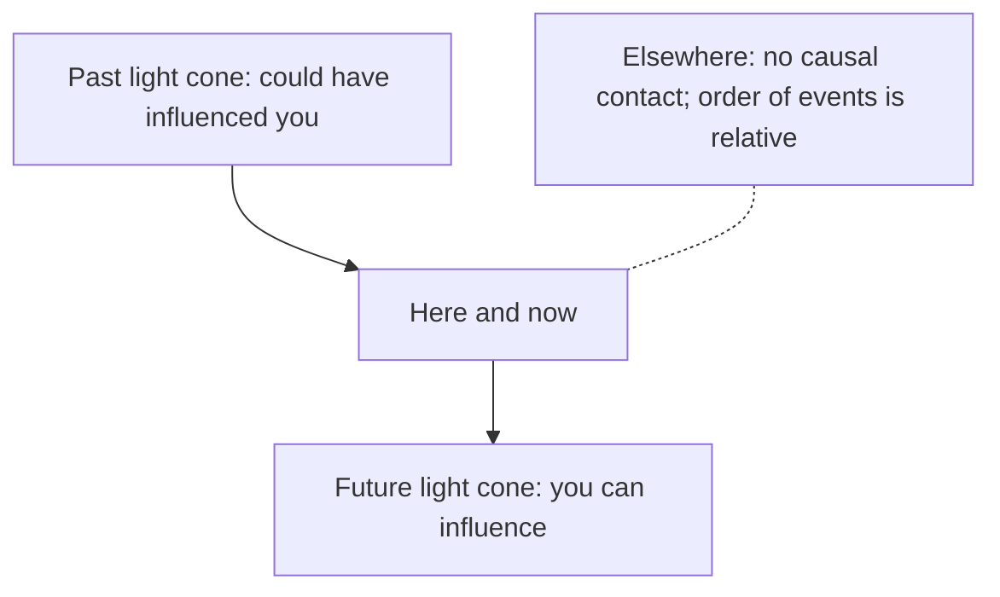

{.right}

# Relativity

### Special, General, and Cosmological

Here's the truth that Einstein revealed, and that still sounds wrong the first time you hear it: **space and time are not separate stages on which things happen. They are one four-dimensional fabric, and different observers slice it differently.**

### The core idea, in plain words

**Special relativity (1905)** rests on two sentences:

1. The laws of physics are the same for every observer moving at constant velocity.
2. The speed of light \(c\) is the same for all of them.

The second sounds harmless until you take it seriously. If a train passenger and a platform watcher both measure the same speed for the same flash of light, then they *must* disagree about distances and durations. Moving clocks run slow; moving rulers shrink along their motion. What everyone agrees on is not time, not distance, but the **spacetime interval**:

$$ s^2 = -c^2\,\Delta t^2 + \Delta x^2 + \Delta y^2 + \Delta z^2. $$

That's [Pythagoras](pythagoras.md) with a minus sign for time. The transformations between observers that keep \(s^2\) fixed are the **Lorentz transformations**, and they form a [Group](groups.md), just as rotations form a group because they keep ordinary distance fixed.

**General relativity (1915)** adds gravity: mass and energy curve spacetime, and free objects travel along the straightest possible paths in the curved geometry. In John Wheeler's words: matter tells spacetime how to curve; spacetime tells matter how to move.

**Cosmological** relativity applies the same equations to the whole universe: an expanding spacetime, the Big Bang, and the large-scale shape of everything.

### An everyday analogy: a rubber sheet and a bowling ball

Stretch a rubber sheet tight and put a bowling ball in the middle. Roll a marble past and it curves around the dip, not because the ball pulls it, but because the sheet itself is bent. That's general relativity in a picture. (The analogy cheats a little, since it uses real gravity to make the dip, and it's really spacetime, not just space, that curves. But it gets the key idea across: gravity is geometry.)

For special relativity, think of two people looking at a table from different corners of a room. One says "the table is 2 m wide and 1 m deep"; the other, standing at an angle, gets different numbers. Neither is wrong. The table's true size, its diagonal, is the same for both. Time and space are like width and depth; the interval is the diagonal.

### A worked example: the muon that shouldn't reach the ground

Muons are made by cosmic rays about 15 km up, and they live on average \(2.2\) microseconds before decaying. Even at nearly light speed they should travel only

$$ (3 \times 10^8\ \text{m/s}) \times (2.2 \times 10^{-6}\ \text{s}) \approx 660\ \text{m}. $$

Yet we detect them at sea level in large numbers. Why? They travel at about \(v = 0.9995c\), giving a **Lorentz factor**

$$ \gamma = \frac{1}{\sqrt{1 - v^2/c^2}} = \frac{1}{\sqrt{1 - 0.9990}} \approx 31.6. $$

From the ground, the muon's clock runs 31.6 times slow, so it lasts about \(70\) microseconds and covers about \(21\) km. Plenty. From the muon's point of view, its clock is fine, but the atmosphere is squashed by the same factor to under 500 m. Two stories, one outcome, and both agree on the interval.

### A picture in words: light cones

Picture yourself at a point in spacetime, now and here. Draw time going up the page and space going sideways. A flash of light you emit spreads out as a cone opening upwards; the light that could reach you from the past forms a cone opening downwards. Everything inside the upper cone is your possible **future**: you can influence it. Everything inside the lower cone is your **past**: it could have influenced you. Everything outside both is "elsewhere", events that no signal can connect to you, and observers can't even agree whether they happened before or after your now.

### Common misconceptions

- **"Everything is relative."** The opposite. Relativity is about what is *invariant*: the speed of light, the interval, the laws of physics. Einstein almost called it the theory of invariants.
- **"Time dilation is an illusion or a clock malfunction."** It's real. GPS satellites must correct for both special-relativistic slowing (about 7 microseconds a day) and general-relativistic speeding up from weaker gravity (about 45 a day), or your map would drift by kilometres daily.
- **"Nothing can go faster than light, so the universe can't expand faster either."** The limit is on things moving *through* space. Space itself can stretch faster, which is why distant galaxies recede beyond our horizon.
- **"\(E = mc^2\) means mass turns into energy only in bombs."** It says mass *is* a form of energy. Most of your body's mass is the binding energy of quarks and gluons.

### How it connects

- **Down** to [Pythagoras](pythagoras.md) (the interval is Pythagoras with a twist) and [Inner Product Spaces](innerproductspaces.md) (spacetime has an indefinite inner product, the Minkowski metric).
- **Sideways** to [Tensors](tensors.md): Einstein's field equations \(G_{\mu\nu} = \tfrac{8\pi G}{c^4} T_{\mu\nu}\) are an equation between tensors, true in every coordinate system, and the [summation convention](tensors.md) was invented for them.
- **Up** to [Groups](groups.md) (the Lorentz and Poincaré groups) and [Topology](topology.md) (the global shape of the universe).
- **Out** to [Quantum Mechanics](qm.md): uniting the two is the great unfinished business of physics.

The truth revealed: there is no universal clock ticking behind the universe. There's only the fabric of spacetime, and the one distance in it that everyone agrees on.

{Sources and Links}

- [ Lorentz and Poincare Invariance](https://books.google.ae/books?id=jryk42J8oQIC&pg=PA53&lpg=PA53&dq=poincare+explained&source=bl&ots=b2GI8usc0E&sig=LqwBGx8tqEH2c-hCOoa_mDp031g&hl=en&sa=X&ved=0ahUKEwjsrZu2yuPQAhVLFCwKHfL8Ad04ChDoAQgXMAA#v=onepage&q=poincare%20explained&f=false
  )
