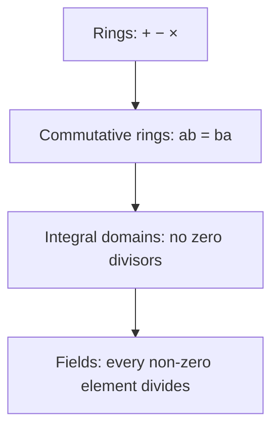

[Abstract Algebra](abstractalgebra.md) | [ZF Axioms](zf.md) | [Math](math.md)
[Set Theory](settheory.md) |
[Number Theory](numbertheory.md) |
[Groups](groups.md) |
[Quotient Groups](quotientgroups.md) |
[Rings](rings.md) |
[Commutative Rings](commutativerings.md) |
[Fields](fields.md) |
[Group Actions](group.md) |
[Modules](modulesalegbra.md) |
[Vector Spaces](vectorspaces.md) |
[Linear Operators and Matrices](linearoperators.md) |
[Inner Product Spaces](innerproductspaces.md) |
[Tensors](tensors.md) |
[Exterior Algebras](exterioralgebras.md) |
[Theory](galois.md "MISSING PAGE") |
[Polynomial Rings](multivariable.md "MISSING PAGE") |
[Category Theory](categorytheory.md) |

{.center}

# Rings

Here is the truth nobody told me at school: **a ring is just a place where you can add, subtract and multiply, and the usual habits of arithmetic still work.** Division is not invited.

That's all a ring is. You have been living in one your whole life: the integers.

### The core idea, in plain words

In [Groups](groups.md) we had *one* operation, a single way of combining things, with an undo for every move. A ring has **two** operations, which we call "addition" and "multiplication" because that's what they usually turn out to be. A ring is a [set](settheory.md) \(R\) with \(+\) and \(\times\) such that:

1. **Under addition, \(R\) is an abelian group.** There is a zero, every element \(a\) has a negative \(-a\), and \(a + b = b + a\).
2. **Multiplication is associative:** \((ab)c = a(bc)\).
3. **Multiplication distributes over addition:** \(a(b + c) = ab + ac\) and \((a + b)c = ac + bc\).

Most authors also ask for a multiplicative identity \(1\) with \(1 \cdot a = a \cdot 1 = a\). I'll assume one is there.

Look at what is **missing**:

- Nobody promised \(ab = ba\). When it does hold, the ring is **commutative** ([Commutative Rings](commutativerings.md)).
- Nobody promised you can divide. An element with a multiplicative undo is called a **unit**, and in most rings only a few elements are units.

The distributive law is what makes it all hang together. It is the single rule that makes the two operations talk to each other. Without it you'd just have two separate structures sitting on the same set and ignoring each other.

### An everyday analogy: a kitchen with no knives

Think of a kitchen where you can **combine** ingredients (add), **take them away** (subtract), and **scale a recipe up** (multiply: double it, triple it). What you can't always do is *split* a recipe: halve a recipe that uses three eggs and you're in trouble. The integers are like that. \(3 \times 4\) is fine, \(3 - 7\) is fine, but \(3 \div 2\) throws you out of the kitchen. A ring is a kitchen where every recipe can be combined and scaled, and splitting is a privilege, not a right.

### A worked example: the clock that multiplies

In [Groups](groups.md) I built the 4-hour clock \(\mathbb{Z}_4 = \{0, 1, 2, 3\}\) with addition. Now let's **multiply** on it too: multiply as usual, then keep the remainder after dividing by 4.

| × | 0 | 1 | 2 | 3 |
|---|---|---|---|---|
| **0** | 0 | 0 | 0 | 0 |
| **1** | 0 | 1 | 2 | 3 |
| **2** | 0 | 2 | 0 | 2 |
| **3** | 0 | 3 | 2 | 1 |

Check a distributive law: \(2 \times (3 + 3) = 2 \times 2 = 0\), and \(2 \times 3 + 2 \times 3 = 2 + 2 = 0\). ✔

Now look at the row for 2: \(2 \times 2 = 0\). **Two non-zero things multiply to zero.** In ordinary numbers that never happens, but here it does. Such an element is called a **zero divisor**. And notice that 2 has no multiplicative undo: nothing in its row is a 1. Meanwhile \(3 \times 3 = 9 \equiv 1\), so 3 is its own inverse. The units of \(\mathbb{Z}_4\) are \(\{1, 3\}\).

Here's the general truth hiding in this table: in \(\mathbb{Z}_n\), the number \(a\) is a unit exactly when \(a\) and \(n\) share no common factor. That's [Number Theory](numbertheory.md) poking its head through the door.

### A picture in words: the matrix ring

Take all \(2 \times 2\) matrices with real entries. You can add them and multiply them, and all the ring rules hold. But try this:

$$
A = \begin{pmatrix} 0 & 1 \\ 0 & 0 \end{pmatrix}, \qquad B = \begin{pmatrix} 0 & 0 \\ 1 & 0 \end{pmatrix}
$$

$$
AB = \begin{pmatrix} 1 & 0 \\ 0 & 0 \end{pmatrix}, \qquad BA = \begin{pmatrix} 0 & 0 \\ 0 & 1 \end{pmatrix}
$$

So \(AB \neq BA\). And \(A \cdot A = 0\) even though \(A \neq 0\). Picture \(A\) as a machine that shoves everything one slot along and drops what falls off the end. Run it twice and everything has fallen off. This is the ring that powers [Linear Operators and Matrices](linearoperators.md), and it is the archetype of a ring where order matters.

Here's the family tree, from most general to most well-behaved:

### Common misconceptions

- **"A ring is just a group with extra stuff."** Half true. The addition is a group; the multiplication usually isn't. In \(\mathbb{Z}\), 2 has no multiplicative inverse, so \((\mathbb{Z}, \times)\) is not a group.
- **"If \(ab = 0\) then \(a = 0\) or \(b = 0\)."** Only in special rings (integral domains). It fails in \(\mathbb{Z}_4\) and in matrices. Every school trick that "solves" \(x^2 - 5x + 6 = 0\) by factoring quietly relies on it.
- **"You can always cancel."** From \(ab = ac\) you can't conclude \(b = c\) in general: in \(\mathbb{Z}_4\), \(2 \times 1 = 2 \times 3 = 2\), yet \(1 \neq 3\).
- **"\(0 \times a = 0\) is an axiom."** It isn't, it's a consequence. \(0 \cdot a = (0 + 0) a = 0 \cdot a + 0 \cdot a\), then subtract \(0 \cdot a\) from both sides. Distributivity forces it. I love that: the rule that "anything times zero is zero" is not a law of nature, it's what the distributive law leaves you no choice about.

### How it connects

- **Down** to [Groups](groups.md): every ring's addition is an abelian group, and its units form a group under multiplication.
- **Sideways** to [Quotient Groups](quotientgroups.md): squash a ring by an *ideal* and you get a quotient ring. \(\mathbb{Z}_4\) is exactly \(\mathbb{Z}\) squashed by the multiples of 4.
- **Up** to [Commutative Rings](commutativerings.md), [Multivariable Polynomial Rings](multivariablepolynomialrings.md) and [Fields](fields.md), the rings where division finally gets invited.
- **Out** to [Modules](modulesalegbra.md) (a ring acting on a group, the way numbers scale vectors) and to [Linear Operators and Matrices](linearoperators.md).

The truth revealed: a ring is arithmetic with the training wheels off. You keep adding and multiplying, and you find out which of your habits were laws and which were luck.
