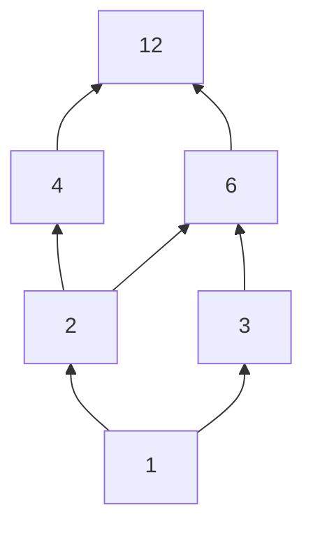

# Set Relations

## Equivalence Relations

**Definition**

- Let **S** be a set and **~** a relation between any two objects in the set:
- **[Reflexivity](reflexivityrelation.md)** For every **a** in **S**, **a ~ a**
- **[Symmetry](symmetryrelation.md)** For any **a, b** in **S**, if **a ~ b** -> **b ~ a**
- **[Transitivity](transitivityrelation.md)** For any **a, b, c** in **S**, if **a ~ b** and **b ~ c** --> **a ~ c**

## The core idea, in plain words

A **relation** on a [set](settheory.md) \(S\) is simply a set of ordered pairs \(R \subseteq S \times S\). We write \(a \sim b\) when \((a,b) \in R\). That's it: any list of "who is linked to whom" is a relation. The interesting part is which *properties* the list has. Five matter most:

| Property | Rule |
|---|---|
| [Reflexive](reflexivityrelation.md) | \(a \sim a\) for every \(a\) |
| [Symmetric](symmetryrelation.md) | \(a \sim b \implies b \sim a\) |
| Antisymmetric | \(a \sim b\) and \(b \sim a \implies a = b\) |
| [Transitive](transitivityrelation.md) | \(a \sim b\) and \(b \sim c \implies a \sim c\) |
| Total (connex) | \(a \sim b\) or \(b \sim a\) for every \(a, b\) |

Two combinations are the stars of mathematics:

$$ \text{equivalence relation} = \text{reflexive} + \text{symmetric} + \text{transitive} $$

$$ \text{partial order} = \text{reflexive} + \text{antisymmetric} + \text{transitive} $$

An equivalence relation says "these are *the same* in some respect". A partial order says "this comes *before or with* that". Same skeleton, one bone swapped.

## An everyday analogy

- **Equivalence:** sorting socks by colour. "Same colour as" is reflexive, symmetric, transitive. The result is a set of piles where every sock is in exactly one pile.
- **Partial order:** "must be done before (or is the same step as)" on the steps of getting dressed. Underwear before trousers, socks before shoes, but socks and trousers? Either order. Some pairs simply aren't comparable, which is why it's *partial*.

## A small worked example

**Equivalence:** on the integers let \(a \sim b\) mean \(a \equiv b \pmod 3\) (3 divides \(a - b\)). It splits \(\mathbb{Z}\) into exactly three **equivalence classes**:

$$ [0] = \{\dots,-3,0,3,6,\dots\},\quad [1] = \{\dots,-2,1,4,7,\dots\},\quad [2] = \{\dots,-1,2,5,8,\dots\}. $$

The big theorem: **equivalence relations on \(S\) correspond exactly to partitions of \(S\)** (ways of cutting \(S\) into non-empty, non-overlapping pieces that cover everything). Classes are the pieces; "in the same piece" is the relation. For a 3-element set there are exactly 5 partitions, so exactly 5 equivalence relations.

**Partial order:** divisibility on \(\{1, 2, 3, 4, 6, 12\}\).
Reflexive (\(a \mid a\)), antisymmetric (if \(a \mid b\) and \(b \mid a\) among positive integers then \(a = b\)), transitive. But \(4\) and \(6\) are incomparable: neither divides the other. Not total, hence *partial*. By contrast \(\le\) on numbers is a **total order**: every pair is comparable.

## A picture in words

An equivalence relation looks like **islands**: inside each island everyone is linked to everyone; there are no bridges between islands. A partial order looks like a **family tree drawn upward** (a Hasse diagram): draw only the "immediate" steps and let transitivity fill in the rest.

(Divisors of 12 under divisibility; read an upward path as "divides".)

## Common misconceptions

- **"Antisymmetric = not symmetric."** Equality is both; some relations are neither. See [Symmetry](symmetryrelation.md).
- **"Divisibility is a partial order on all integers."** Not on \(\mathbb{Z}\): \(2 \mid -2\) and \(-2 \mid 2\) but \(2 \ne -2\), so antisymmetry fails. Restrict to positive integers.
- **"Two of the three equivalence properties imply the third."** None of them does. Reflexive + symmetric, not transitive: "within 1 of". Reflexive + transitive, not symmetric: \(\le\). Symmetric + transitive, not reflexive: \(\{(1,1)\}\) on \(\{1,2\}\).
- **"A partial order must have a top and bottom."** Divisibility on \(\{2, 3\}\) has neither a single top nor bottom.

## How it connects

- In [Groups](groups.md), "\(a^{-1}b \in H\)" is an equivalence relation whose classes are cosets, the raw material of [Quotient Groups](quotientgroups.md).
- In [Group Actions](group.md), "in the same orbit" is an equivalence relation, so orbits partition the set.
- Modular arithmetic in [Number Theory](numbertheory.md) is arithmetic on equivalence classes.
- Partial orders run everything from task schedulers to subset inclusion \(\subseteq\) in [Set Theory](settheory.md).

The truth revealed: a relation is just a list of links, and three tiny rules decide whether it describes *sameness* or *order*.
