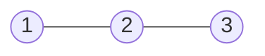

- Let **S** be a set and **~** a relation between any two objects in the set:
- **[Reflexivity](reflexivityrelation.md)** For every **a** in **S**, **a ~ a**
- **[Symmetry](symmetryrelation.md)** For any **a, b** in **S**, if **a ~ b** -> **b ~ a**
- **[Transitivity](transitivityrelation.md)** For any **a, b, c** in **S**, if **a ~ b** and **b ~ c** --> **a ~ c**

## Symmetry: if it goes one way, it goes back

### The core idea, in plain words

A relation \(\sim\) on a set \(S\) is **symmetric** when every connection runs both ways:

$$ \forall a, b \in S,\quad a \sim b \implies b \sim a. $$

Note the shape: it is an *if–then*. It never forces anything to be related. It only says that *whenever* a link exists, its mirror image exists too.

### An everyday analogy: "is married to" vs "loves"

If Ana is married to Ben, Ben is married to Ana. Symmetric. "Loves", sadly, is not: half of all poetry is about \(a \sim b\) without \(b \sim a\). And "is the sister of" is not symmetric either: Ana can be Ben's sister while Ben is Ana's brother.

### A small worked example

On \(S = \{1, 2, 3\}\):

- \(R_1 = \{(1,2), (2,1), (3,3)\}\): symmetric ✔. Every pair has its partner; \((3,3)\) is its own mirror.
- \(R_2 = \{(1,2), (2,1), (2,3)\}\): **not** symmetric ✘: \((2,3)\) is there, \((3,2)\) is not.
- \(\varnothing\) (no pairs at all): symmetric ✔, vacuously. There's no link to break the rule.

On the integers: \(a = b\) ✔, \(a \equiv b \pmod n\) ✔ (if \(n \mid a-b\) then \(n \mid b-a\)), \(a \le b\) ✘ (\(1 \le 2\) but not \(2 \le 1\)).

### The key counter-example: symmetric but not transitive

Let \(a \sim b\) mean "\(|a - b| \le 1\)" on the integers ("are within one step of each other").

- Symmetric ✔: \(|a-b| = |b-a|\).
- Reflexive ✔: \(|a-a| = 0\).
- Transitive ✘: \(1 \sim 2\) and \(2 \sim 3\), but \(|1-3| = 2\), so \(1 \not\sim 3\).

So it is reflexive and symmetric but **not** an equivalence relation. Friendship works the same way: my friend's friend need not be my friend. "Is close to" is the everyday trap: lots of small "close" steps add up to "far".

And the other way round, **symmetric and transitive but not reflexive**: on \(S = \{1, 2\}\) take \(R = \{(1,1)\}\). Symmetric ✔, transitive ✔, but \((2,2)\) is missing, so not reflexive. Element 2 is related to nothing at all, which is exactly the loophole in the "symmetry + transitivity gives reflexivity" false proof.

### A picture in words: two-way streets

In the arrow picture, symmetric means **every arrow comes with a return arrow**, so you can redraw them as plain lines with no arrowheads. In the matrix picture, the table is a mirror image of itself across the main diagonal.

(Here \(1\)–\(2\) and \(2\)–\(3\) are linked both ways, but there is no \(1\)–\(3\) line: symmetric, not transitive.)

### Common misconceptions

- **"Antisymmetric is the opposite of symmetric."** Not quite. *Antisymmetric* means "\(a \sim b\) and \(b \sim a\) imply \(a = b\)". Equality is **both** symmetric and antisymmetric; the relation \(\{(1,2),(2,1),(2,3)\}\) is **neither**. The true "never both ways" notion is *asymmetric* (e.g. \(<\)).
- **"Symmetric means everything is related."** No: the empty relation is symmetric.
- **"Symmetric relations must be reflexive."** No: "is married to" is symmetric, and nobody is married to themselves.

### How it connects

- Together with [Reflexivity](reflexivityrelation.md) and [Transitivity](transitivityrelation.md) it makes an **equivalence relation**; swapped for antisymmetry it gives a **partial order**. See [Set Relations](setrelations.md).
- A symmetric relation is the same thing as an (undirected) graph: friendship networks, road maps, molecules.
- In [Groups](groups.md), "same coset" is symmetric precisely because every element of a subgroup has an inverse in it.

The truth revealed: symmetry is the rule of the two-way street, and it says nothing at all about how far you can travel along it.
