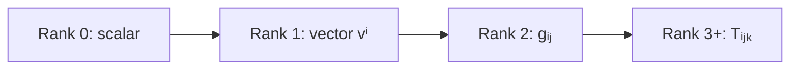

[Abstract Algebra](abstractalgebra.md) | [ZF Axioms](zf.md) | [Math](math.md)

# Tensors

###### Einstein's Summation Convention

Get the pdf here: 
[summation (pdf)](/assets/summation-2.pdf)

Understanding Gravitation and all kinds of modern physics requires a working knowledge of
Einstein's summation convention.

And here is the truth behind the word itself: **a tensor is a machine that eats several vectors and returns a number, and is linear in each one it eats.**

Scalars, vectors and matrices are all tensors. They're the first three rungs of one ladder.

### The core idea, in plain words

A [Linear Operator](linearoperators.md) is linear in one input. A **multilinear** map is linear in each of several inputs separately, holding the others fixed. The dot product is the classic example: \(\langle u, v \rangle\) is linear in \(u\) and linear in \(v\). That makes it a **tensor of rank 2**.

The **rank** (or order) is just how many slots the machine has:

- rank 0: a **scalar**, a single number, no slots;
- rank 1: a **vector** or **covector** \(v_i\), one index;
- rank 2: a **matrix-like** object \(g_{ij}\), two indices;
- rank 3 and up: \(T_{ijk}\), a cube or hyper-cube of numbers.

Here is the point that separates a tensor from "a box of numbers": **its components must change in a specific way when you change coordinates**, so that the machine itself stays the same. A tensor is a geometric fact; its components are just how that fact looks in your current coordinate system.

That's exactly why physics loves them. If an equation between tensors is true in one coordinate system, it's true in every coordinate system. The laws of nature can't depend on how we draw our axes.

### An everyday analogy: stress inside a block of jelly

Press on a block of jelly. At any point inside, if you imagine a tiny cut facing some direction, the jelly on one side pushes on the other with a force, which might point in a different direction from the cut. Input: a direction (the cut). Output: a force (a vector). That rule is linear, and with one more slot (ask "how much of that force along this direction?") it becomes a rank-2 tensor, the **stress tensor**. Rotate your measuring axes and all nine numbers change, but the jelly is squeezed exactly the same.

### A worked example: the summation convention in action

Einstein's convention says: **when an index appears once up and once down, sum over it.** So

$$ v^i w_i \quad\text{means}\quad v^1 w_1 + v^2 w_2 + v^3 w_3. $$

Take the metric of ordinary flat space, \(g_{ij} = 1\) if \(i = j\), else \(0\). The squared length of a vector \(v = (3, 4, 12)\) is

$$ g_{ij} v^i v^j = (3)^2 + (4)^2 + (12)^2 = 169, \qquad \|v\| = 13. $$

Two indices, two sums, nine terms, of which only three survive. Now switch to the spacetime of special [Relativity](relativity.md), where (with units where light speed is 1) the metric is \(\eta = \mathrm{diag}(-1, 1, 1, 1)\). For an event 5 units away in time and 3 in space,

$$ \eta_{\mu\nu} x^\mu x^\nu = -5^2 + 3^2 = -16. $$

Every observer, moving at any speed, computes the same \(-16\). That invariant **interval** is the beating heart of relativity, and the tensor notation guarantees it.

### A picture in words: the tensor product of two vectors

Take an arrow \(u = (1, 2)\) and an arrow \(v = (3, 4)\). Form every possible product of a component of \(u\) with a component of \(v\) and lay them out in a grid:

$$ u \otimes v = \begin{pmatrix} 1 \cdot 3 & 1 \cdot 4 \\ 2 \cdot 3 & 2 \cdot 4 \end{pmatrix} = \begin{pmatrix} 3 & 4 \\ 6 & 8 \end{pmatrix}. $$

Picture it as a multiplication table. Every rank-2 tensor is a *sum* of tables like this. A table that is a single \(u \otimes v\) has proportional rows; a general tensor needs several. In [Quantum Mechanics](qm.md), a two-particle state that is a single \(u \otimes v\) is "unentangled"; one that needs a sum is **entangled**. Entanglement is literally "this tensor doesn't factor."

### Common misconceptions

- **"A tensor is a multi-dimensional array."** An array is a tensor's components in one coordinate system. Without the transformation rule, it's just a spreadsheet.
- **"Upper and lower indices are decoration."** They mark vectors versus covectors, things that transform oppositely. The metric \(g_{ij}\) is the tool that converts one into the other.
- **"Rank means matrix rank."** Two different words. Tensor rank (order) counts indices; matrix rank counts independent rows.
- **"Tensors are only for physicists."** They're [Module](modulesalegbra.md) theory: the tensor product \(M \otimes N\) is defined for any modules, and machine learning's "tensors" are arrays borrowing the name.

### How it connects

- **Down** to [Vector Spaces](vectorspaces.md) and [Linear Operators and Matrices](linearoperators.md): a matrix is a rank-2 tensor in disguise.
- **Sideways** to [Inner Product Spaces](innerproductspaces.md): the inner product is the metric tensor.
- **Up** to [Exterior Algebras](exterioralgebras.md), the antisymmetric tensors that measure areas and volumes.
- **Out** to [Relativity](relativity.md), where gravity is the curvature tensor of spacetime, and to [Quantum Mechanics](qm.md), where combining systems means taking tensor products.

The truth revealed: a tensor is the part of a calculation that doesn't care how you drew your axes.
