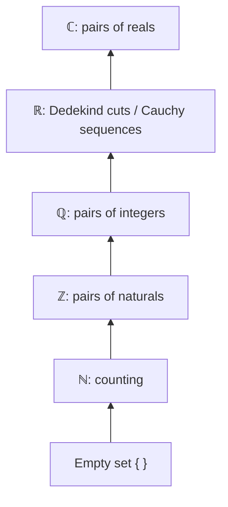

# The Foundations of Mathematics

## By Ian Stewart & David Tall

[Back to Math](math.md)

{.right}

This page is my companion to Ian Stewart and David Tall's *The Foundations of Mathematics* (Oxford University Press, first edition 1977, second edition 2015). It's the book I'd hand anyone who has done school maths and wants to know what's *underneath* it. Here's the truth it reveals: **mathematics is not built on numbers. It's built on logic and sets, and the numbers come later, constructed by hand.**

### The core idea, in plain words

At school you're handed the numbers and told the rules. Stewart and Tall ask a ruder question: *where do the numbers come from, and why should we believe the rules?* Their answer goes in layers:

1. **Intuition** first: we already have pictures of lines, counting and limits.
2. **Logic and sets**: the language for saying precisely what we mean ([Logic](logic.md), [Set Theory](settheory.md)).
3. **Relations and functions**: equivalence relations, orderings, maps ([Set Relations](setrelations.md)).
4. **Construction of the number systems**: natural numbers from sets, integers from pairs of naturals, rationals from pairs of integers, reals from cuts or sequences, complex numbers from pairs of reals.
5. **Axioms and structures**: [Groups](groups.md), [Rings](rings.md), [Fields](fields.md), and what it means to say "the real numbers are *the* complete ordered field".
6. **Limits of the method**: infinity, cardinality and Gödel's theorems.

The book's real lesson, and the reason I like it, is that **formal and intuitive thinking are partners.** You need pictures to know what to prove and proofs to know your pictures don't lie.

### An everyday analogy: renovating a house you live in

You've lived in a house for years. Then one day you pull up the floorboards to see what's holding it all up. The house was fine before you looked, but now you know *why* it stands, which walls carry weight, and which ones you could knock down. Foundations of mathematics is pulling up the floorboards of arithmetic. Nothing about \(2 + 2 = 4\) changes, but you finally see the joists.

### A worked example: building the integers from the naturals

Suppose all you have is \(\mathbb{N} = \{0, 1, 2, \dots\}\). There's no \(-3\). How do you invent it honestly?

Idea: \(-3\) is "what you get from \(2 - 5\)", or \(0 - 3\), or \(10 - 13\). So represent an integer by a **pair** \((a, b)\), thought of as \(a - b\), and declare two pairs equal when they describe the same difference:

$$ (a, b) \sim (c, d) \iff a + d = b + c. $$

Only addition of naturals is used, no subtraction. Check it's an equivalence relation: reflexive (\(a + b = b + a\)), symmetric (obvious), transitive (add the two equations and cancel). So the pairs split into classes, and **an integer is defined to be one of these classes**: \(-3 = \{(0, 3), (1, 4), (2, 5), \dots\}\).

Addition: \((a, b) + (c, d) = (a + c,\ b + d)\). Check \(-3 + 5\): \((0, 3) + (5, 0) = (5, 3)\), which is in the class of \(2\). ✔

The same trick, pairs modulo an equivalence, builds the rationals from the integers, with \((p, q) \sim (r, s) \iff ps = qr\), which is just "\(\tfrac{p}{q} = \tfrac{r}{s}\)" said without division. It's the same move as [Quotient Groups](quotientgroups.md): squash a bigger set by an equivalence relation to get the thing you wanted.

### A picture in words: a tower of number systems

Picture a tower. The ground floor is the empty set \(\{\}\). From it, the natural numbers: \(0 = \{\}\), \(1 = \{0\}\), \(2 = \{0, 1\}\), each number the set of all the numbers before it. On top of them the integers, then the rationals, then the reals, each floor built from pairs, classes or sequences of the floor below. At the very top the complex numbers. Every floor contains a faithful copy of the floors below it.

### Common misconceptions

- **"Foundations means the maths is shaky."** The opposite: it's the inspection that shows the building is sound, and it locates the few places (like the axiom of choice) where real choices are made.
- **"\(-3\) is 'really' a set of pairs."** The construction shows integers *can* be modelled that way. What matters is the structure, not the particular bricks.
- **"Rigour replaces intuition."** Stewart and Tall insist it doesn't. Intuition suggests; rigour checks.
- **"Everything true can be proved."** Gödel showed any consistent system strong enough for arithmetic has true statements it can't prove.

### How it connects

- **Down** to [Logic](logic.md), [Modus Ponens](modusponens.md) and [Set Theory](settheory.md), the first chapters of the book.
- **Sideways** to the [ZF Axioms](zf.md), the formal rules that the tower stands on, and to [Set Relations](setrelations.md), the equivalence relations used in every construction.
- **Up** to [Groups](groups.md), [Rings](rings.md) and [Fields](fields.md): the axioms the finished number systems satisfy.
- **Back** to [Math](math.md), the hub for everything on this site.

The truth revealed: the numbers you've trusted all your life were built, floor by floor, out of nothing at all.
