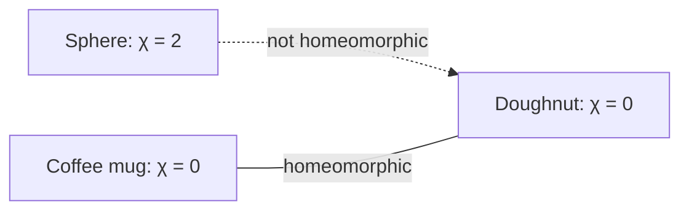

A **homeomorphism** or  **continuous transformation**, is an

- **equivalence relation** and
- **one-to-one (injective) correspondence**
  between points in two geometric figures or topological spaces 
  that is continuous in both directions.
- **preserves distances is called an isometry.**
- [Affine transformations](affinetransformation.md)

Those are the technical words. Here's the truth behind them: **topology is geometry with the ruler thrown away. It only cares what's next to what, and whether you can get from here to there without tearing.**

### The core idea, in plain words

Most geometry is about measurement: lengths, angles, areas. Topology deliberately forgets all of that. Two shapes count as **the same** if one can be bent, stretched, squeezed or twisted into the other *without tearing and without gluing*. Such a deformation is the **homeomorphism** above: a one-to-one correspondence that is continuous both ways. Continuity means "nearby points go to nearby points"; continuity both ways means you never tear and never glue.

Formally, a **topological space** is a [set](settheory.md) together with a choice of which subsets are **open**, the "neighbourhoods", such that:

1. the empty set and the whole set are open;
2. any union of open sets is open;
3. any finite intersection of open sets is open.

That's all. No distances. Just a notion of "nearby". From this thin soup grow continuity, connectedness, compactness and holes.

Notice the link to the [Set Relations](setrelations.md) pages: "is homeomorphic to" is an **equivalence relation**, reflexive, symmetric and transitive. Topology chops the universe of shapes into equivalence classes and asks what's left when you forget the details.

### An everyday analogy: the coffee mug and the doughnut

The old joke: a topologist can't tell a coffee mug from a doughnut. Imagine a mug made of soft clay. Squash the cup part down into the handle and smooth it out, and you get a ring, a doughnut. No tearing, no gluing. Both have exactly **one hole**, and that is the only thing topology sees. A ball, on the other hand, can never become a doughnut without punching a hole in it.

A tube map is the same idea in daily life. The real distances and curves are thrown away; only the connections, which station is next to which, survive. And that's all you need to get across town.

### A worked example: Euler's formula

Draw any connected network on a sphere (or a flat sheet): \(V\) dots, \(E\) lines, \(F\) regions (counting the outside). Then

$$ V - E + F = 2. $$

Check a cube: \(8 - 12 + 6 = 2\). ✔ A tetrahedron: \(4 - 6 + 4 = 2\). ✔ A single dot on a sphere: \(1 - 0 + 1 = 2\). ✔

Now draw on a doughnut. A square grid wrapped round it with 1 dot, 2 lines (one round the hole, one through it) and 1 square: \(1 - 2 + 1 = 0\).

That number, the **Euler characteristic**, doesn't depend on how you draw the network, only on the surface. Sphere: 2. Doughnut: 0. Two-holed doughnut: \(-2\). In general a surface with \(g\) holes has

$$ \chi = 2 - 2g. $$

So the sphere and the doughnut **cannot** be homeomorphic, because their characteristics differ. That's topology's main trick: find a number (or a [Group](groups.md)) that can't change under deformation, then use it to prove two shapes are different.

### A picture in words: an ant on a rubber band

Picture an ant walking along a closed rubber band. Stretch the band into a square, a long oval, a wiggly loop: the ant's journey is "the same", it goes once round and comes back. Now cut the band. The ant's world is now a line with two ends, and it can never return without turning back. Cutting is the one thing topology forbids, because it changes the answer to "can I go round?"

The loops the ant can walk, up to deformation, form the **fundamental group**. On a circle it's the integers (go round \(n\) times), the group \(\mathbb{Z}\). On a sphere every loop can be shrunk to a point, so it's trivial.

### Common misconceptions

- **"Topology is about shapes looking alike."** Looks are irrelevant. A square and a circle are the same; a circle and a figure-eight are not.
- **"Any continuous bijection is a homeomorphism."** The inverse must be continuous too. Wrap the half-open interval \([0, 1)\) round a circle: it's continuous and one-to-one, but the inverse tears the circle open at one point.
- **"Open sets are 'sets without their edge'."** In \(\mathbb{R}\) that's the intuition, but in a general space "open" just means "declared to be a neighbourhood", and strange spaces have strange open sets.
- **"Topology is useless because it ignores measurement."** Ignoring measurement is its power: it finds facts robust to any amount of wobble. GPS errors, protein folding and data analysis all use it.

### How it connects

- **Down** to [Set Theory](settheory.md) (a topology is a collection of sets) and [Set Relations](setrelations.md) (homeomorphism is an equivalence relation).
- **Sideways** to [Affine Transformations](affinetransformation.md), which keep lines and ratios, and isometries, which keep distances. Topology keeps the least of all.
- **Up** to algebraic topology, where [Groups](groups.md) measure holes, and to [Category Theory](categorytheory.md), which was invented to organise exactly that.
- **Out** to [Relativity](relativity.md), where the shape of the universe is a topological question, and to [Dynamics](dynamics.md), where Poincaré invented much of topology to study planetary orbits.

The truth revealed: some facts survive any amount of stretching. Topology is the hunt for them.
