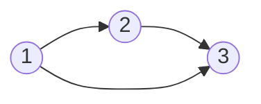

- Let **S** be a set and **~** a relation between any two objects in the set:
- **[Reflexivity](reflexivityrelation.md)** For every **a** in **S**, **a ~ a**
- **[Symmetry](symmetryrelation.md)** For any **a, b** in **S**, if **a ~ b** -> **b ~ a**
- **[Transitivity](transitivityrelation.md)** For any **a, b, c** in **S**, if **a ~ b** and **b ~ c** --> **a ~ c**

## Transitivity: links chain together

### The core idea, in plain words

A relation \(\sim\) on a set \(S\) is **transitive** when you can always take a shortcut:

$$ \forall a, b, c \in S,\quad (a \sim b \ \text{and}\ b \sim c) \implies a \sim c. $$

If you can get from \(a\) to \(b\), and from \(b\) to \(c\), then \(a\) is already directly linked to \(c\). Chains of any length collapse to one step (apply the rule repeatedly).

### An everyday analogy: ancestors

If Ana is an ancestor of Ben and Ben is an ancestor of Cara, Ana is an ancestor of Cara. Transitive. But "is a parent of" is not: Ana is Cara's grandparent, not her parent. Adding "transitively" to "parent of" (following chains) is exactly how you build "ancestor of". Mathematicians call that the **transitive closure**.

### A small worked example

On \(S = \{1, 2, 3\}\):

- \(R_1 = \{(1,2), (2,3), (1,3)\}\): transitive ✔. The only chain is \(1 \to 2 \to 3\), and the shortcut \((1,3)\) is present.
- \(R_2 = \{(1,2), (2,3)\}\): **not** transitive ✘, since \((1,3)\) is missing.
- \(R_3 = \{(1,2), (2,1)\}\): **not** transitive ✘! The chain \(1 \to 2 \to 1\) demands \((1,1)\), and it's missing. A sneaky one: people forget chains can loop back.

On the integers: \(<\) and \(\le\) ✔, \(a \mid b\) ✔ (if \(b = ka\) and \(c = mb\) then \(c = (mk)a\)), \(a \equiv b \pmod n\) ✔, "\(a \ne b\)" ✘ (\(1 \ne 2\), \(2 \ne 1\), but \(1 = 1\)).

### Counter-examples worth remembering

- **Transitive but not symmetric:** \(<\). \(1 < 2\) but not \(2 < 1\).
- **Transitive but not reflexive:** \(<\) again; nothing is less than itself.
- **Symmetric but not transitive:** "within 1 of": \(|1-2| \le 1\), \(|2-3| \le 1\), but \(|1-3| = 2\). See [Symmetry](symmetryrelation.md).
- **Real-world non-transitivity:** Rock beats scissors, scissors beats paper, paper beats rock. "Beats" is not transitive, which is what makes the game work.

### A picture in words: every two-step path has a shortcut

In the arrow picture, transitive means **whenever you see a path of two arrows \(a \to b \to c\), the direct arrow \(a \to c\) is already drawn**.

Here the shortcut \(1 \to 3\) is present, so the relation is transitive. Delete it and transitivity breaks.

### Common misconceptions

- **"Transitivity needs three different elements."** No: \(a, b, c\) may coincide. That's why \(\{(1,2),(2,1)\}\) fails: \(a = c = 1\).
- **"If a relation has no chains, it isn't transitive."** The opposite: with no two-step chains, the rule is never tested, so it holds vacuously. \(\{(1,2)\}\) is transitive.
- **"Preferences are always transitive."** Economists *assume* they are; real people (and majority votes, see Condorcet's paradox) can be cyclic.

### How it connects

- Transitivity is the one property shared by both **equivalence relations** and **partial orders**. See [Set Relations](setrelations.md), [Reflexivity](reflexivityrelation.md), [Symmetry](symmetryrelation.md).
- It is the hidden engine of logical chains: "if \(p \to q\) and \(q \to r\) then \(p \to r\)" is transitivity of implication, a cousin of [Modus Ponens](modusponens.md).

The truth revealed: transitivity is what lets small steps add up, and spotting where it fails ("close to", "beats", "friend of") is half of clear thinking.
