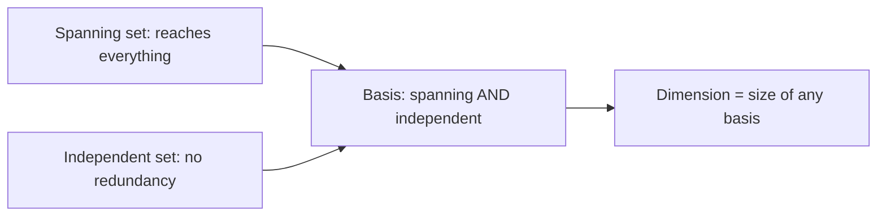

[Abstract Algebra](abstractalgebra.md) | [ZF Axioms](zf.md) | [Math](math.md)
[Set Theory](settheory.md) |
[Number Theory](numbertheory.md) |
[Groups](groups.md) |
[Quotient Groups](quotientgroups.md) |
[Rings](rings.md) |
[Commutative Rings](commutativerings.md) |
[Fields](fields.md) |
[Group Actions](groupactions.md "MISSING PAGE") |
[Modules](modulesalegbra.md) |
[Vector Spaces](vectorspaces.md) |
[Linear Operators and Matrices](linearoperators.md) |
[Inner Product Spaces](innerproductspaces.md) |
[Tensors](tensors.md) |
[Exterior Algebras](exterioralgebras.md) |
[Theory](galois.md "MISSING PAGE") |
[Polynomial Rings](multivariable.md "MISSING PAGE") |
[Category Theory](categorytheory.md) |

{.center}

# Vector Spaces

Here is the truth about vector spaces that no textbook says plainly enough: **a vector is anything you can add to another of its kind and stretch by a number. That's it. Arrows are just the most famous example.**

Once you see that, functions, polynomials, sound waves and quantum states all turn out to be vectors.

### The core idea, in plain words

Pick a [Field](fields.md) \(F\) of scalars (usually \(\mathbb{R}\) or \(\mathbb{C}\)). A **vector space** over \(F\) is a set \(V\) with:

- **addition** \(u + v\), making \((V, +)\) an abelian [Group](groups.md) with a zero vector \(\mathbf{0}\), and
- **scalar multiplication** \(c\,v\) for \(c \in F\),

satisfying the natural rules: \(c(u + v) = cu + cv\), \((c + d)v = cv + dv\), \((cd)v = c(dv)\) and \(1v = v\).

Exactly the definition of a [Module](modulesalegbra.md), with the ring promoted to a field. And that promotion buys a miracle: **every vector space has a basis**, a set of vectors such that every vector is a combination of them in exactly one way. The number of basis vectors is the same however you choose them, and it is called the **dimension**.

### An everyday analogy: colours on a screen

Every colour your screen shows is a mix of red, green and blue light. "Add" two colours by adding their light; "scale" a colour by dimming or brightening it. Red, green and blue form a basis: every colour is a unique recipe of so much red, so much green, so much blue. Colour space is 3-dimensional. You could choose a different basis (cyan, magenta, yellow, say) and describe the same colours with different numbers, but you'd always need exactly three.

### A worked example: polynomials as vectors

Let \(P_2\) be all polynomials of degree at most 2 with real coefficients, \(a + bx + cx^2\). Add two of them and you get another; multiply by a real number and you get another. So \(P_2\) is a vector space.

A basis: \(\{1, x, x^2\}\). The polynomial \(3 - 2x + 5x^2\) has coordinates \((3, -2, 5)\). So \(\dim P_2 = 3\), and \(P_2\) behaves exactly like \(\mathbb{R}^3\).

Now check a different basis: \(\{1,\ 1 + x,\ 1 + x + x^2\}\). Write \(3 - 2x + 5x^2\) in it:

$$ 3 - 2x + 5x^2 = a \cdot 1 + b(1 + x) + c(1 + x + x^2). $$

Matching \(x^2\): \(c = 5\). Matching \(x\): \(b + c = -2\), so \(b = -7\). Matching constants: \(a + b + c = 3\), so \(a = 5\). New coordinates \((5, -7, 5)\). **Same vector, different coordinates.** The vector doesn't care which basis you use; only its description changes.

And **linear independence**: are \(1 + x\), \(1 - x\) and \(2\) independent? No: \((1 + x) + (1 - x) - 2 = 0\). One of them is redundant, and together they only span a 2-dimensional piece of \(P_2\).

### A picture in words: a flat sheet through the origin

Stand in ordinary 3D space. A **subspace** is a flat thing through the origin: the origin alone (dimension 0), a line through it (dimension 1), a plane through it (dimension 2), or everything (dimension 3). A plane that misses the origin is *not* a subspace, because it doesn't contain \(\mathbf{0}\), and adding two of its vectors pushes you off it.

Two arrows not on the same line span a plane: every point on the plane is "so much of the first plus so much of the second", like coordinates on a slanted sheet of graph paper.

### Common misconceptions

- **"Vectors are lists of numbers."** Lists are what you get *after* choosing a basis. The vector itself exists before you pick coordinates.
- **"Vectors have length and direction."** Only once you add an inner product ([Inner Product Spaces](innerproductspaces.md)). A plain vector space has no notion of length or angle.
- **"Any plane is a vector space."** Only planes through the origin.
- **"Infinite-dimensional is just big."** It's different. The space of all continuous functions has no finite basis, and questions like "does this infinite sum converge?" enter. That's where analysis and quantum mechanics live.

### How it connects

- **Down** to [Fields](fields.md) (the scalars), [Groups](groups.md) (vector addition) and [Modules](modulesalegbra.md) (the ring version).
- **Sideways** to [Linear Algebra](linearalgebra.md), the overview of the whole subject.
- **Up** to [Linear Operators and Matrices](linearoperators.md), the machines between vector spaces, and to [Inner Product Spaces](innerproductspaces.md), [Tensors](tensors.md) and [Exterior Algebras](exterioralgebras.md).
- **Out** to [Quantum Mechanics](qm.md), where states are vectors in a complex vector space and superposition is just vector addition.

The truth revealed: a vector is not an arrow. It is anything that adds and scales, and arrows are only the first thing that does.
